# Assignment 1 – AWS VPC, Public & Private Subnets

## Overview

This project demonstrates how to build a custom AWS Virtual Private Cloud (VPC) with public and private subnets, configure routing, deploy EC2 instances, and establish secure SSH access through a bastion host.

The assignment was completed as part of the CoderCo DevOps Bootcamp.

Rather than using the default AWS VPC, I created a custom network to gain practical experience with cloud networking, subnetting, route tables, Internet Gateways, NAT Gateways, security groups and EC2 connectivity.

## Objectives

- Create a custom VPC with public and private subnets.
- Configure an Internet Gateway for public internet connectivity.
- Configure a NAT Gateway for outbound internet access from the private subnet.
- Create and associate public and private route tables.
- Configure security groups to restrict inbound traffic.
- Deploy EC2 instances into their respective subnets.
- Use the public EC2 instance as a bastion host to access the private EC2 instance.
- Test internal connectivity, DNS resolution and outbound internet access.

## Network Architecture

```text
Internet
   |
Internet Gateway
   |
AWS VPC (10.0.0.0/16)
   |
   |-- Public Subnet (10.0.10.0/24)
   |      |
   |      |-- EC2-Public (Bastion Host)
   |      |     Public IP: 13.48.1.92
   |      |     Private IP: 10.0.10.206
   |      |
   |      |-- NAT Gateway + Elastic IP
   |
   |-- Private Subnet (10.0.20.0/24)
          |
          |-- EC2-Private
                Private IP: 10.0.20.125
                No Public IP
```

### Network Configuration

| Component | Configuration |
|---|---|
| AWS Region | eu-north-1 (Stockholm) |
| VPC CIDR | `10.0.0.0/16` |
| Public Subnet | `10.0.10.0/24` |
| Private Subnet | `10.0.20.0/24` |
| Public EC2 | Ubuntu 26.04 LTS |
| Private EC2 | Ubuntu 26.04 LTS |
| Internet Gateway | Attached to custom VPC |
| NAT Gateway | Deployed in public subnet |
| Bastion Host | EC2-Public |
| SSH | TCP port 22 |
| HTTP | TCP port 80 |

---

## 1. Creating the Custom VPC

I first created a custom VPC using the CIDR block `10.0.0.0/16`.

A VPC provides a logically isolated virtual network within AWS where I can deploy and manage cloud resources.

The `/16` CIDR block provides a large private address range, allowing me to divide the network into smaller subnets.

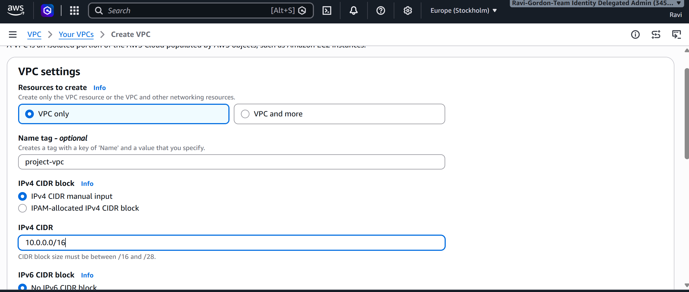

### Creating the Public Subnet

I created the public subnet using:

`10.0.10.0/24`

A `/24` subnet contains 256 IPv4 addresses, of which AWS reserves five, leaving 251 usable addresses for resources.

This subnet would host my public EC2 instance and NAT Gateway.

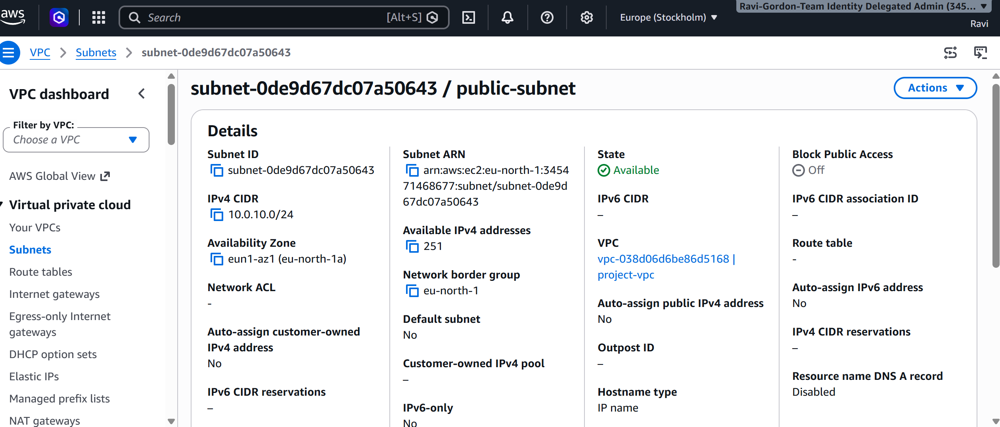

### Creating the Private Subnet

I repeated the process to create a private subnet using:

`10.0.20.0/24`

The private subnet would host an EC2 instance without a public IPv4 address.

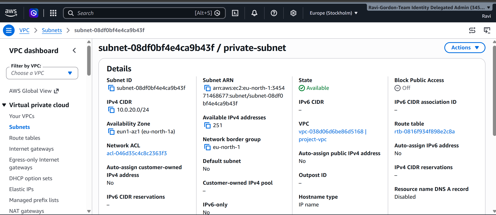

---

## 2. Configuring the Internet Gateway

I created an Internet Gateway (IGW) to provide a path between the VPC and the internet.

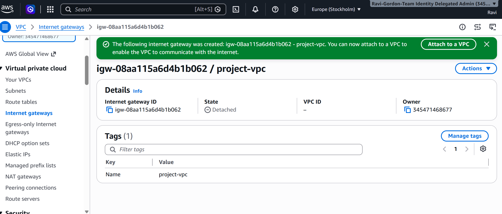

I then attached the Internet Gateway to my custom VPC.

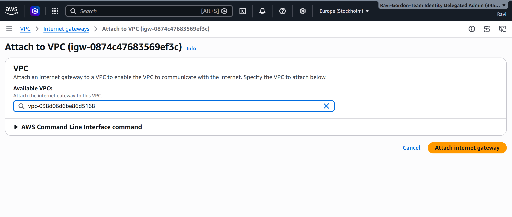

Attaching the Internet Gateway alone does not provide internet connectivity. The appropriate route table, public IP addressing and security rules must also be configured.

---

## 3. Configuring the Public Route Table

I created a public route table and associated it with my VPC.

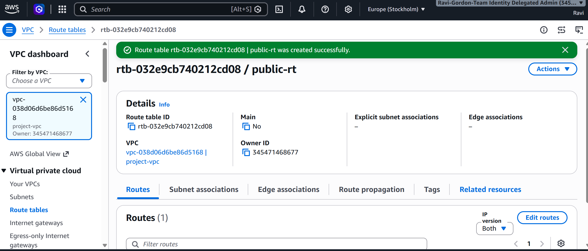

I configured the following routes:

| Destination | Target |
|---|---|
| `10.0.0.0/16` | Local |
| `0.0.0.0/0` | Internet Gateway |

The local route allows communication between subnets within the VPC.

The default route directs traffic destined for external networks towards the Internet Gateway.

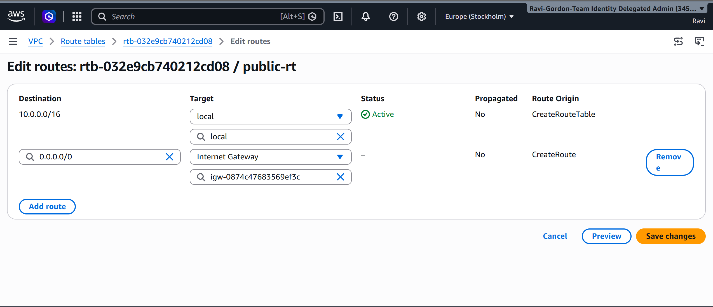

---

## 4. Creating the Elastic IP and NAT Gateway

### Allocating an Elastic IP

I allocated an Elastic IP address for my NAT Gateway.

An Elastic IP is a static public IPv4 address that can be associated with supported AWS resources.

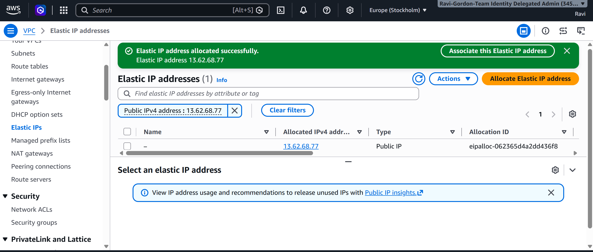

### Creating the NAT Gateway

I created a public NAT Gateway inside my public subnet and associated it with the allocated Elastic IP.

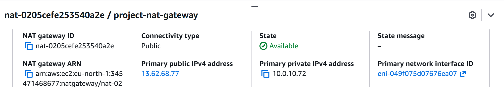

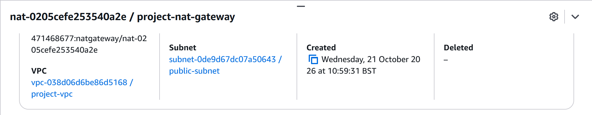

The NAT Gateway allows resources in the private subnet to initiate outbound connections to the internet without requiring public IP addresses.

---

## 5. Associating the Route Tables

I associated the public route table with my public subnet.

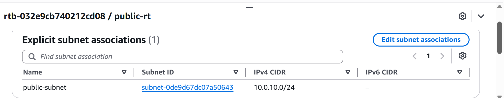

I then associated the private route table with my private subnet.

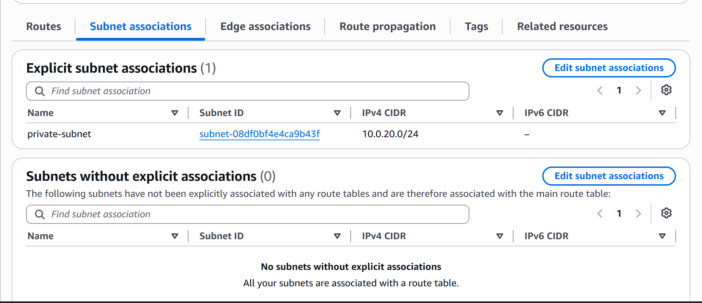

### Configuring Private Subnet Internet Access

I configured the private route table with the following routes:

| Destination | Target |
|---|---|
| `10.0.0.0/16` | Local |
| `0.0.0.0/0` | NAT Gateway |

This allows private EC2 instances to access external services, such as software repositories, while remaining inaccessible to unsolicited inbound connections from the internet.

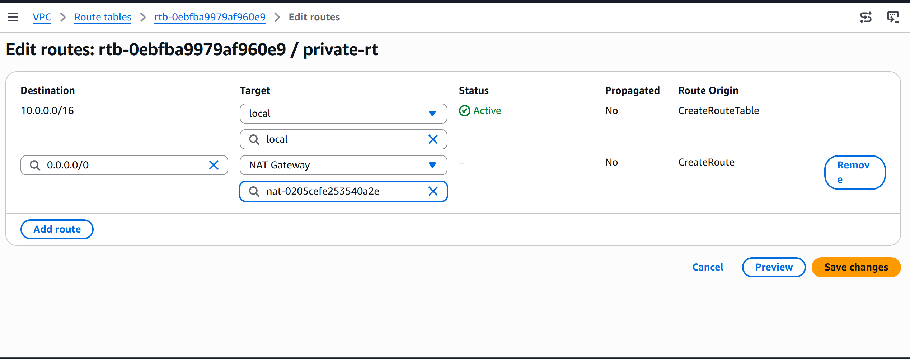

---

## 6. Configuring Security Groups

### Public EC2 Security Group

I created a security group named `public-ec2-sg`.

I configured the inbound rules to allow SSH and HTTP only from my public IP address.

| Type | Protocol | Port | Source |
|---|---|---|---|
| SSH | TCP | 22 | My IP `/32` |
| HTTP | TCP | 80 | My IP `/32` |

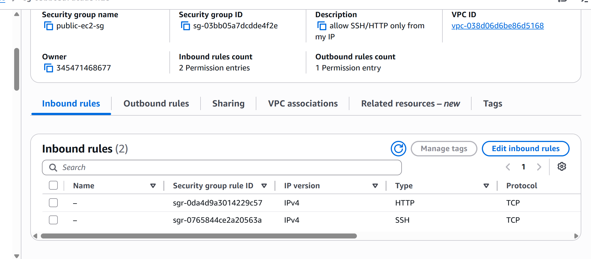

I also reviewed the outbound rules, which permitted outbound traffic.

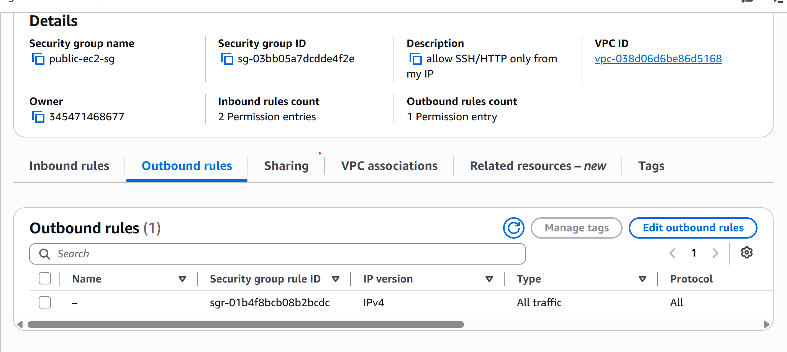

### Private EC2 Security Group

I created another security group named `private-ec2-sg`.

The objective was to restrict SSH access to connections originating from my public EC2 instance acting as a bastion host.

| Type | Protocol | Port | Source |
|---|---|---|---|
| SSH | TCP | 22 | `public-ec2-sg` |

Using a security group reference allows SSH traffic from network interfaces associated with the public EC2 security group, rather than exposing SSH access to an external IP range.

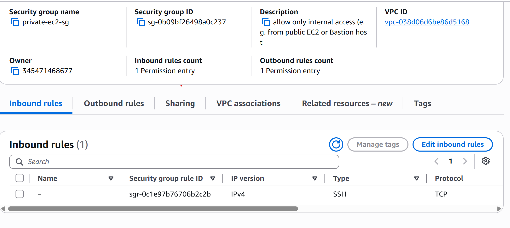

---

## 7. Deploying the Public EC2 Instance

I deployed an Ubuntu EC2 instance into my public subnet.

The instance would act as my bastion host, providing a controlled entry point into the private network.

### Troubleshooting – Unable to Connect to EC2

During my initial deployment, I forgot to enable public IPv4 address assignment.

This meant that my EC2 instance could not be reached directly from my local machine over the internet.

I recreated the instance and ensured the following were configured:

1. A public IPv4 address.
2. A default route to the Internet Gateway.
3. A security group permitting SSH from my public IP address.

After correcting this, I attempted to connect using the AWS EC2 Instance Connect browser interface.

However, I received the following error:

`Failed to connect to your instance – Error establishing an SSH connection.`

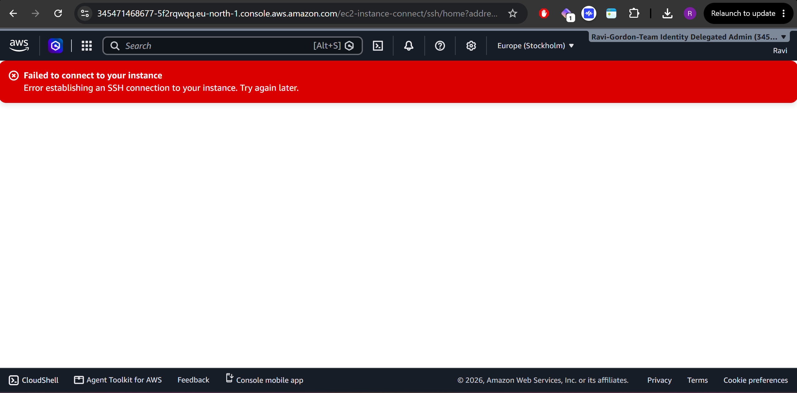

### Troubleshooting Steps

I checked the instance's public IP address, security group inbound rules and network configuration.

I then attempted to connect directly from my local terminal using my SSH private key.

```bash
ssh -i Assignment-1.pem ubuntu@13.48.1.92
```

The connection succeeded.

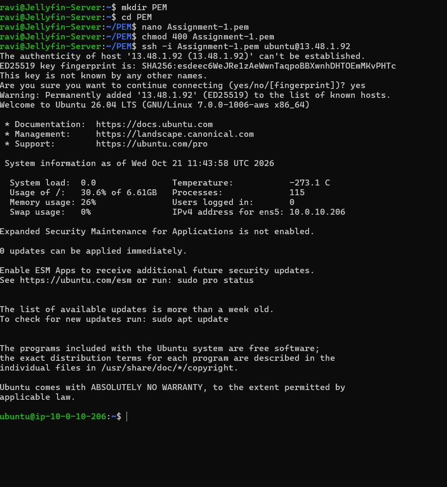

This confirmed that direct SSH access from my machine was working, even though the browser-based EC2 Instance Connect attempt had failed.

### Verifying Network Configuration

Once connected, I checked the instance's network interfaces and routing table.

```bash
ip a
ip route
```

These commands allowed me to confirm the private IP address assigned to the instance and its default gateway.

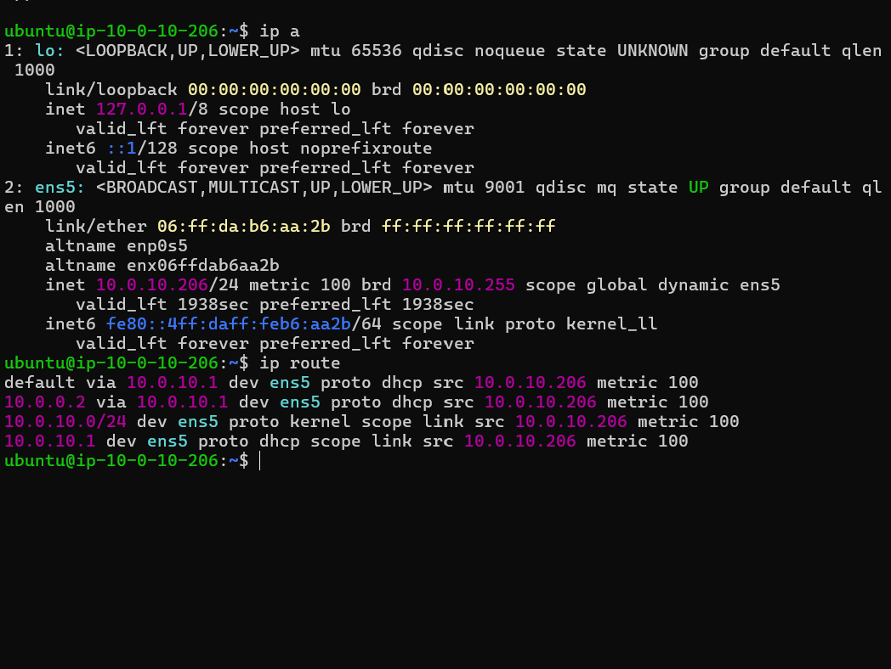

I then tested internet connectivity and DNS resolution:

```bash
ping google.com
```

The test was successful.

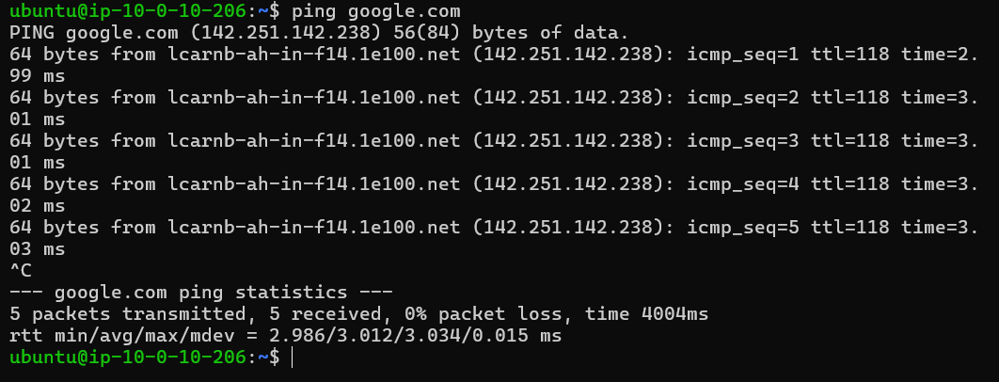

---

## 8. Deploying the Private EC2 Instance

I created a second Ubuntu EC2 instance and deployed it into my private subnet.

This instance was configured without a public IPv4 address.

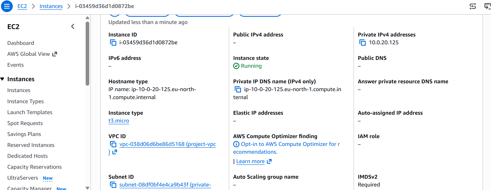

The intention was to connect to the private instance through the public EC2 instance acting as a bastion host.

### Troubleshooting – Bastion Host Connection Failed

My first attempt to connect from EC2-Public to EC2-Private failed.

I discovered that the original private security group allowed SSH connections from my home public IP address.

However, the SSH connection was originating from EC2-Public inside the VPC.

The private security group therefore did not permit the connection.

### Resolution

I corrected the inbound rule on `private-ec2-sg` to allow SSH traffic from `public-ec2-sg`.

I then tested TCP port 22 connectivity from EC2-Public to EC2-Private.

```bash
nc -zv -w 5 10.0.20.125 22
```

The connection succeeded, confirming that TCP port 22 was reachable.

### Troubleshooting – Permission Denied (publickey)

After resolving the security group issue, I attempted to SSH into the private instance.

However, I received:

```text
Permission denied (publickey)
```

This indicated that the network connection was working, but SSH authentication had failed.

For this temporary lab, I created a copy of my SSH private key on the public EC2 instance and restricted its permissions:

```bash
chmod 400 Assignment-1.pem
```

I then connected to the private instance:

```bash
ssh -i Assignment-1.pem ubuntu@10.0.20.125
```

The connection succeeded.

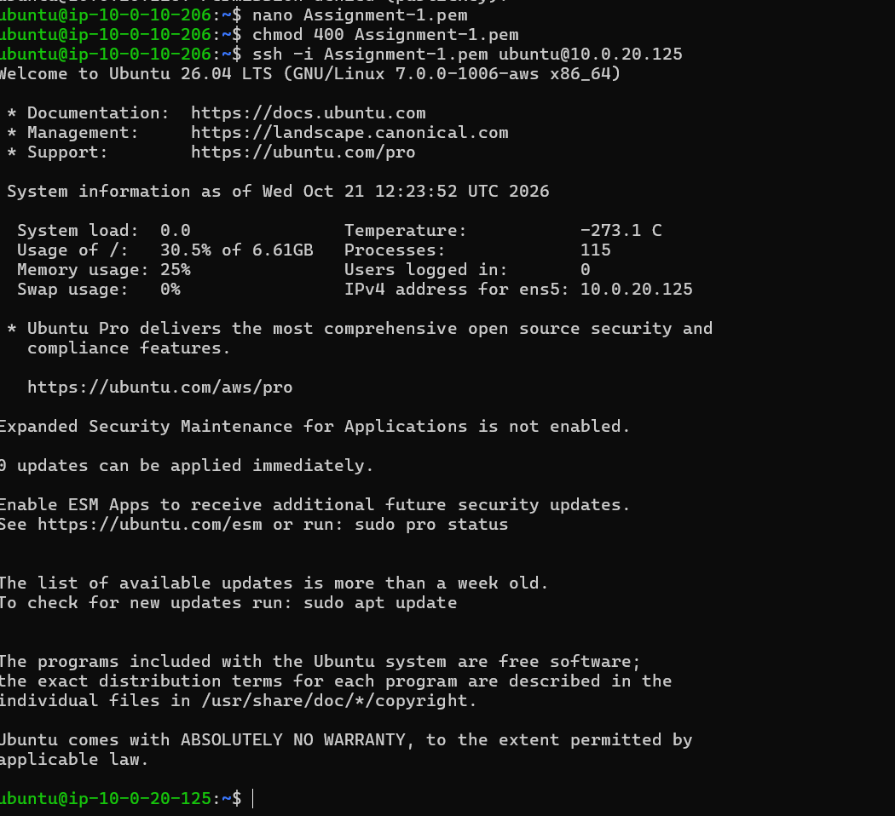

**Security consideration:** Copying a private key onto a bastion host is not recommended for production environments. A more secure approach would be to use SSH ProxyJump, keeping the private key on my local machine.

---

## 9. Testing Outbound Internet Connectivity from EC2-Private

Once connected to the private EC2 instance, I verified the hostname:

```bash
hostname
```

The result was:

```text
ip-10-0-20-125
```

I then tested outbound HTTPS connectivity:

```bash
curl https://aws.amazon.com
```

The command successfully returned HTML content.

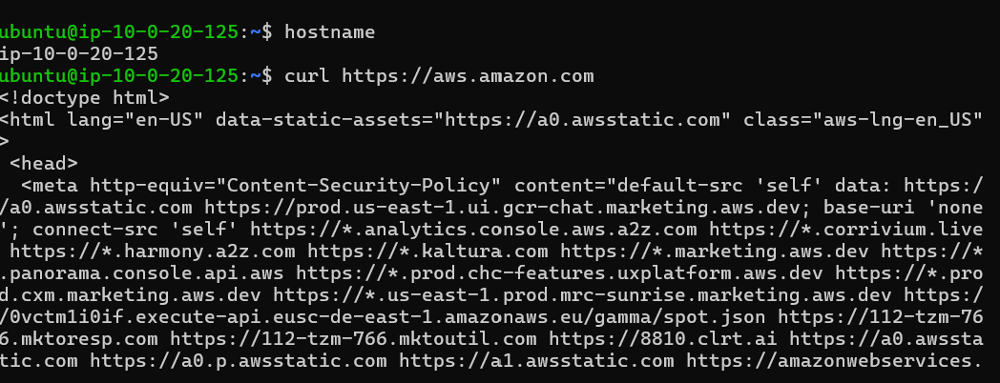

This confirmed that the private EC2 instance could access an external website.

Combined with the private route table configuration, this demonstrated outbound internet connectivity through the NAT Gateway without assigning a public IP address to the private instance.

---

## 10. What I Learned

Through this assignment, I gained practical experience with:

- **VPC networking:** Creating and managing a custom AWS network.
- **Subnetting:** Separating public and private resources using CIDR blocks.
- **Internet Gateways:** Providing internet connectivity to appropriately configured public resources.
- **NAT Gateways:** Allowing private resources to initiate outbound internet connections.
- **Route tables:** Controlling how traffic is directed within and outside a VPC.
- **Security groups:** Restricting inbound traffic using IP ranges and security group references.
- **EC2 deployment:** Launching Ubuntu instances into specific subnets.
- **SSH authentication:** Using key pairs and Linux file permissions.
- **Bastion hosts:** Accessing private infrastructure through a controlled public entry point.
- **Troubleshooting:** Diagnosing network connectivity and authentication issues using `ip`, `ping`, `nc`, `curl` and `ssh`.

## 11. Key Takeaways

One of the biggest lessons from this assignment was understanding that successful EC2 connectivity depends on multiple components working together.

An EC2 instance may have a correctly configured security group but still be unreachable if its subnet routing or public IP configuration is incorrect.

I also learned to distinguish between network connectivity problems and SSH authentication failures.

When TCP port 22 became reachable but SSH returned `Permission denied (publickey)`, I knew the network path was working and could focus on authentication.

Finally, testing outbound connectivity from the private EC2 instance helped me understand how NAT Gateways allow private resources to access external services without exposing them directly to inbound internet traffic.

## 12. Resource Cleanup

After completing the assignment and capturing the required screenshots, I planned to terminate the EC2 instances and remove unused networking resources to avoid unnecessary AWS charges.

Resources requiring cleanup include the NAT Gateway, Elastic IP and other temporary infrastructure created for this lab.

---

**Project:** CoderCo DevOps Bootcamp – AWS Networking Assignment 1

**Technologies:** AWS VPC, EC2, Subnets, Internet Gateway, NAT Gateway, Elastic IP, Route Tables, Security Groups, Linux, SSH