# Assignment 3 — AWS S3 Static Website, CloudFront CDN & Route 53

## Live Project

**Website:** [RG Infrastructure — AWS Static Website](https://dio587nouf9s7.cloudfront.net/)

This project hosts my RG Infrastructure portfolio ( Still in progress,very much not completed content wise) using Amazon S3, CloudFront, Route 53 and AWS Certificate Manager (ACM).

The website is delivered through Amazon CloudFront using HTTPS, with Amazon S3 serving as the origin.

---


## Overview

This assignment documents the deployment of a static website on AWS using Amazon S3, Amazon Route 53, Amazon CloudFront and AWS Certificate Manager (ACM).

The objective was to host my RG Infrastructure portfolio using an S3 bucket, configure DNS for my custom domain, and distribute the website through CloudFront using HTTPS.

My domain, `rginfralabs.co.uk`, is registered with GoDaddy, while DNS management is delegated to Amazon Route 53.

During the assignment, I encountered several DNS resolution and CloudFront configuration issues. These provided an opportunity to practise troubleshooting using `nslookup`, `dig` and `curl`.

## AWS Services Used

| Service | Purpose |
|---|---|
| Amazon S3 | Hosts the static website files |
| Amazon Route 53 | Manages DNS records for my custom domain |
| Amazon CloudFront | Distributes and caches website content through a CDN |
| AWS Certificate Manager | Provides an SSL/TLS certificate for HTTPS |
| AWS Application Load Balancer | Additional networking experimentation |
| GoDaddy | Domain registrar |

## Architecture

The final website architecture is:

```text
User / Web Browser
        |
        v
rginfralabs.co.uk
        |
        v
Amazon Route 53
(A and AAAA Alias Records)
        |
        v
Amazon CloudFront
(CDN + HTTPS)
        |
        v
Amazon S3 Website Endpoint
(HTTP)
        |
        v
index.html / error.html
```

The S3 bucket is hosted in the `eu-north-1` (Stockholm) region.

The ACM certificate used by CloudFront was created in `us-east-1` (N. Virginia), as required by CloudFront.

---

## 1. Creating the S3 Bucket

I first created an Amazon S3 bucket to store the files for my static website.

I named the bucket `rginfralabs.co.uk` to match my custom domain registered through GoDaddy.

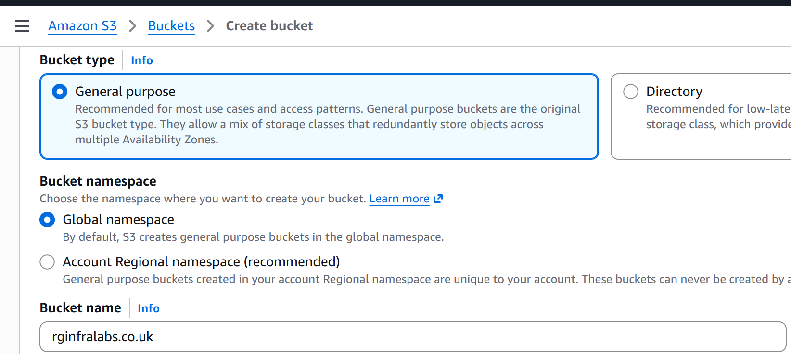

### Configuring Public Access

As this assignment uses the S3 static website endpoint, the website objects needed to be publicly readable.

I deselected **Block all public access** for the bucket.

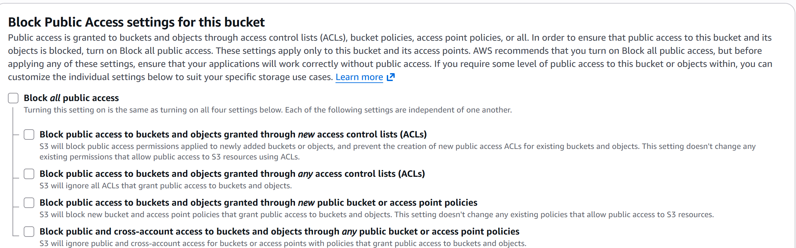

This created my empty S3 bucket.

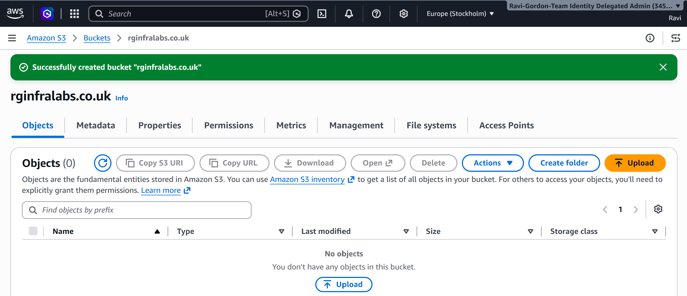

**Note:** This configuration was used specifically for the assignment. For a more secure production deployment, I would use a private S3 bucket with CloudFront Origin Access Control (OAC), rather than exposing the bucket publicly.

## 2. Enabling Static Website Hosting

I navigated to the S3 bucket properties and enabled **Static website hosting**.

I configured the website to use:

- `index.html` as the index document.
- `error.html` as the error document.

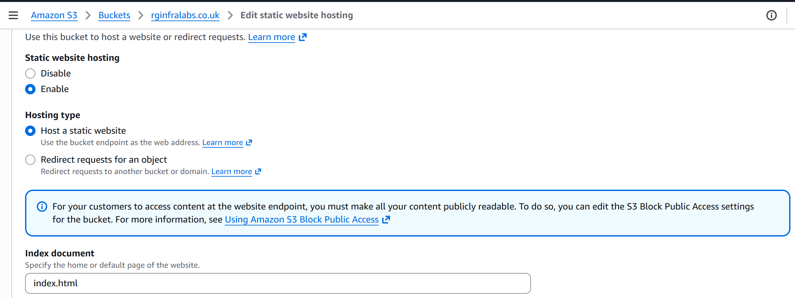

The `error.html` file provides a custom error page when the website encounters an error.

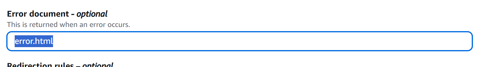

## 3. Configuring the S3 Bucket Policy

Although I had disabled Block Public Access, the objects were not automatically publicly accessible.

I needed to create a bucket policy explicitly allowing users to read the website files.

I configured the following policy:

```json
{
    "Version": "2012-10-17",
    "Statement": [
        {
            "Sid": "PublicReadGetObject",
            "Effect": "Allow",
            "Principal": "*",
            "Action": [
                "s3:GetObject"
            ],
            "Resource": [
                "arn:aws:s3:::rginfralabs.co.uk/*"
            ]
        }
    ]
}
```

The policy allows public `s3:GetObject` access to objects inside the bucket.

It does not grant public permission to upload, modify or delete objects.

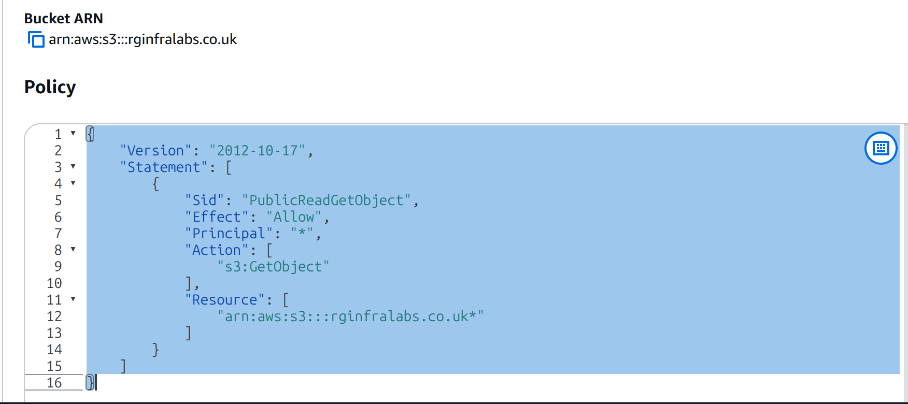

## 4. Uploading and Testing the Website

After configuring the bucket, I uploaded my static website files.

The website uses a black-and-green design based on my RG Infrastructure branding.

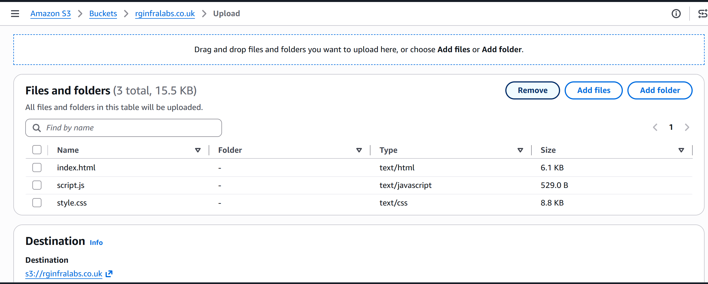

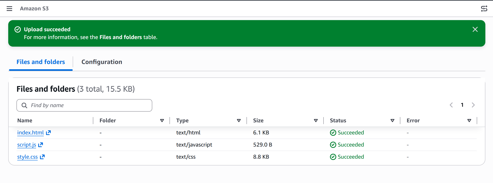

I then tested the S3 website endpoint directly to confirm that the website loaded successfully.

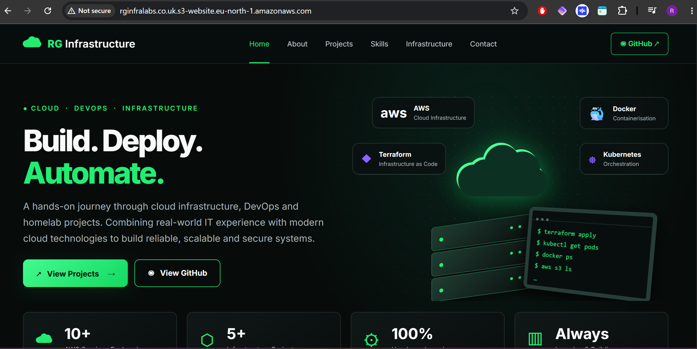

This confirmed that S3 could serve the HTML and CSS files before I introduced custom DNS or CloudFront.

---

## 5. Configuring Amazon Route 53

My domain was originally registered through GoDaddy.

To manage its DNS records using AWS, I created a public hosted zone in Route 53 for:

`rginfralabs.co.uk`

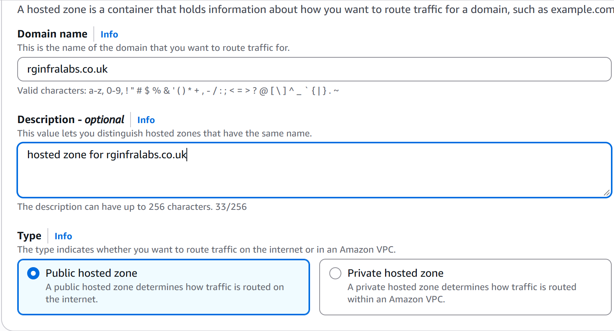

### Updating the Nameservers

Route 53 generated four authoritative nameservers for the hosted zone.

I updated the nameservers in GoDaddy to point to Amazon Route 53.

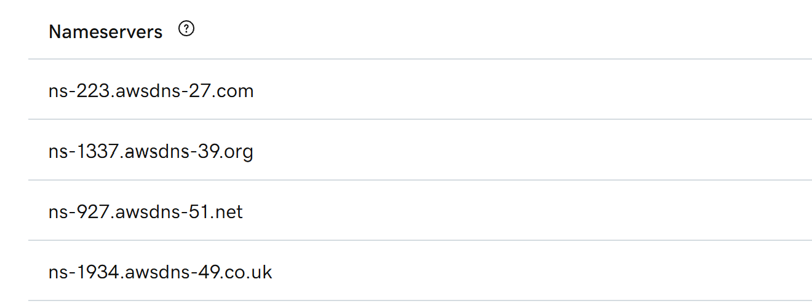

This delegated DNS management to Route 53 while keeping GoDaddy as the domain registrar.

### Creating the Initial A Record

I created an A alias record pointing my root domain to the S3 static website endpoint.

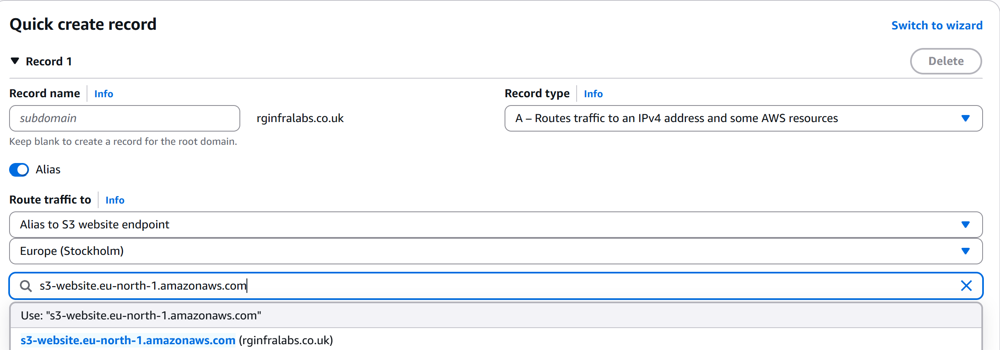

I then checked the configuration and tested the website.

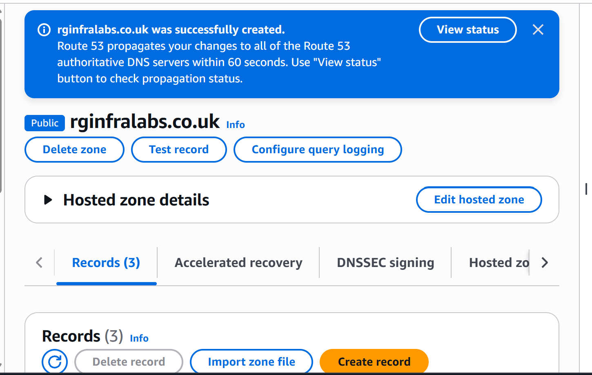

I also checked that the Route 53 DNS change reported an `INSYNC` status.

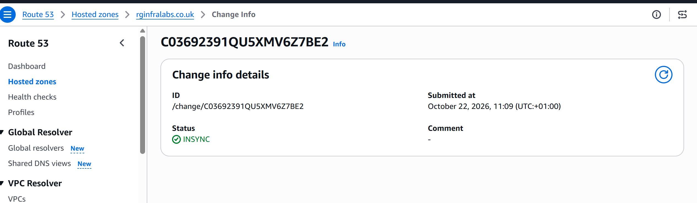

`INSYNC` indicates that the Route 53 change has been propagated to its authoritative DNS servers. It does not guarantee that external recursive DNS resolvers have refreshed their cached records.

---

## 6. Troubleshooting DNS Resolution

After configuring Route 53, I discovered that accessing `rginfralabs.co.uk` still displayed the old GoDaddy parking page.

Rather than immediately rebuilding the AWS infrastructure, I began investigating DNS resolution.

### Checking the Nameservers

I first used `nslookup` to check which nameservers were associated with my domain.

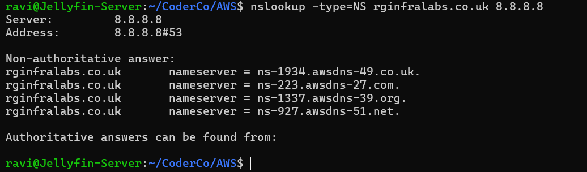

### Checking the A Record

I then checked which IP addresses were being returned for the domain.

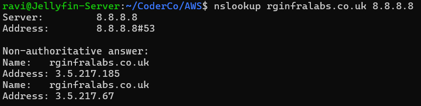

### Querying Route 53 Directly

To determine whether the issue was with AWS or my local DNS resolver, I queried one of the authoritative Route 53 nameservers directly.

```bash
dig @ns-223.awsdns-27.com rginfralabs.co.uk A +short
```

Route 53 returned AWS IP addresses associated with the S3 website endpoint.


### Querying Google Public DNS

I compared the results against Google's public DNS resolver.

```bash
dig @8.8.8.8 rginfralabs.co.uk A +short
```

Google DNS also returned AWS addresses, while my local resolver continued returning older GoDaddy addresses.

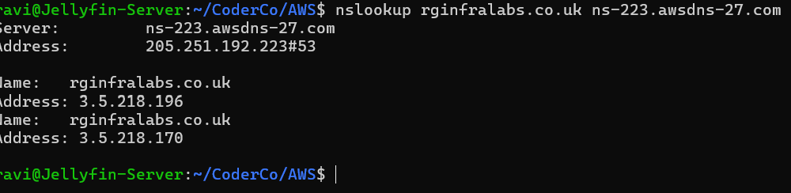

### Testing the Website with curl

I used `curl` to inspect the HTTP response from my custom domain.

```bash
curl -I http://rginfralabs.co.uk/
```

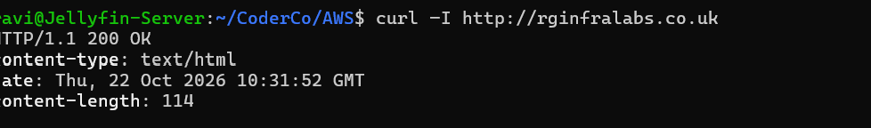

The response initially showed behaviour consistent with the old GoDaddy parking page.

### Bypassing Local DNS with curl

To isolate the problem, I forced `curl` to connect to an IP address returned by the Route 53 nameserver.

```bash
curl -I \
  --resolve rginfralabs.co.uk:80:3.5.218.249 \
  http://rginfralabs.co.uk/
```

The response returned:

```text
HTTP/1.1 200 OK
Server: AmazonS3
Content-Type: text/html
Content-Length: 6293
```

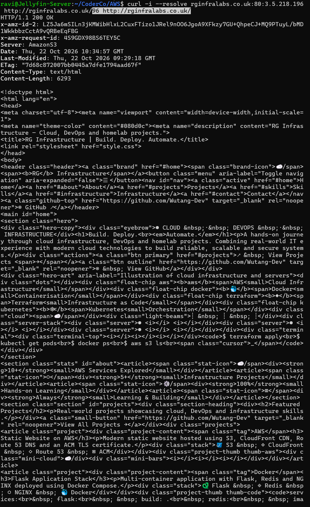

This was an important troubleshooting result.

It demonstrated that the website was accessible through AWS when the outdated local DNS response was bypassed.

### Investigating Local DNS

I continued comparing the results from my local DNS resolver and public DNS services.

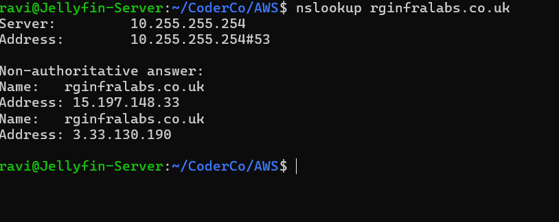

My local resolver continued returning the older GoDaddy addresses:

```text
15.197.148.33
3.33.130.190
```

I also flushed the DNS cache on Windows.

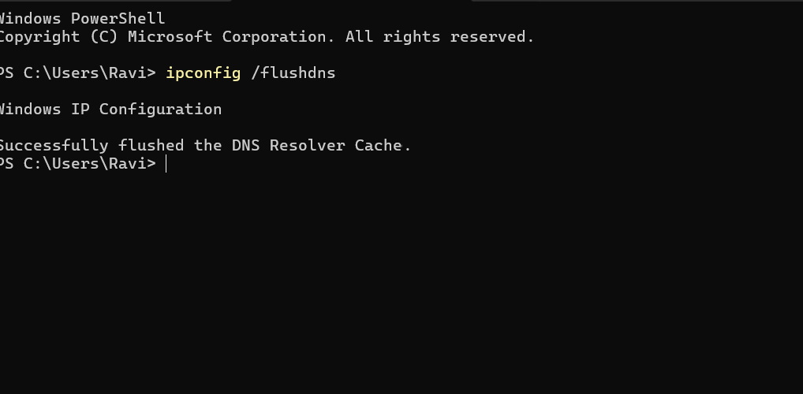

However, the local DNS issue persisted.

As this machine also runs my homelab services, including Jellyfin, Jellyseerr, the ARR stack and Tailscale, I decided not to make unnecessary changes to its system-level DNS configuration.

**Lesson learned:** When troubleshooting DNS, compare authoritative DNS responses with public and local recursive resolvers before assuming that the cloud infrastructure is incorrectly configured.

---

## 7. Configuring Amazon CloudFront

After verifying that the S3 website was functioning, I created a CloudFront distribution to serve the website through a content delivery network.

CloudFront caches website content at edge locations, helping reduce repeated requests to the origin and improve delivery performance.

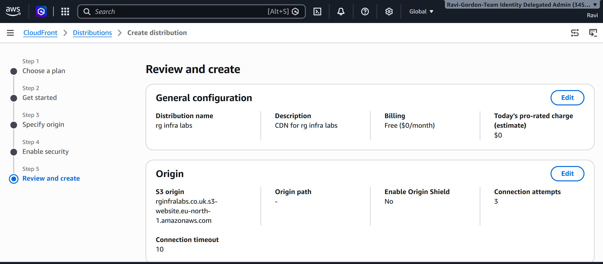

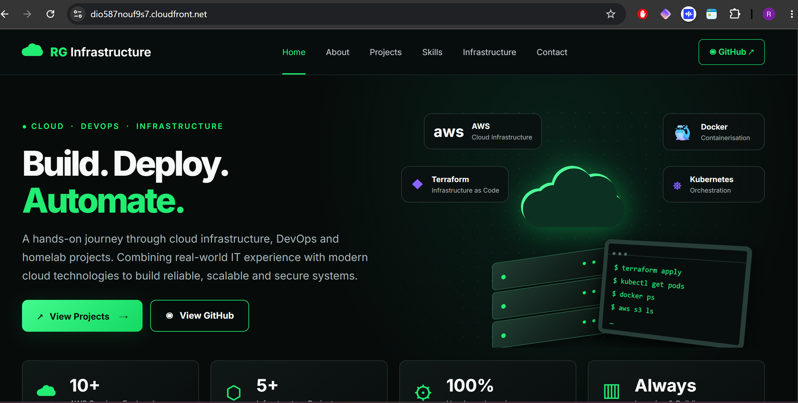

### Configuring the Origin

I configured the S3 static website endpoint as the CloudFront origin:

```text
rginfralabs.co.uk.s3-website.eu-north-1.amazonaws.com
```

The origin protocol was configured as **HTTP only**, using port `80`.

This is important because S3 static website endpoints do not support HTTPS connections directly.

CloudFront handles HTTPS connections from visitors while communicating with the S3 website endpoint over HTTP.

### Troubleshooting a CloudFront 504 Error

During testing, CloudFront initially returned:

```text
HTTP/2 504
x-cache: Error from cloudfront
```

I investigated the CloudFront origin configuration and found that the origin had initially been configured to use HTTPS.

After changing the origin protocol to HTTP only and allowing the distribution to deploy, CloudFront successfully served the website.

I verified the distribution using:

```bash
curl -I https://dio587nouf9s7.cloudfront.net/
```

The successful response included:

```text
HTTP/2 200
server: AmazonS3
via: ...cloudfront.net (CloudFront)
```

**Lesson learned:** HTTPS between a visitor and CloudFront is separate from the protocol used between CloudFront and its origin.

---

## 8. Additional Load Balancer Experimentation

During the assignment, I also experimented with an AWS Application Load Balancer.

This was separate from the final S3 and CloudFront architecture.

I created a load balancer and explored its configuration.

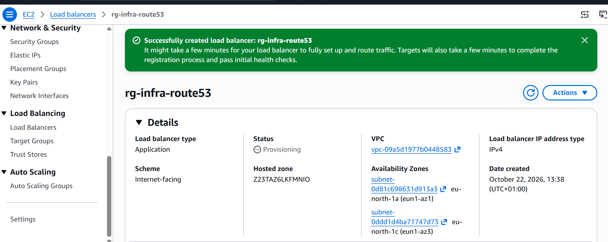

I then configured a security rule.

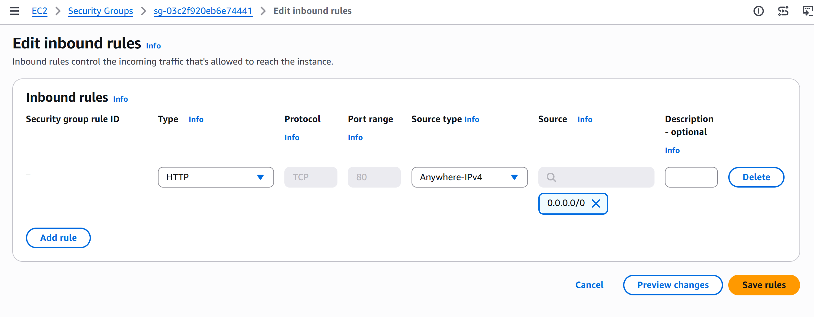

### Fixed-Response Listener

I configured a listener with a fixed response to explore how an Application Load Balancer can respond to requests without forwarding them to a backend target.

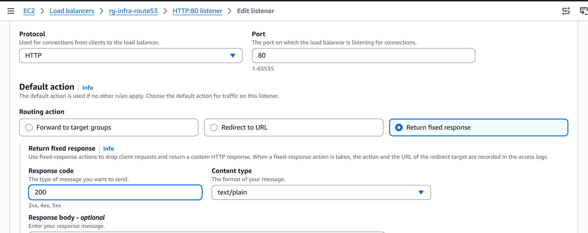

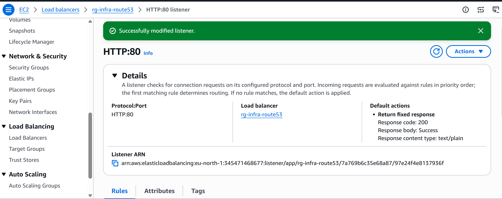

I then tested the load balancer.

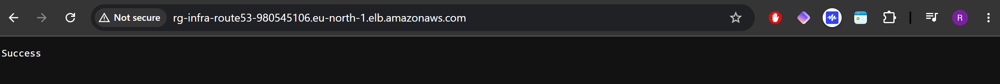

This exercise was useful for reinforcing my understanding of listeners, security groups and HTTP responses.

However, an Application Load Balancer was not required for the final static website deployment.

---

## 9. Configuring HTTPS with AWS Certificate Manager

To serve my custom domain securely through CloudFront, I requested a public SSL/TLS certificate using AWS Certificate Manager.

The certificate was created for:

`rginfralabs.co.uk`

CloudFront requires ACM certificates for custom domains to be created in the **US East (N. Virginia), `us-east-1` region**.

I initially created a certificate in Stockholm before identifying this requirement and requesting a new certificate in the correct region.

### DNS Validation

I selected DNS validation and created the required CNAME record in Route 53.

ACM used the record to verify that I controlled the domain.

After validation completed, the certificate status changed to `Issued`.

### Attaching the Certificate to CloudFront

I selected the issued ACM certificate in the CloudFront distribution settings.

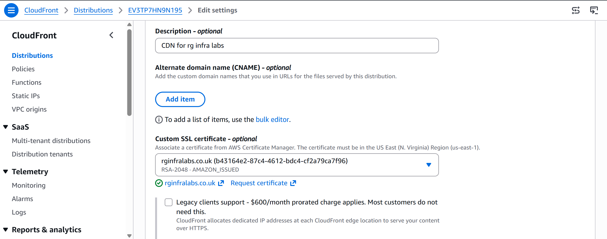

I also added `rginfralabs.co.uk` as an alternate domain name.

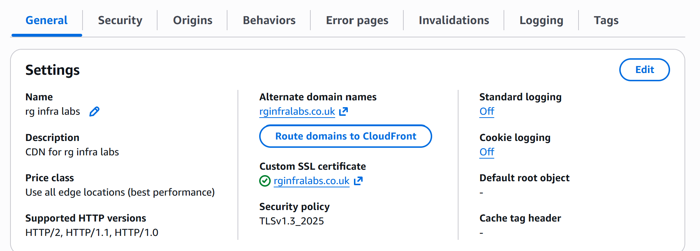

This allowed CloudFront to recognise requests for my custom domain and present the matching SSL/TLS certificate.

---

## 10. Routing the Custom Domain to CloudFront

Once CloudFront had been configured with the custom domain and certificate, I updated Route 53.

The original A alias record pointed directly to S3.

I removed that record and used CloudFront's automatic DNS routing workflow to create new alias records.

The final configuration included:

| Record | Destination |
|---|---|
| A | CloudFront distribution |
| AAAA | CloudFront distribution |
| CNAME | ACM DNS validation |
| NS | Route 53 authoritative nameservers |
| SOA | Hosted zone authority information |

The A and AAAA alias records direct traffic for `rginfralabs.co.uk` to CloudFront.

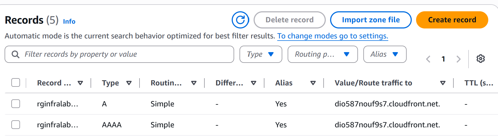

### Troubleshooting the Final DNS Configuration

After updating Route 53, I performed additional tests to confirm that public DNS was resolving the domain to CloudFront.

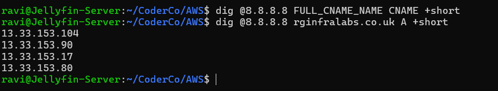

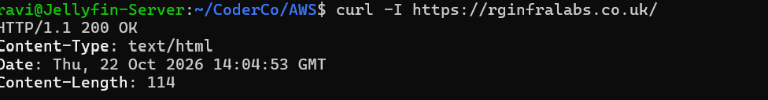

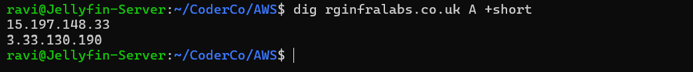

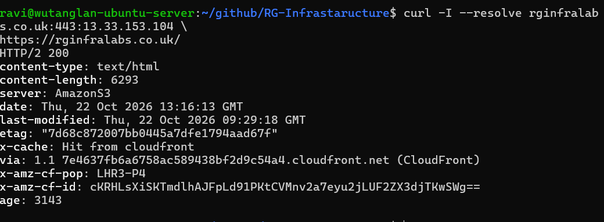


Google Public DNS returned CloudFront addresses, but my local resolver continued returning the previous GoDaddy addresses.

To confirm that HTTPS was working correctly, I bypassed local DNS using `curl --resolve`.

```bash
curl -I \
  --resolve rginfralabs.co.uk:443:13.33.153.104 \
  https://rginfralabs.co.uk/
```

The response was successful:

```text
HTTP/2 200
content-type: text/html
content-length: 6293
server: AmazonS3
x-cache: Hit from cloudfront
via: ...cloudfront.net (CloudFront)
```

This confirmed that CloudFront could serve the website over HTTPS using my custom domain and SSL/TLS certificate.

The `x-cache: Hit from cloudfront` header also demonstrated that CloudFront was serving the response from its cache.

The local DNS issue remained unresolved at the time of testing, but the AWS infrastructure had passed the direct end-to-end HTTPS test.

---

## 11. What I Learned

### Amazon S3

- How to create an S3 bucket for static website hosting.
- How to configure index and error documents.
- How public access settings and bucket policies work together.
- How to test an S3 website endpoint before configuring DNS.

### Amazon Route 53

- How to create a public hosted zone.
- How to delegate DNS management from GoDaddy to Route 53.
- How A and AAAA alias records route traffic to AWS services.
- The difference between authoritative DNS and recursive DNS resolvers.
- Why DNS caching can cause different resolvers to return different results.

### Amazon CloudFront

- How to configure a CloudFront distribution.
- How CloudFront uses an origin to retrieve website content.
- Why S3 website endpoints require HTTP origin connections.
- How CloudFront serves HTTPS traffic to visitors.
- How to identify cached responses using the `x-cache` header.

### AWS Certificate Manager

- How to request and validate a public certificate.
- Why CloudFront certificates must be created in `us-east-1`.
- How DNS validation works using CNAME records.
- How to associate a certificate with a CloudFront distribution.

### Troubleshooting

This assignment reinforced the importance of troubleshooting individual infrastructure components rather than rebuilding everything when something fails.

The most useful commands were:

| Command | Purpose |
|---|---|
| `nslookup` | Check DNS resolution |
| `dig` | Query DNS records and specific resolvers |
| `dig +trace` | Trace DNS delegation |
| `curl -I` | Inspect HTTP response headers |
| `curl --resolve` | Bypass DNS while preserving the requested hostname |

## Conclusion

This assignment gave me hands-on experience deploying a static website using multiple AWS services.

I successfully configured an S3 website, delegated DNS management to Route 53, deployed CloudFront as a Content Delivery Network (CDN), issued an SSL/TLS certificate through AWS Certificate Manager (ACM), and configured HTTPS access using my custom domain.

The most valuable part of the assignment was troubleshooting DNS resolution and CloudFront connectivity.

Rather than treating every failed website request as an AWS deployment issue, I learned to test each layer independently using tools such as `dig`, `nslookup` and `curl` to identify where the problem occurred.

Although the AWS infrastructure was functioning correctly, my local network continued resolving the domain to outdated GoDaddy parking IP addresses. By comparing responses from authoritative DNS servers, public resolvers and my local resolver, I was able to isolate the issue to stale DNS responses rather than the AWS configuration.

**Final result:** The website is now successfully accessible at **https://rginfralabs.co.uk**, served through Amazon CloudFront over HTTPS with DNS managed by Route 53. Normal access has also been verified from my local network following the resolution of the stale DNS issue.

This project reinforced the importance of understanding how cloud services work together and using a structured troubleshooting approach to diagnose infrastructure problems.