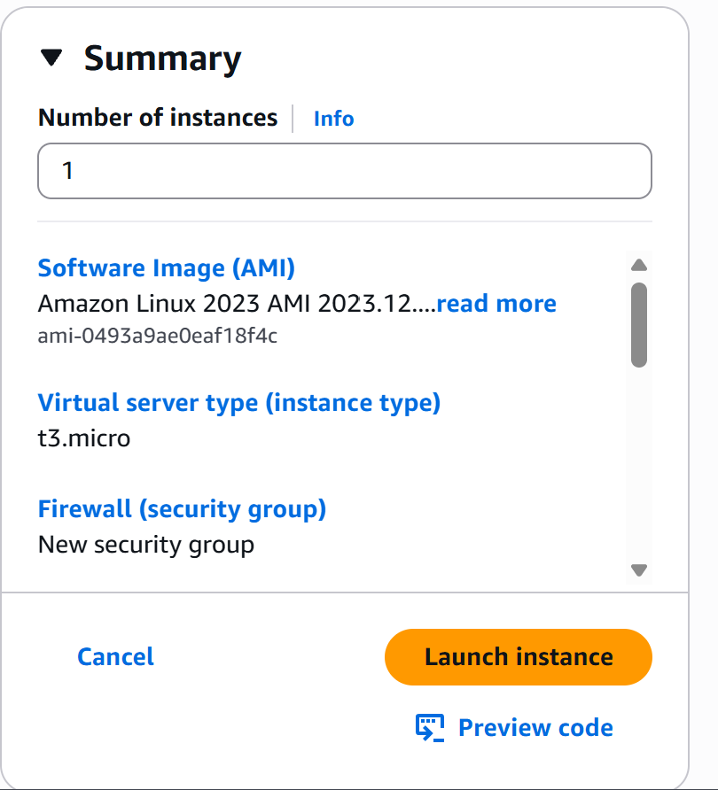
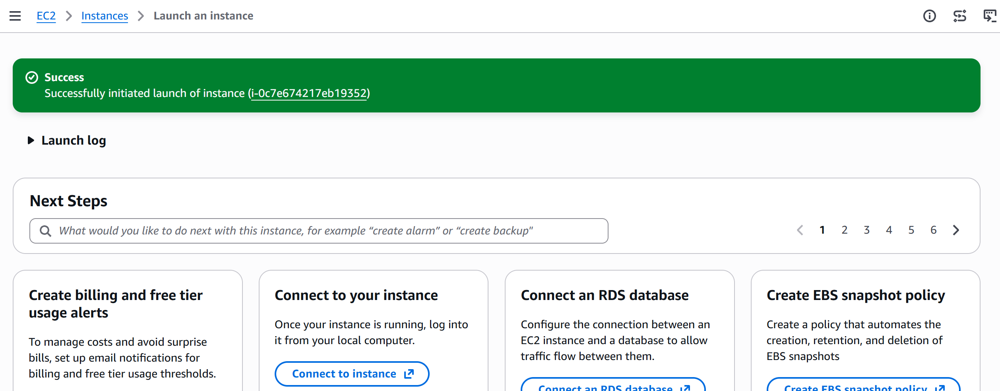
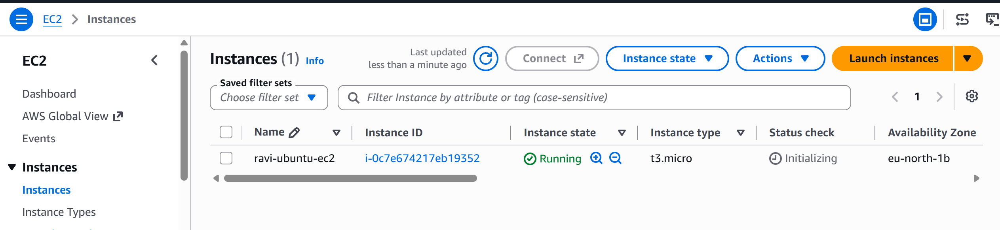
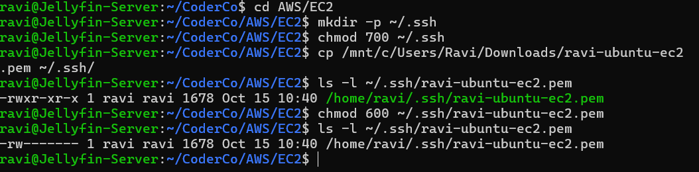
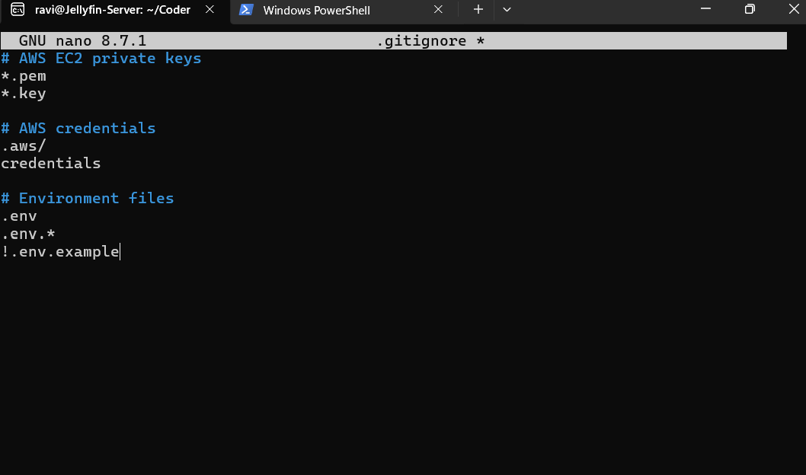

# AWS EC2 – Launching an Instance and Configuring SSH Access

## Overview

As part of the CoderCo AWS module, I deployed my first Amazon EC2 instance and configured SSH access from my Ubuntu WSL2 environment.

The objective was to gain hands-on experience deploying a cloud-based virtual machine, configuring security groups, managing SSH keys and troubleshooting remote connectivity.

As this is a learning environment, I selected an Amazon Linux AMI and instance type based on their Free Tier eligibility to help minimise costs.

## Objectives

- Launch an Amazon EC2 instance.
- Select an appropriate Amazon Machine Image (AMI).
- Configure an EC2 instance type.
- Create an SSH key pair.
- Configure security group rules.
- Secure the SSH private key using Linux file permissions.
- Protect sensitive files from being committed to GitHub.
- Connect to an EC2 instance using SSH.
- Troubleshoot SSH authentication errors.

## Implementation

### Step 1 – Creating an EC2 Instance

I logged into the AWS Management Console and navigated to **EC2 → Instances → Launch instances**.

For the operating system, I selected **Amazon Linux 2023 Kernel 6.18 AMI**.

I chose this AMI because it was listed as Free Tier eligible. As I am currently learning AWS, I want to minimise unnecessary cloud costs.

For the instance type, I selected `t3.micro` for the same reason.

**Screenshot – EC2 Configuration Summary**



### Step 2 – Creating an SSH Key Pair

During the EC2 configuration process, I created a new SSH key pair named:

`ravi-ubuntu-ec2`

The private key was downloaded as a `.pem` file to my Windows machine.

This key pair allows me to authenticate to the EC2 instance securely using SSH.

### Step 3 – Configuring Security Groups

During instance creation, I configured the security group to allow inbound SSH traffic on TCP port `22`.

Rather than allowing SSH connections from any IP address, I restricted access to **My IP**.

This reduces unnecessary exposure by limiting which public IP addresses can initiate SSH connections to the instance.

### Step 4 – Launching the EC2 Instance

After reviewing the configuration, I launched the EC2 instance.

AWS confirmed that the instance had been successfully launched.

**Screenshot – Successful EC2 Launch**



I then navigated to the EC2 Instances dashboard and verified that the instance was running.

**Screenshot – Running EC2 Instance**



### Step 5 – Configuring SSH on Ubuntu WSL2

I decided to connect to the EC2 instance from my Ubuntu WSL2 environment to continue practising Linux administration.

First, I created a directory to store my SSH private keys:

```bash
mkdir -p ~/.ssh
```

I then restricted access to the SSH directory:

```bash
chmod 700 ~/.ssh
```

Next, I copied my downloaded private key from the Windows Downloads directory into my Ubuntu SSH directory:

```bash
cp /mnt/c/Users/Ravi/Downloads/ravi-ubuntu-ec2.pem ~/.ssh/
```

I secured the private key using:

```bash
chmod 600 ~/.ssh/ravi-ubuntu-ec2.pem
```

This grants the owner read and write permissions while preventing other users from accessing the file.

I verified the permissions using:

```bash
ls -l ~/.ssh/ravi-ubuntu-ec2.pem
```

**Screenshot – Configuring SSH**



### Step 6 – Protecting Sensitive Files Using Git Ignore

To reduce the risk of accidentally publishing private keys to GitHub, I created a `.gitignore` file in my CoderCo repository.

I added rules to exclude private key files and other sensitive configuration files.

Example:

```gitignore
# SSH private keys
*.pem
*.key

# AWS credentials
.aws/
credentials

# Environment files
.env
.env.*
!.env.example
```

I also stored my SSH private key outside the Git repository in `~/.ssh/`.

**Screenshot – Git Ignore Configuration**



### Step 7 – Connecting to EC2 Using SSH

After configuring the private key, I attempted to connect to my EC2 instance using SSH.

My initial attempts were unsuccessful.

The first attempt failed because I referenced the private key without specifying its correct location.

After correcting the path, my second attempt failed because I used the username `ubuntu`.

However, my EC2 instance was running Amazon Linux 2023, which uses `ec2-user` as the default SSH username.

I resolved the issue by using the correct username and private key path.

```bash
ssh -v -o IdentitiesOnly=yes \
-i ~/.ssh/ravi-ubuntu-ec2.pem \
ec2-user@ec2-16-171-160-132.eu-north-1.compute.amazonaws.com
```

The `-v` option enabled verbose output for troubleshooting, while `IdentitiesOnly=yes` instructed SSH to use the specified identity rather than offering additional identities from the SSH agent.

After correcting the command, I successfully connected to my EC2 instance.

The terminal displayed the Amazon Linux 2023 welcome message, confirming that SSH authentication was successful.

## Troubleshooting

| Issue | Cause | Resolution |
|---|---|---|
| SSH private key not found | Incorrect private key path | Used the full path to the key inside `~/.ssh/` |
| Permission denied (publickey) | Incorrect SSH username | Changed `ubuntu` to `ec2-user` |
| SSH private key security | Private keys require restricted file permissions | Applied `chmod 600` to the private key |

## What I Learnt

- **Amazon EC2:** How to deploy and manage a virtual machine in AWS.
- **Amazon Machine Images:** AMIs provide the operating system and initial software configuration for EC2 instances.
- **Instance Types:** Different EC2 instance types provide different CPU, memory and networking capabilities.
- **Security Groups:** Control inbound and outbound traffic to EC2 resources.
- **SSH Authentication:** Used a private key to authenticate securely to a remote Linux server.
- **Linux Permissions:** Used `chmod 700` and `chmod 600` to secure SSH directories and private keys.
- **Git Security:** Used `.gitignore` to reduce the risk of committing sensitive files.
- **Troubleshooting:** Diagnosed and resolved SSH authentication errors caused by an incorrect key path and username.

## Security Considerations

- Restricted SSH access to my public IP address.
- Stored the SSH private key outside my Git repository.
- Applied restrictive Linux file permissions to the private key.
- Added private key patterns to `.gitignore`.
- Avoided publishing private keys or AWS credentials in GitHub documentation.

## Conclusion

This exercise provided practical experience deploying an EC2 instance and connecting to it remotely using SSH from Ubuntu WSL2.

It also reinforced my understanding of cloud compute, security groups, Linux file permissions, SSH authentication and troubleshooting.

The EC2 instance will provide an environment for future AWS and Linux exercises.

---

[Back to EC2 & Compute](README.md) | [Back to AWS Home](../README.md)