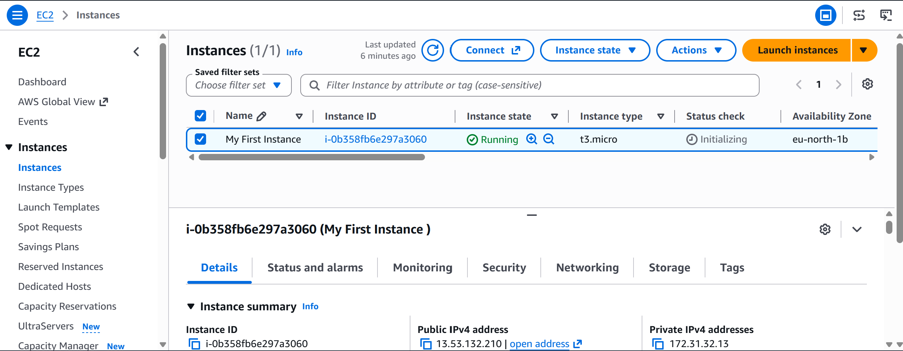
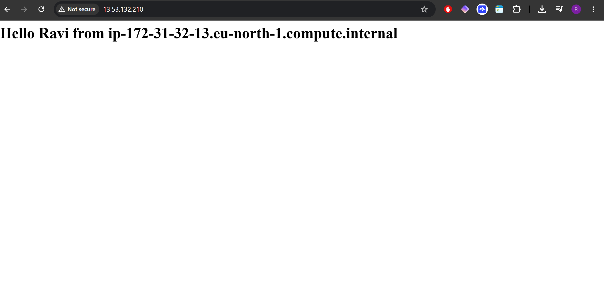

# Deploying an Apache Web Server on AWS EC2 Using User Data

## Overview

As part of my CoderCo AWS module, I deployed my first Apache web server on an Amazon Linux 2023 EC2 instance.

The objective of this lab was to learn how to use **EC2 User Data** to automate the installation and configuration of a web server during instance launch.

Rather than manually installing Apache through SSH, I used a Bash script to install the required packages, start the Apache service and create a simple HTML webpage.

## Technologies Used

| Technology | Purpose |
|---|---|
| AWS EC2 | Hosting the virtual server |
| Amazon Linux 2023 | Operating system |
| Apache HTTP Server | Serving the webpage |
| Bash | Automating installation and configuration |
| EC2 User Data | Running the bootstrap script |
| AWS Security Groups | Controlling inbound network traffic |

## 1. Creating the EC2 Instance

I launched an EC2 instance using the AWS Management Console and selected Amazon Linux 2023 as the operating system.

During the launch configuration, I added a User Data script to automate the web server setup.

The instance was configured to allow HTTP traffic on TCP port 80 so that the webpage could be accessed through its public IPv4 address.



## 2. Creating the User Data Script

I created the following Bash script to install and configure Apache automatically.

```bash
#!/bin/bash

dnf update -y
dnf install -y httpd

systemctl start httpd
systemctl enable httpd

echo "<h1>Hello Ravi from $(hostname -f)</h1>" > /var/www/html/index.html
```

### Understanding the Script

| Command | Purpose |
|---|---|
| `#!/bin/bash` | Specifies the Bash interpreter |
| `dnf update -y` | Updates installed packages |
| `dnf install -y httpd` | Installs Apache |
| `systemctl start httpd` | Starts the Apache service |
| `systemctl enable httpd` | Enables Apache to start automatically on boot |
| `hostname -f` | Returns the instance's fully qualified hostname |
| `echo ... > index.html` | Creates the HTML homepage |

I initially made two syntax errors when writing the script:

- Used `yum-install` instead of `yum install`.
- Used `hostname-l` instead of `hostname -f`.

After correcting these errors, I used the revised script for the deployment. I also used `dnf`, the native package manager for Amazon Linux 2023.

## 3. Launching the Instance

After completing the configuration, I launched the EC2 instance.

EC2 User Data was used to execute the Bash script during the instance's initial boot.

The script installed Apache, started the web server and created the custom HTML page.

## 4. Testing the Apache Web Server

Once the EC2 instance was running, I copied its public IPv4 address and entered it into my browser using HTTP.

The webpage loaded successfully and displayed the following message:

```text
Hello Ravi from ip-172-31-32-13.eu-north-1.compute.internal
```



This confirmed that the web server was responding to HTTP requests and serving the custom HTML page.

The hostname displayed on the page was the instance's internal hostname, while the browser connected using the instance's public IPv4 address.

## 5. Understanding the Network Configuration

The request followed this path:

```text
Web Browser
    |
    | HTTP Request (TCP Port 80)
    |
    v
EC2 Public IPv4 Address
    |
    v
AWS Security Group
    |
    | Allow Inbound HTTP
    |
    v
Amazon Linux 2023
    |
    v
Apache HTTP Server
    |
    v
/var/www/html/index.html
```

The EC2 instance used a private IP address within the AWS VPC, while its public IPv4 address allowed access from the internet.

The Security Group permitted inbound HTTP traffic on TCP port 80.

## 6. What I Learnt

- How to launch an Amazon Linux 2023 EC2 instance.
- How EC2 User Data automates instance configuration during initial boot.
- How to install Apache using the DNF package manager.
- How to manage Linux services using `systemctl`.
- How to create and serve a basic HTML webpage.
- How Security Groups control inbound HTTP traffic.
- The difference between an EC2 instance's public IPv4 address and internal hostname.
- How small Bash syntax errors can prevent automation scripts from executing correctly.

## 7. Outcome

Successfully deployed my first Apache web server on AWS EC2 using User Data.

The Apache installation, service configuration and HTML page creation were automated through a Bash script, and the webpage was accessible through the instance's public IPv4 address.

This lab helped me understand how EC2 User Data can be used to bootstrap cloud infrastructure without manually configuring each server after deployment.