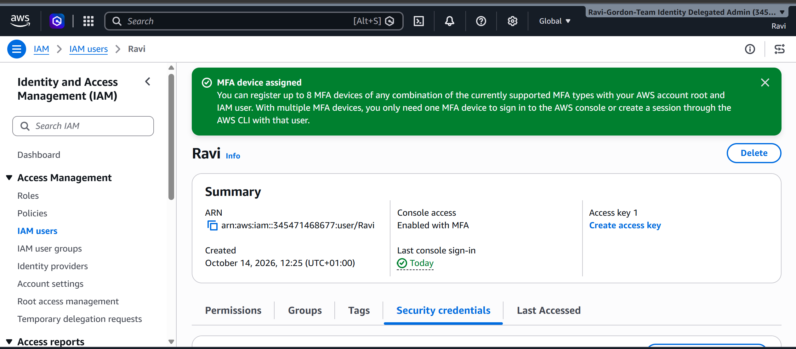

# AWS IAM – Creating an IAM User and Enabling MFA

## Overview

As part of the CoderCo AWS module, I completed a practical exercise using AWS Identity and Access Management (IAM).

The objective was to create an IAM user, enable AWS Management Console access and configure Multi-Factor Authentication (MFA) to improve account security.

## Objectives

- Create an IAM user in AWS.
- Enable AWS Management Console access.
- Configure Multi-Factor Authentication (MFA).
- Verify that MFA was successfully enabled.
- Understand the importance of securing AWS identities.

## Implementation

### Step 1 – Creating an IAM User

I logged into the AWS Management Console and navigated to **Identity and Access Management (IAM)**.

From the IAM dashboard, I selected **Users** and created a new IAM user named `Ravi`.

I enabled AWS Management Console access for the user.

### Step 2 – Configuring MFA

After creating the IAM user, I navigated to the **Security credentials** tab.

I configured an MFA device for the user to provide an additional layer of authentication security.

MFA helps protect AWS accounts by requiring an additional authentication factor alongside the user's password.

### Step 3 – Verifying MFA

After configuring MFA, I returned to the IAM user summary page to verify that the configuration was successful.

The AWS Management Console displayed the confirmation message **MFA device assigned**.

The user summary also confirmed that console access was **Enabled with MFA**.

## What I Learnt

- **AWS IAM:** Used to manage identities and control access to AWS services and resources.
- **IAM Users:** Represent identities that can authenticate to AWS using configured credentials.
- **Multi-Factor Authentication:** Adds an additional authentication factor to improve account security.
- **Security Credentials:** Used to manage IAM authentication settings, including console passwords, access keys and MFA devices.
- **Least Privilege:** IAM users should only receive the permissions required to perform their tasks.

## Conclusion

This exercise provided hands-on experience creating an AWS IAM user and configuring Multi-Factor Authentication.

It reinforced the importance of securing AWS identities before granting access to cloud resources.

---

