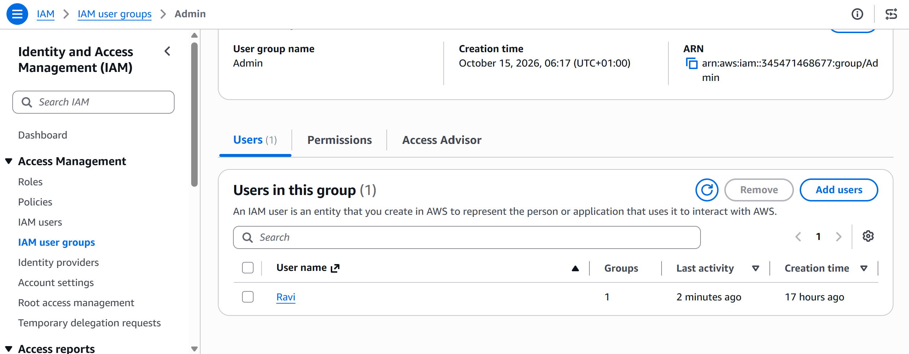

# AWS IAM – Creating and Managing User Groups

## Overview

As part of the CoderCo AWS module, I completed a practical exercise involving IAM User Groups.

The objective was to create an IAM group, assign a permissions policy and add an existing IAM user to the group.

## Objectives

- Create an IAM User Group.
- Add an existing IAM user to the group.
- Attach an AWS managed permissions policy.
- Understand how group permissions are inherited by IAM users.

## Implementation

### Step 1 – Creating an IAM User Group

I logged into the AWS Management Console and navigated to **Identity and Access Management (IAM)**.

From the IAM dashboard, I selected **User groups** and created a new group named `Admin`.

### Step 2 – Adding an IAM User

During the group creation process, I selected my previously created IAM user, `Ravi`, and added it to the `Admin` group.

This allows the user to inherit permissions assigned to the group.

### Step 3 – Assigning Permissions

As the group was created for administrative access, I attached the AWS managed policy `AdministratorAccess`.

This policy grants broad administrative permissions across AWS services and resources.

By attaching the policy to the group rather than directly to the user, permissions can be managed centrally.

### Step 4 – Verifying Group Membership

After creating the group, I reviewed the IAM configuration to confirm that:

- The `Admin` group had been created.
- The IAM user `Ravi` was a member of the group.
- The `AdministratorAccess` policy was attached to the group.

**Screenshot – IAM Admin Group**

## What I Learnt

- **IAM User Groups:** Allow multiple IAM users to be managed together.
- **Group Permissions:** Users inherit permissions from policies attached to their groups.
- **AWS Managed Policies:** Predefined permissions policies maintained by AWS.
- **AdministratorAccess:** Grants broad administrative access to AWS resources.
- **Centralised Management:** Permissions can be assigned to groups instead of managing each user individually.

## Security Considerations

The `AdministratorAccess` policy was used for this training exercise to understand IAM group permissions.

In real-world environments, administrative access should be restricted to authorised identities, and permissions should follow the principle of least privilege.

## Conclusion

This exercise provided hands-on experience creating an IAM User Group, adding an existing IAM user and assigning permissions using an AWS managed policy.

It demonstrated how IAM groups simplify permissions management across multiple users.

---

[Back to IAM Home](README.md) | [Back to AWS Home](../README.md)