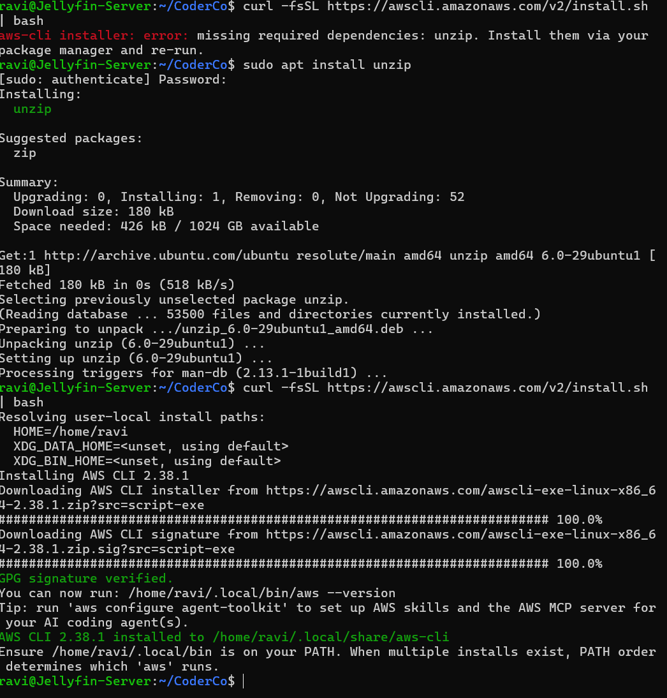

# Installing AWS CLI on Ubuntu Linux

## Overview

As part of the CoderCo AWS module, I installed the AWS Command Line Interface (CLI) on my Ubuntu Linux environment.

I chose to complete this exercise using Linux rather than Windows to continue developing my Linux command-line skills.

The AWS CLI allows me to interact with AWS services directly from the terminal without relying on the AWS Management Console.

## Objectives

- Install the AWS CLI on Ubuntu Linux.
- Practise installing software using the Linux terminal.
- Troubleshoot installation dependency errors.
- Understand how the AWS CLI can be used to manage AWS resources.

## Implementation

### Step 1 – Installing the AWS CLI

I initially attempted to install the AWS CLI using the following command:

```bash
curl -fsSL https://awscli.amazonaws.com/v2/install.sh | bash
```

However, the installation failed with the following error:

```text
missing required dependencies: unzip.
Install them via your package manager and re-run.
```

### Step 2 – Troubleshooting the Installation

The error indicated that the `unzip` package was missing from my Ubuntu environment.

To resolve this, I installed the required dependency using the APT package manager:

```bash
sudo apt install unzip
```

Once the installation completed, I repeated the original AWS CLI installation command:

```bash
curl -fsSL https://awscli.amazonaws.com/v2/install.sh | bash
```

This time, the installation completed successfully.

### Step 3 – Installation Screenshot

The screenshot below documents the AWS CLI installation process.


# Installing AWS CLI on Ubuntu Linux

## Overview

As part of the CoderCo AWS module, I installed the AWS Command Line Interface (CLI) on my Ubuntu Linux environment.

I chose to complete this exercise using Linux rather than Windows to continue developing my Linux command-line skills.

The AWS CLI allows me to interact with AWS services directly from the terminal without relying on the AWS Management Console.

## Objectives

- Install the AWS CLI on Ubuntu Linux.
- Practise installing software using the Linux terminal.
- Troubleshoot installation dependency errors.
- Understand how the AWS CLI can be used to manage AWS resources.

## Implementation

### Step 1 – Installing the AWS CLI

I initially attempted to install the AWS CLI using the following command:

```bash
curl -fsSL https://awscli.amazonaws.com/v2/install.sh | bash
```

However, the installation failed with the following error:

```text
missing required dependencies: unzip.
Install them via your package manager and re-run.
```

### Step 2 – Troubleshooting the Installation

The error indicated that the `unzip` package was missing from my Ubuntu environment.

To resolve this, I installed the required dependency using the APT package manager:

```bash
sudo apt install unzip
```

Once the installation completed, I repeated the original AWS CLI installation command:

```bash
curl -fsSL https://awscli.amazonaws.com/v2/install.sh | bash
```

This time, the installation completed successfully.

### Step 3 – Installation Screenshot

The screenshot below documents the AWS CLI installation process.


## What I Learnt

- **AWS CLI:** Provides a command-line interface for interacting with AWS services.
- **Linux Package Management:** Used `apt` to install a missing software dependency.
- **Troubleshooting:** Identified and resolved an installation error caused by the missing `unzip` package.
- **Remote Administration:** The AWS CLI can be installed on Linux virtual machines, including headless Ubuntu Server environments.
- **Automation:** The AWS CLI can be used in scripts to automate AWS administration tasks.

## Reflection

Installing the AWS CLI on Linux allowed me to practise working with the Linux terminal while developing my AWS skills.

I also learnt that the AWS CLI can be particularly useful when working with virtual machines that do not have a graphical interface.

As I progress through the AWS module, I plan to use the CLI to manage AWS resources more efficiently and eventually automate tasks using Bash scripts.

## Conclusion

This exercise introduced me to installing the AWS CLI on Ubuntu Linux and troubleshooting a missing dependency.

It also demonstrated how Linux command-line skills can be applied directly to cloud administration and future DevOps automation.

---

[Back to AWS CLI Home](README.md) | [Back to AWS Home](../README.md)
