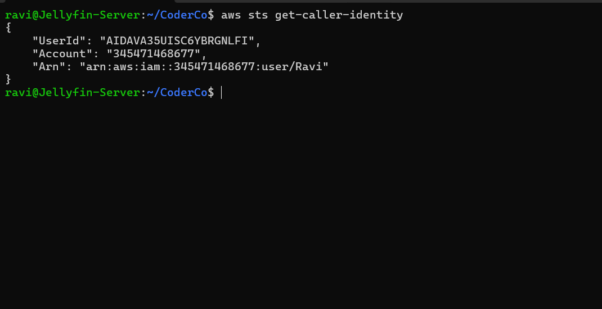

# Configuring AWS CLI Authentication on Ubuntu Linux

## Overview

As part of the CoderCo AWS module, I configured the AWS CLI on my Ubuntu Linux environment to authenticate with my AWS account.

Having previously installed the AWS CLI, the objective of this exercise was to configure authentication using my existing IAM user and verify connectivity to AWS.

## Objectives

- Configure AWS CLI credentials on Ubuntu Linux.
- Authenticate using an existing IAM user.
- Verify AWS authentication using the terminal.
- Understand the importance of protecting AWS credentials.

## Implementation

### Step 1 – Configuring AWS Credentials

I opened my Ubuntu terminal and ran:

```bash
aws configure
```

I configured the AWS CLI using my existing IAM user, `Ravi`, providing the required access key, secret access key, default AWS Region and output format.

**Security Note:** I deliberately excluded screenshots of the credential configuration process because they contained sensitive access keys.

### Step 2 – Verifying Authentication

After configuring the credentials, I ran:

```bash
aws sts get-caller-identity
```

The command successfully returned my AWS account information, confirming that the CLI was authenticated as my IAM user, `Ravi`.



## What I Learnt

- **AWS CLI Configuration:** Used `aws configure` to configure AWS authentication.
- **IAM Authentication:** Connected my Linux environment to AWS using an existing IAM user.
- **AWS STS:** Used `get-caller-identity` to verify my authenticated AWS identity.
- **Credential Security:** Learnt the importance of keeping access keys and secret keys private.
- **Remote Administration:** AWS CLI allows me to interact with AWS services from terminal-based Linux environments.

## Security Considerations

For this exercise, I used IAM user access keys to configure authentication.

Long-term access keys require careful management. In future exercises, I plan to explore temporary credentials and IAM Identity Center.

## Conclusion

This exercise demonstrated how to configure AWS CLI authentication on Ubuntu Linux and verify successful connectivity to my AWS account.

It provides a foundation for managing AWS services through the terminal and eventually automating AWS tasks using Bash scripts.

---

[Back to AWS CLI Home](README.md) | [Back to AWS Home](../README.md)