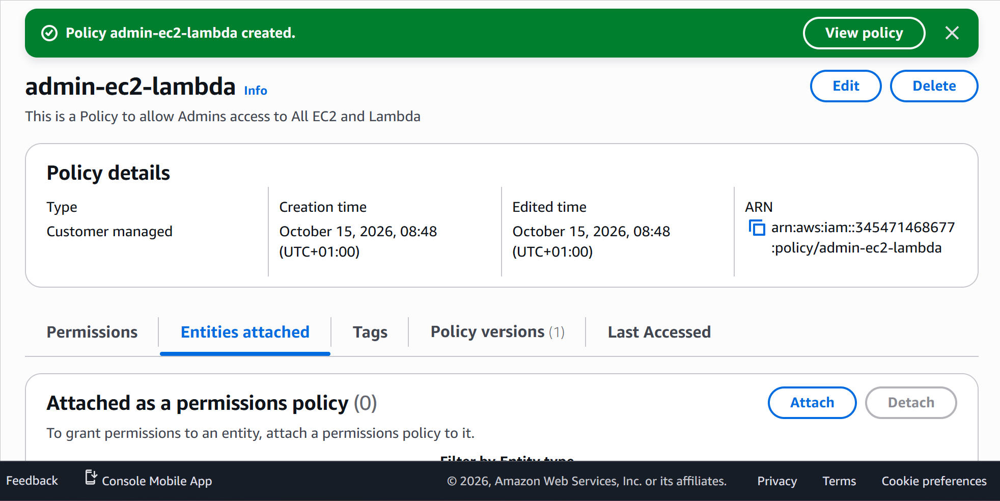
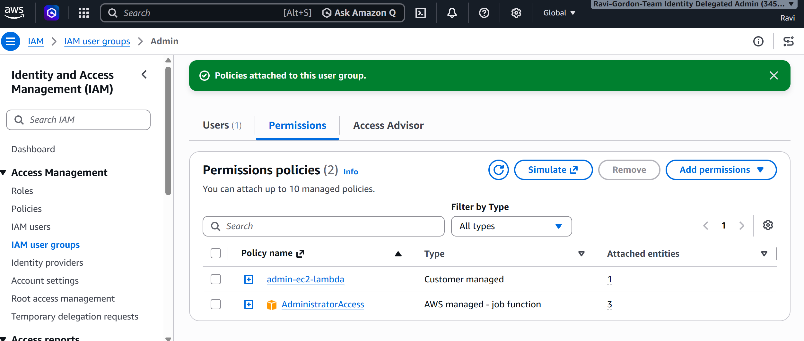

# AWS IAM – Creating and Attaching Custom IAM Policies

## Overview

As part of the CoderCo AWS module, I completed a practical exercise involving AWS IAM policies.

The objective was to create a custom IAM policy that allows access to Amazon EC2 and AWS Lambda, then attach the policy to my existing `Admin` IAM group.

This exercise helped me understand how AWS permissions can be defined using policies and assigned to multiple users through IAM groups.

## Objectives

- Create a custom IAM permissions policy.
- Configure permissions for Amazon EC2 and AWS Lambda.
- Attach the custom policy to an existing IAM group.
- Understand how IAM users inherit permissions from groups.
- Develop practical experience managing AWS permissions.

## Implementation

### Step 1 – Creating a Custom IAM Policy

I logged into the AWS Management Console and navigated to **Identity and Access Management (IAM)**.

From the IAM dashboard, I selected **Policies** and created a new custom permissions policy.

I configured the policy to allow all actions for the following AWS services:

- **Amazon EC2:** Allows actions associated with managing EC2 resources.
- **AWS Lambda:** Allows actions associated with managing Lambda functions and related resources.

I selected all available actions for both services because the policy was intended for my administrative IAM group.

**Screenshot – Creating the IAM Policy**

### Step 2 – Attaching the Policy to an IAM Group

After creating the custom policy, I navigated to **IAM → User groups**.

I selected my existing `Admin` group and attached the newly created policy.

By attaching the policy to the group, its permissions are available to all IAM users who belong to that group.

This allows permissions to be managed centrally rather than attaching the same policy to individual users.

**Screenshot – Attaching the Policy**

## What I Learnt

- **IAM Policies:** Define which actions an identity is allowed or denied when accessing AWS resources.
- **Custom Policies:** Allow administrators to create permissions tailored to specific AWS services and requirements.
- **EC2 Permissions:** Control access to EC2 actions and resources.
- **Lambda Permissions:** Control access to Lambda actions and resources.
- **Group-Based Permissions:** Policies attached to IAM groups apply to the users within those groups.
- **Centralised Management:** Managing permissions through groups simplifies administration when multiple users require similar access.

## Security Considerations

For this exercise, I configured broad EC2 and Lambda permissions to practise creating and attaching IAM policies.

In production environments, IAM policies should follow the principle of least privilege, granting only the actions and resource access required.

The `Admin` group already had the AWS managed `AdministratorAccess` policy attached, meaning its members already possessed broad administrative permissions.

The custom policy was therefore created primarily to practise defining and attaching permissions.

## Conclusion

This exercise provided hands-on experience creating a custom IAM policy and attaching it to an existing IAM group.

It reinforced my understanding of how AWS IAM policies work and how group-based permissions can simplify identity and access management.

---

[Back to IAM Home](README.md) | [Back to AWS Home](../README.md)