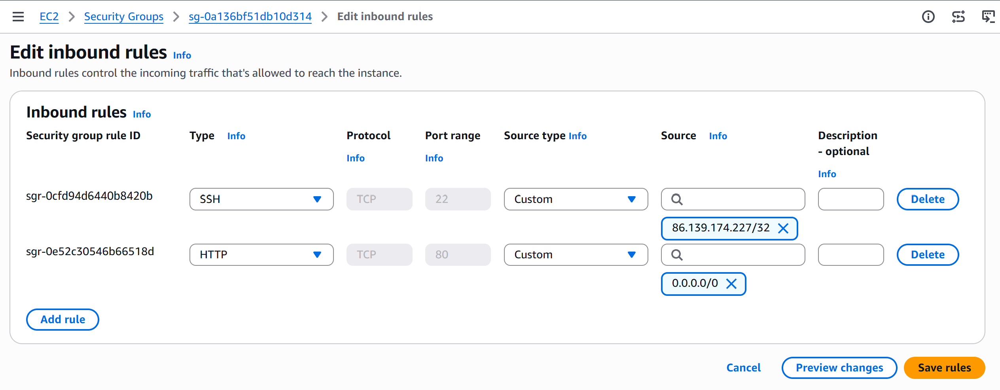

# AWS Security Groups – Inbound Rules Lab

## Overview

As part of my CoderCo AWS module, I explored how AWS Security Groups control network traffic to EC2 instances.

For this lab, I launched an Ubuntu EC2 instance and configured inbound rules to allow SSH and HTTP traffic.

The objective was to understand how Security Groups act as virtual firewalls and how different ports and protocols are used to control access to cloud infrastructure.

## Technologies Used

| Technology | Purpose |
|---|---|
| AWS EC2 | Hosting the Ubuntu virtual machine |
| Ubuntu Server | Operating system |
| AWS Security Groups | Controlling network traffic |
| SSH (TCP 22) | Remote administration |
| HTTP (TCP 80) | Allowing web traffic |

## 1. Launching the EC2 Instance

I launched a new EC2 instance using Ubuntu Server as the operating system.

During the instance configuration, I configured the associated Security Group to allow SSH and HTTP traffic.

## 2. Configuring Inbound Rules

I configured the following inbound rules:

| Type | Protocol | Port | Purpose |
|---|---|---|---|
| SSH | TCP | 22 | Allow remote administration |
| HTTP | TCP | 80 | Allow inbound web traffic |

The SSH rule allows remote connections to the EC2 instance, while the HTTP rule allows clients to access a web server if one is installed and running.

For security, SSH access should be restricted to trusted IP addresses rather than being publicly accessible.

## 3. Understanding Security Groups

AWS Security Groups act as virtual firewalls attached to network interfaces, controlling inbound and outbound traffic.

Key characteristics include:

- **Stateful:** Return traffic for an allowed connection is automatically permitted.
- **Allow rules only:** Security Groups do not support explicit deny rules.
- **Inbound rules:** Control traffic entering the instance.
- **Outbound rules:** Control traffic leaving the instance.
- **Default behaviour:** Traffic that does not match an inbound allow rule is blocked.

Security Groups can be associated with multiple EC2 instances, and an instance can have multiple Security Groups.

## 4. What I Learnt

- How to configure Security Groups during EC2 instance deployment.
- How inbound rules control access to EC2 instances.
- The purpose of SSH on TCP port 22.
- The purpose of HTTP on TCP port 80.
- Why restricting SSH access to trusted IP addresses is important.
- The difference between inbound and outbound Security Group rules.
- How Security Groups provide network-level access control in AWS.

## 5. Outcome

Successfully launched an Ubuntu EC2 instance and configured inbound Security Group rules for SSH and HTTP traffic.

This lab helped reinforce my understanding of network ports, protocols and firewall rules within AWS.