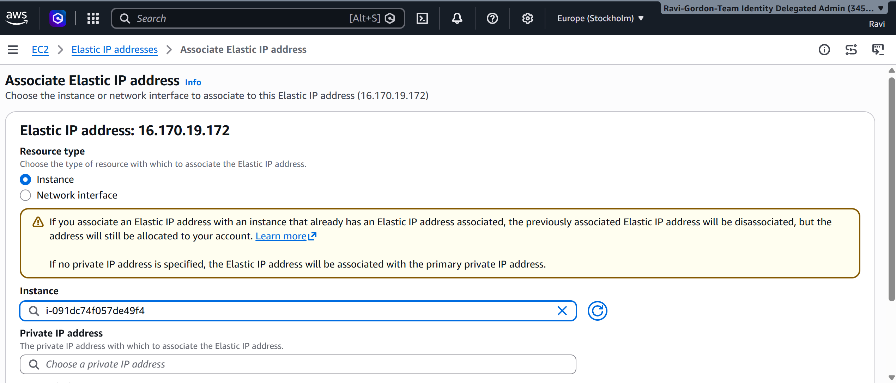
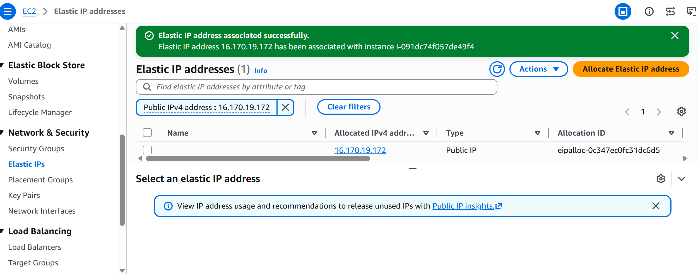
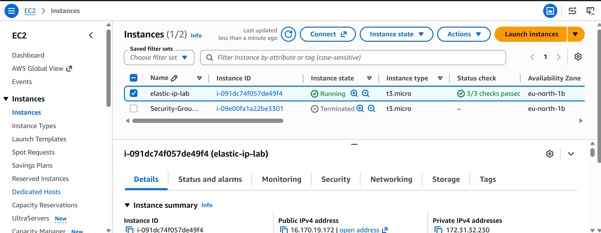

# AWS Elastic IP – Assigning a Static Public IP to an EC2 Instance

## Overview

As part of my CoderCo AWS Security Groups and Cloud Networking module, I completed a practical lab exploring AWS Elastic IP addresses.

The objective was to understand how to allocate a static public IPv4 address and associate it with an existing EC2 instance.

Unlike an automatically assigned public IPv4 address, which can change when an EC2 instance is stopped and started, an Elastic IP remains allocated to my AWS account until I release it.

## Technologies Used

| Technology | Purpose |
|---|---|
| AWS EC2 | Hosting the virtual machine |
| AWS Elastic IP | Providing a static public IPv4 address |
| AWS VPC | Networking environment for the instance |
| AWS Management Console | Configuring and managing AWS resources |

## 1. Allocating an Elastic IP Address

I navigated to the EC2 dashboard and selected **Elastic IPs** under the Network & Security section.

I then allocated a new Elastic IP address from Amazon's public IPv4 address pool.

This created a static public IPv4 address that could be associated with an EC2 instance.

## 2. Associating the Elastic IP with My EC2 Instance

After allocating the Elastic IP, I selected the address and chose **Actions → Associate Elastic IP address**.

I selected my existing EC2 instance as the resource and completed the association.

This allowed the instance to use the allocated Elastic IP as its public IPv4 address.

## 3. Verifying the Elastic IP Association

After completing the association, I returned to the EC2 dashboard to verify that the Elastic IP was associated with my instance.

The Elastic IP provides a consistent public IPv4 address that can be used to access the instance, provided the necessary Security Group rules and network configuration are in place.

## 4. Understanding Elastic IP Addresses

| Feature | Automatically Assigned Public IPv4 | Elastic IP |
|---|---|---|
| Publicly routable | Yes | Yes |
| Static address | No | Yes |
| Can change after stop/start | Yes | Remains allocated |
| Can be reassociated with another instance | Not directly | Yes |
| Public IPv4 charges | Applicable | Applicable |

Elastic IPs are useful when an application or server requires a consistent public IPv4 address.

For example, an Elastic IP can be used when configuring DNS records that need to point to a stable address.

## 5. What I Learnt

- How to allocate an Elastic IP address through the AWS Management Console.
- How to associate an Elastic IP with an existing EC2 instance.
- The difference between an automatically assigned public IPv4 address and a static Elastic IP.
- Why static public IP addresses can be useful for hosting applications and configuring DNS.
- How Elastic IP addresses can be reassociated with other resources.
- Why public IPv4 address allocation and usage must be considered when managing AWS costs.

## 6. Outcome

Successfully allocated and associated an Elastic IP address with an EC2 instance.

This lab improved my understanding of public IP addressing in AWS and how Elastic IPs provide a consistent public IPv4 address for cloud resources.

## 7. Resource Cleanup

Elastic IP addresses incur public IPv4 charges, even when associated with running EC2 instances.

After completing the lab, any Elastic IP no longer required should be disassociated and released to avoid unnecessary charges.