# Task 1 — Automated Docker Build and Push Using GitHub Actions

## Project Overview

Built a CI/CD workflow using GitHub Actions to automatically build and publish a Python Docker image to Docker Hub whenever relevant changes are pushed to GitHub.

The objective was to replace manual Docker builds and pushes with an automated, repeatable pipeline using securely stored credentials.

**Technologies:** Python, Docker, Docker Hub, GitHub Actions, YAML, Git

**Docker Hub:** [wutangdev/hello-python](https://hub.docker.com/r/wutangdev/hello-python)

## 1. Create the Python Application

Created a simple Python function that returns `Hello, World!`, with a main condition to execute and print the result.

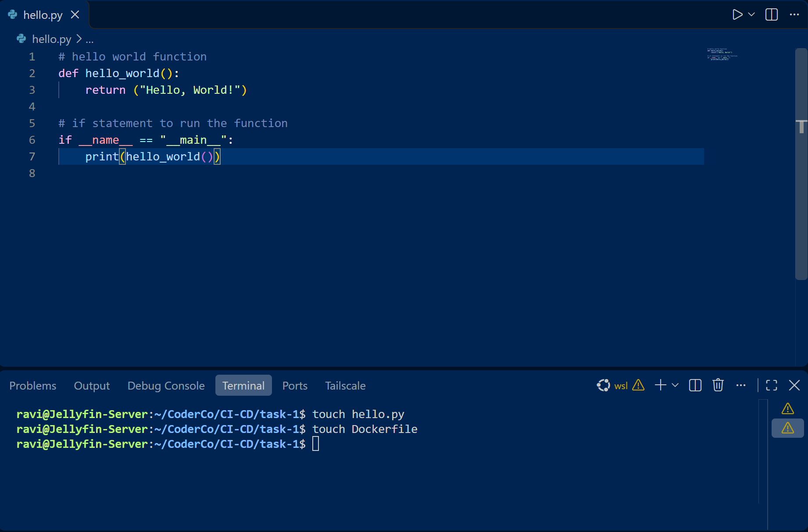

## 2. Create the Dockerfile

Created a Dockerfile using `python:3.12-slim-bookworm`.

The Dockerfile:

- Uses a lightweight Python base image.
- Sets `/app` as the working directory.
- Installs available operating system package updates.
- Copies the application files into the container.
- Executes `hello.py` when the container starts.

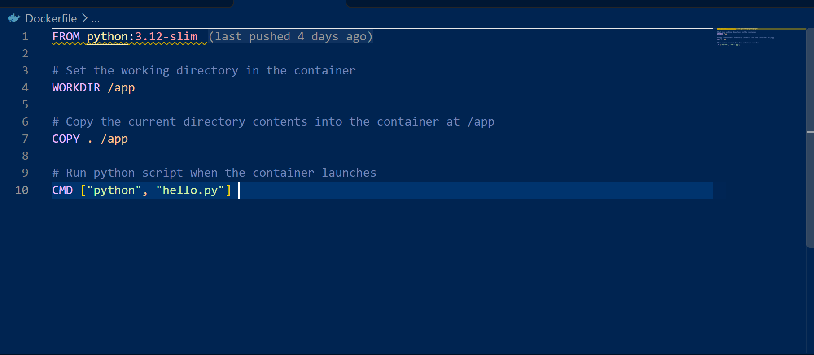

## 3. Build and Test Locally

Built the Docker image using:

```bash
docker build -t hello-python:v1 .
```

The initial build failed because Docker could not retrieve the base image due to a credentials error.

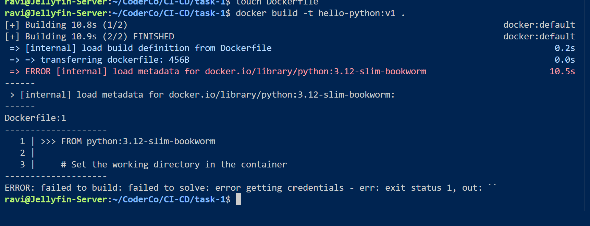

Resolved the issue by authenticating with Docker Hub:

```bash
docker login
```

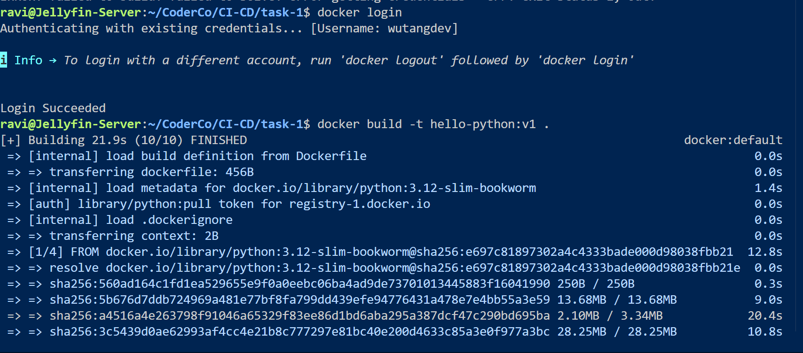

After authenticating, the image built successfully.

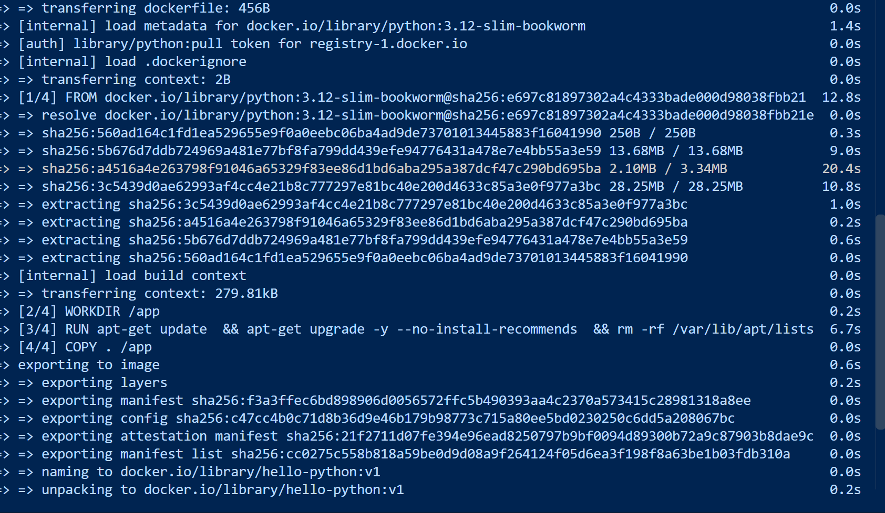

Tested the application inside the container:

```bash
docker run hello-python:v1
```

**Output:** `Hello, World!`

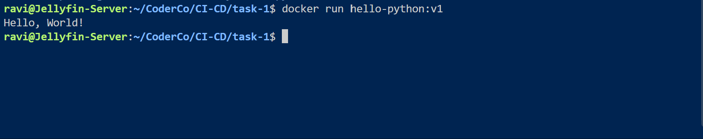

Verified the locally built image:

```bash
docker images hello-python:v1
```

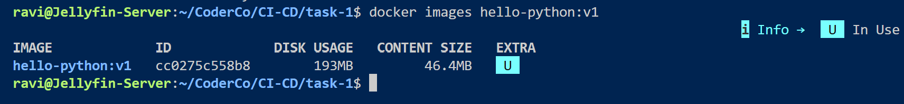

## 4. Configure GitHub Actions

Created `.github/workflows/docker-build.yml` at the repository root.

The workflow uses:

- `on: push` — triggers on matching repository changes.
- `paths` — limits execution to Task 1 files and the workflow itself.
- `runs-on: ubuntu-latest` — provisions a GitHub-hosted runner.
- `actions/checkout@v4` — downloads the repository.
- Docker Buildx — prepares the image build environment.

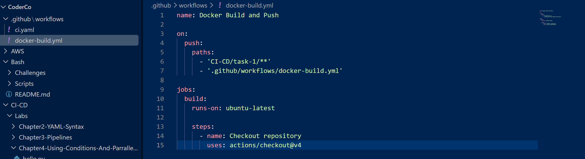

## 5. Configure Docker Hub Authentication

Generated a Docker Hub personal access token and configured two GitHub Actions repository secrets:

- `DOCKER_USERNAME` — Docker Hub username.
- `DOCKERHUB_TOKEN` — Docker Hub access token.

These allow the workflow to authenticate without hardcoding credentials in the repository.

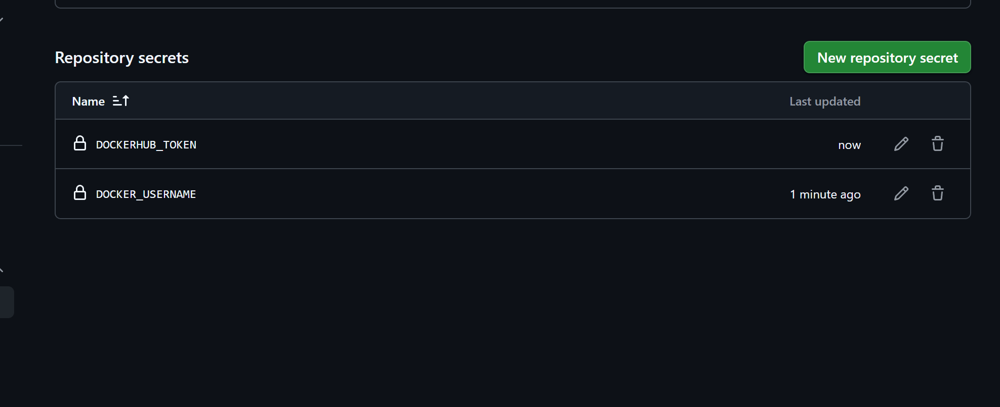

## 6. Automate the Docker Build and Push

Configured the workflow to perform four main operations:

| Step | Purpose |
|---|---|
| Checkout | Download repository source code |
| Docker Buildx | Prepare the Docker build environment |
| Docker Hub login | Authenticate using GitHub secrets |
| Build and push | Build and publish the Docker image |

The build context points to `./CI-CD/task-1`, where the Dockerfile and Python application are located.

The resulting image is published as `wutangdev/hello-python:latest`.

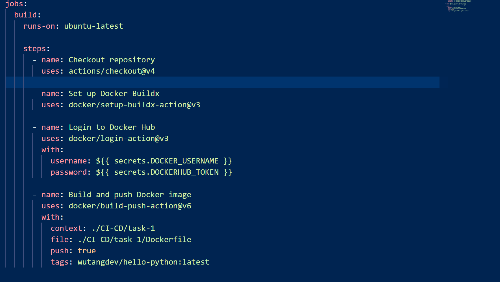

Committed and pushed the workflow and application files to GitHub, triggering the automated pipeline.

## 7. Verify the CI/CD Pipeline

Confirmed that GitHub Actions successfully completed the build-and-push job.

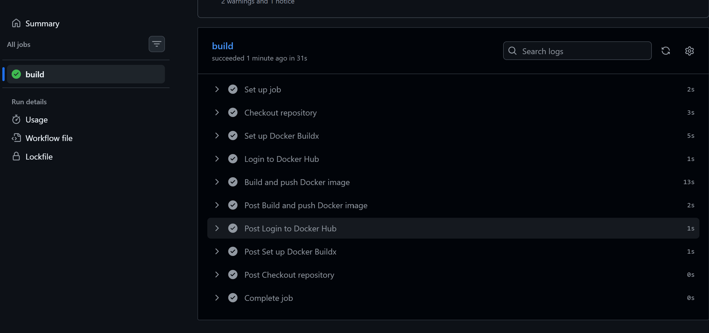

Checked Docker Hub and verified that the image was published with the `latest` tag.

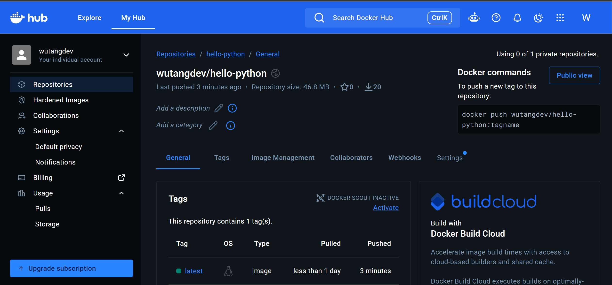

Finally, pulled the published image and executed the container:

```bash
docker pull wutangdev/hello-python:latest
docker run --rm wutangdev/hello-python:latest
```

**Output:**

```text
Hello, World!
```


## Challenges and Troubleshooting

**Docker authentication:** The initial local build failed while retrieving the Python base image. Authenticating with `docker login` resolved the issue.

**Workflow configuration:** Ensured the workflow was located in the repository's root `.github/workflows/` directory and used the correct Docker build context.

**Secure authentication:** Used GitHub Actions secrets instead of storing Docker Hub credentials directly in YAML.

## Conclusion

Successfully implemented an automated CI/CD workflow that builds and publishes a Docker image to Docker Hub when relevant changes are pushed to GitHub.

The published image was independently verified by pulling it from Docker Hub and running the container locally.

**Key learning:** Gained practical experience with GitHub Actions, Docker image automation, repository secrets, build contexts, and troubleshooting CI/CD workflows.

This project demonstrates the foundation of an automated container delivery pipeline that can be extended with testing, security scanning, and deployment stages.