# Task 2 – Automated Terraform Validation with GitHub Actions

## 1. Project Overview

In this assignment, I created a GitHub Actions CI pipeline to automatically check Terraform code for formatting errors and validate its configuration.

I reused and simplified the AWS EC2 Terraform configuration from my previous Terraform assignment.

The objective was to demonstrate how CI pipelines can detect infrastructure code issues before changes are merged.

### Technologies Used
- Terraform – Infrastructure as Code (IaC)
- AWS EC2 – Example infrastructure configuration
- GitHub Actions – CI automation
- Git and GitHub – Version control

## 2. Terraform Configuration

I created a Terraform configuration defining an AWS EC2 instance, variables, provider configuration and outputs.

**Main Terraform configuration:**

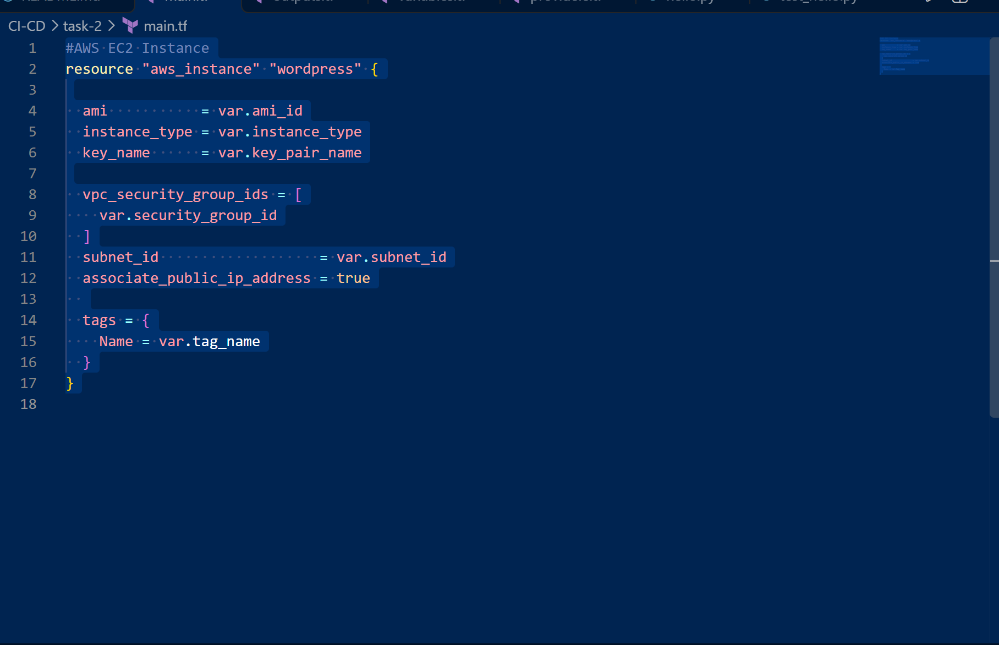

**Outputs:**

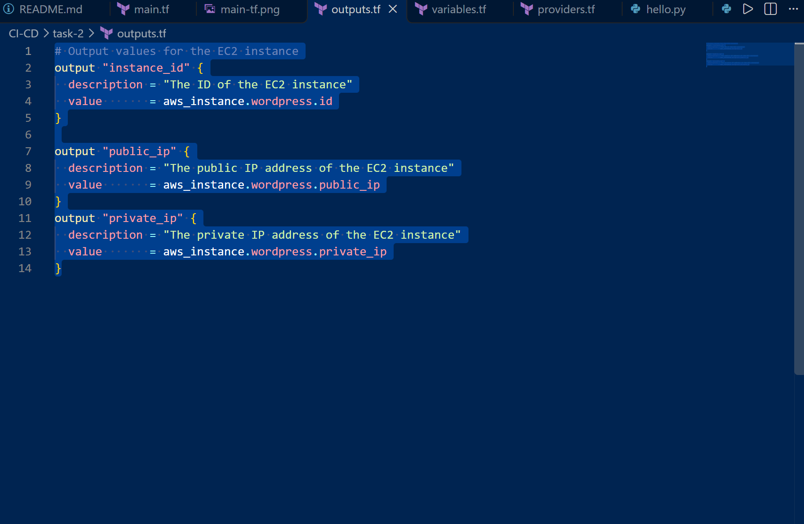

**Provider configuration:**

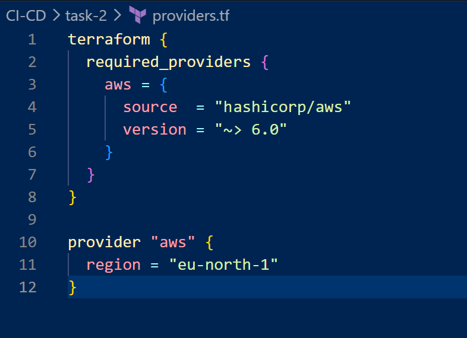

**Variables:**

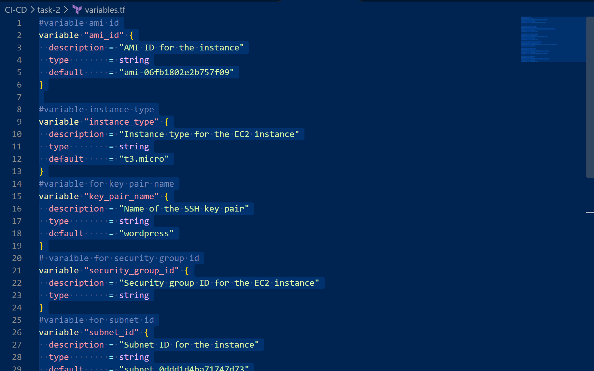

## 3. Local Terraform Testing

Before creating the CI pipeline, I tested the configuration locally using:

```bash
terraform init
terraform validate
```

Terraform initialised successfully and confirmed the configuration was valid.

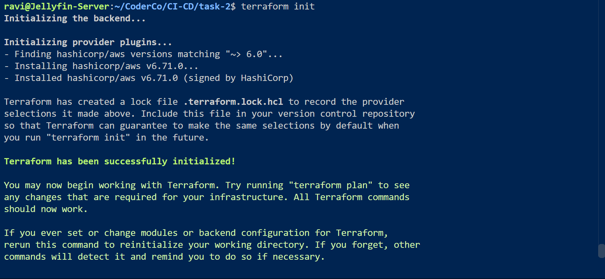

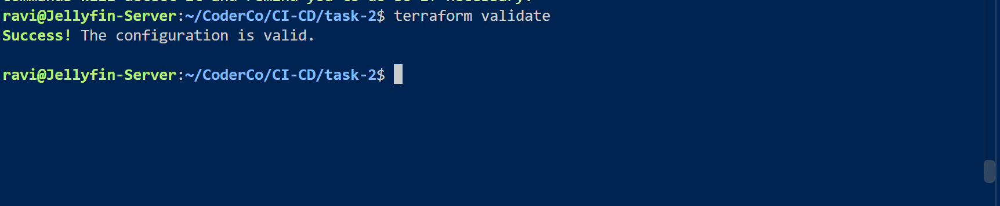

## 4. GitHub Actions Workflow

I created `.github/workflows/terraform-check.yml` to automate Terraform checks whenever changes are pushed or pull requests are opened for Task 2.

The workflow performs the following steps:

| Step | Purpose |
|---|---|
| Checkout | Downloads the CoderCo repository |
| Setup Terraform | Installs Terraform on the GitHub runner |
| Formatting | Runs `terraform fmt -check -diff` to detect formatting errors |
| Initialise | Downloads and initialises the required provider |
| Validate | Runs `terraform validate` to check configuration validity |

**GitHub Actions workflow:**

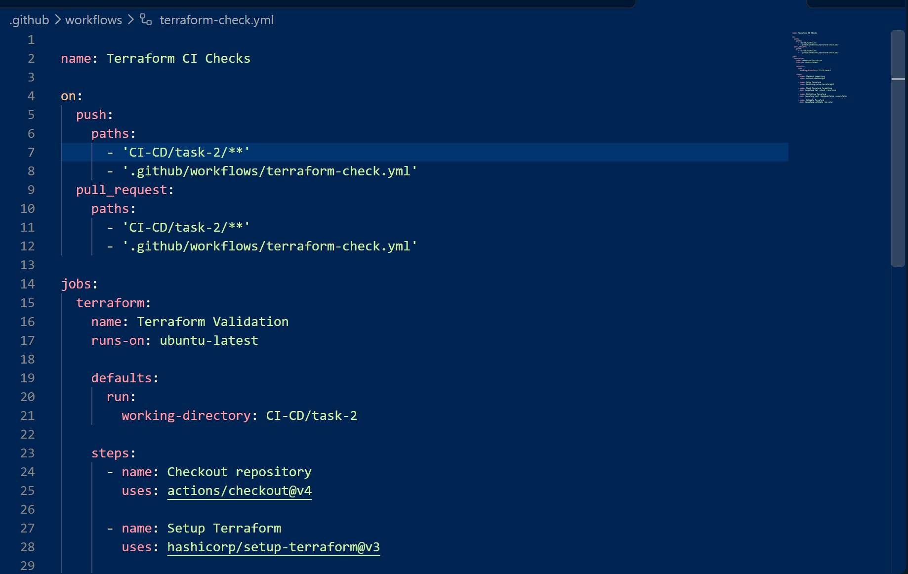

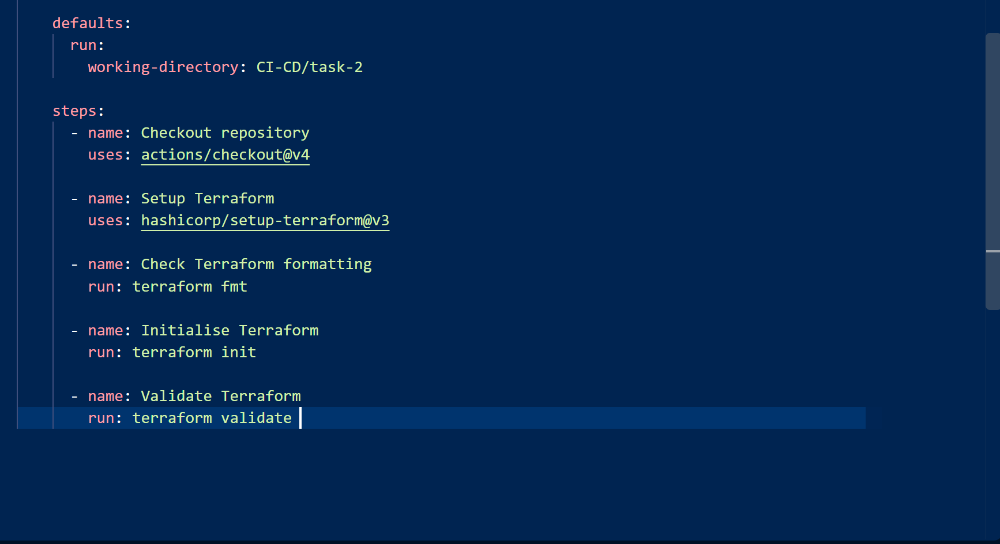

## 5. Testing Pipeline Failure

To test the pipeline, I deliberately introduced a formatting error in `main.tf`.

I changed:

```hcl
instance_type = var.instance_type
```

To:

```hcl
instance_type=var.instance_type
```

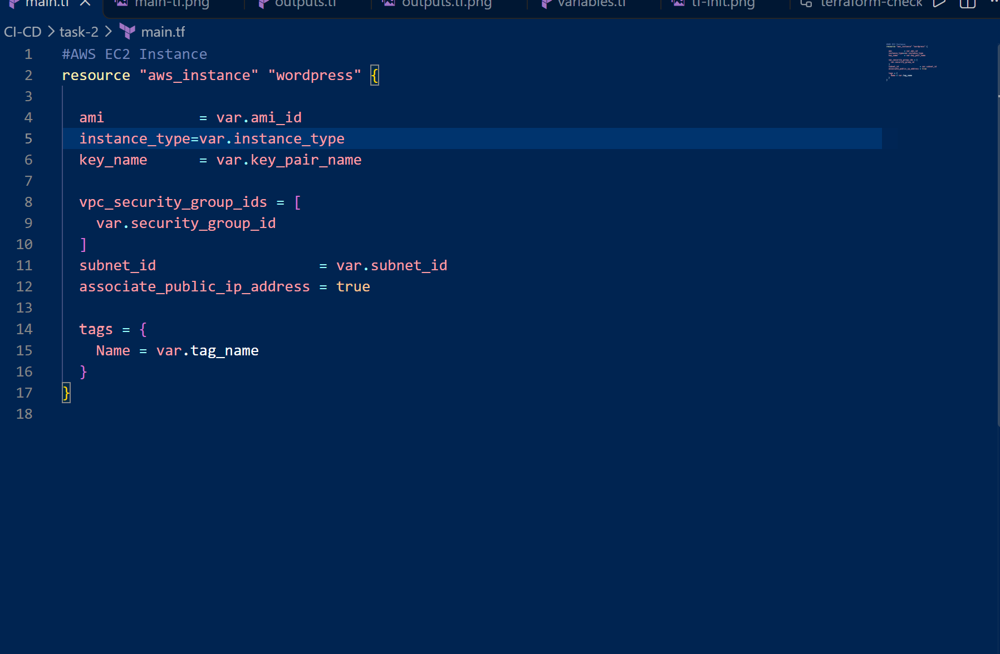

After pushing the change to GitHub, the pipeline failed at the formatting check, as expected.

GitHub Actions identified the incorrectly formatted line and displayed the required correction.

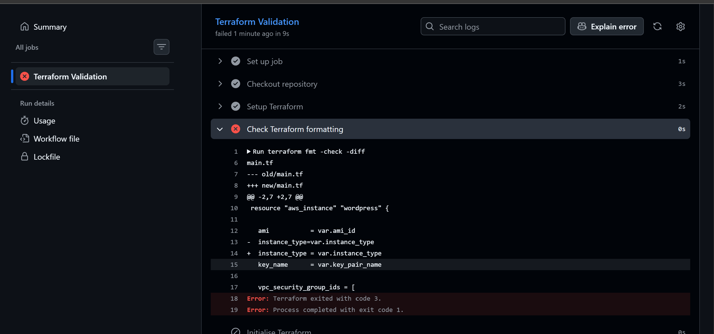

## 6. Fixing the Error

I corrected the formatting locally using:

```bash
terraform fmt
```

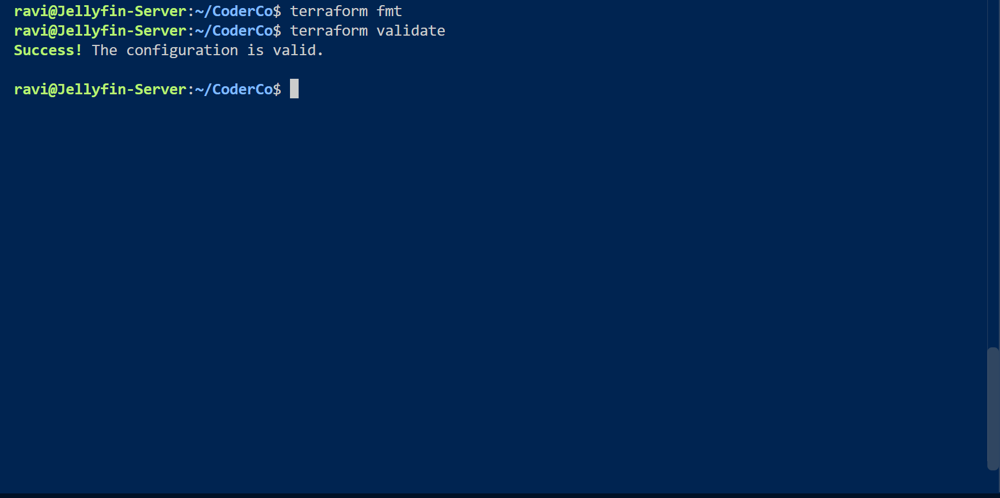

I then committed and pushed the corrected configuration to GitHub.

The pipeline ran again and successfully completed all checks, including Terraform formatting, initialisation and validation.

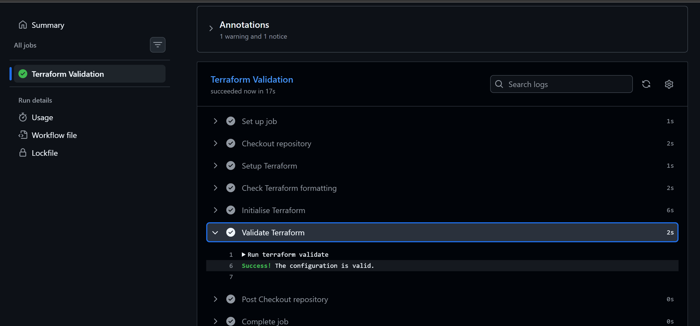

## 7. Conclusion

This assignment demonstrated how GitHub Actions can automatically validate Terraform code and detect formatting issues.

By deliberately introducing an error, observing the pipeline fail and correcting the issue, I gained practical experience troubleshooting CI workflows.

**Final result:** A working GitHub Actions pipeline that automatically checks Terraform formatting and configuration validity on relevant pushes and pull requests, without deploying AWS infrastructure.