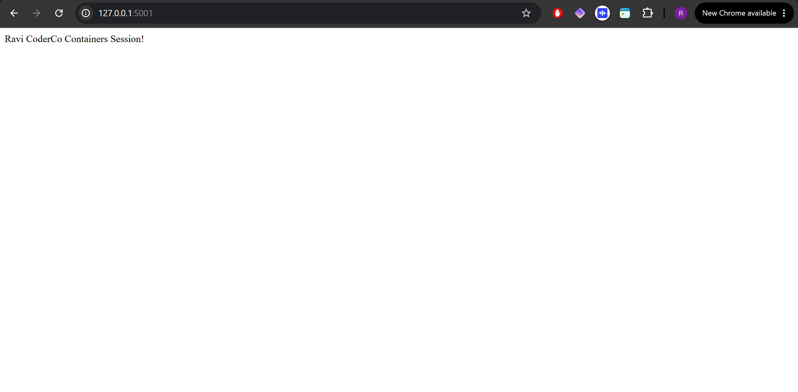

# CoderCo Containers Challenge

## Building a Multi-Container Application with Docker Compose

### Overview

As part of the CoderCo Docker module, I completed a practical challenge to build and deploy a multi-container application using Python Flask, Redis and Docker Compose.

The aim was to understand how multiple containers communicate over a Docker network and how Docker Compose simplifies the management of services.

## Objectives

- Build a Python Flask web application.
- Use Redis as a key-value database to store a visitor count.
- Create separate Dockerfiles for Flask and Redis.
- Connect both containers using Docker Compose.
- Test communication between the Flask application and Redis.

## Application Requirements

**Flask Web Application**

The application contains two routes:

- `/` — Displays a welcome message.
- `/count` — Increments and displays a visitor count stored in Redis.

**Redis Database**

Redis acts as a key-value store, maintaining the visitor count as users access the `/count` endpoint.

**Docker and Docker Compose**

Both services are containerised using separate Dockerfiles. Docker Compose builds and starts the services and connects them through a shared network.

## Project Structure

```text
Challenge/
├── Flask/
│   ├── app.py
│   ├── Dockerfile
│   └── .dockerignore
├── Redis/
│   └── Dockerfile
├── docker-compose.yml
└── README.md
```

## Application Architecture

```text
Browser
   |
   | HTTP Port 5001
   v
Flask Container
   |
   | Redis Protocol / TCP 6379
   v
Redis Container
   |
   v
Visitor Count Stored in Redis
```

Docker Compose provides a shared network, allowing Flask to communicate with Redis using the Redis service name rather than a hardcoded IP address.

## Testing the Application

**1. Build and start the containers**

From the `Challenge` directory:

```bash
sudo docker compose up -d --build
```

**2. Verify container status**

```bash
sudo docker compose ps
```

**3. Test the welcome page**

Open:

`http://localhost:5001`

Expected output:

```text
Ravi CoderCo Containers Session!
```

**4. Test the visitor counter**

Open:

`http://localhost:5001/count`

Refresh the page to increment the counter.

Example output:

```text
Count: 1
Count: 2
Count: 3
```

**5. Troubleshoot container issues**

```bash
sudo docker compose logs web
```

This command displays the Flask container logs and helps identify application errors.

## Screenshots & Testing

### 1. Docker Compose Deployment

Both the Flask and Redis containers were successfully deployed using Docker Compose.

The `docker compose ps` command confirmed that both services were running, with Flask accessible on port 5001 and Redis listening internally on port 6379.


### 2. Redis Visitor Counter

Navigating to `http://localhost:5001/count` confirmed that Flask was communicating with Redis.

Each time the page was refreshed, the visitor count increased, demonstrating that Redis was successfully storing and updating the counter.


### 3. Flask Welcome Page

Navigating to `http://localhost:5001` displayed the welcome message returned by the Flask application.



## What I Learnt

- How to create Dockerfiles for different application services.
- How to build and run a multi-container application using Docker Compose.
- How Docker Compose creates a network that allows containers to communicate using service names.
- How Flask can connect to Redis using the Python Redis client.
- How to use Redis to store and increment a visitor counter.
- How to troubleshoot container startup failures using Docker logs.
- The importance of rebuilding container images after making application changes.


## Conclusion

This challenge helped me understand how containerised services communicate and work together as a single application.

Rather than running Flask and Redis independently, I used Docker Compose to build, network and manage both services.

The completed application successfully displayed a welcome page and maintained an incrementing visitor count using Redis.