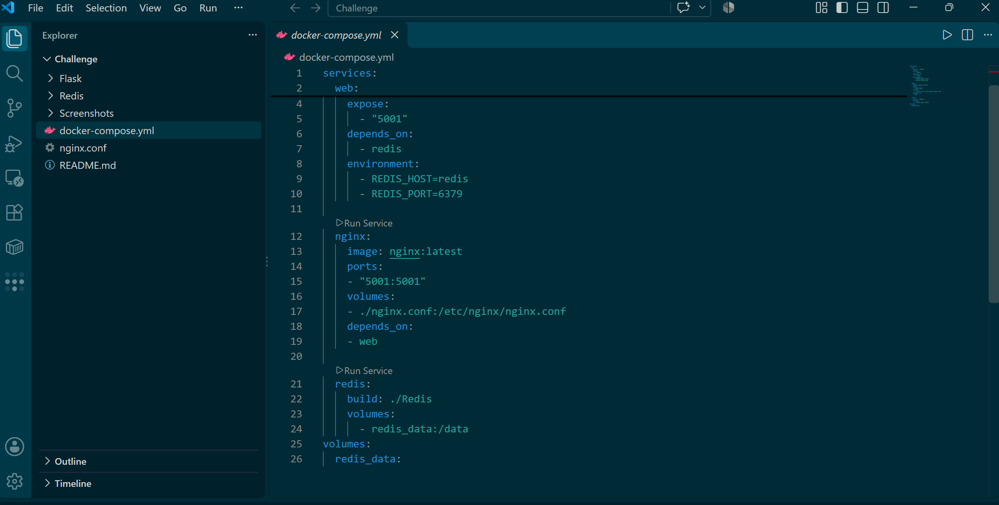
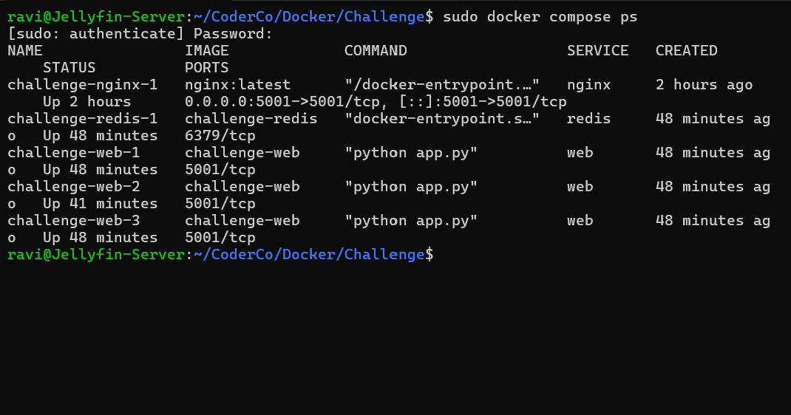
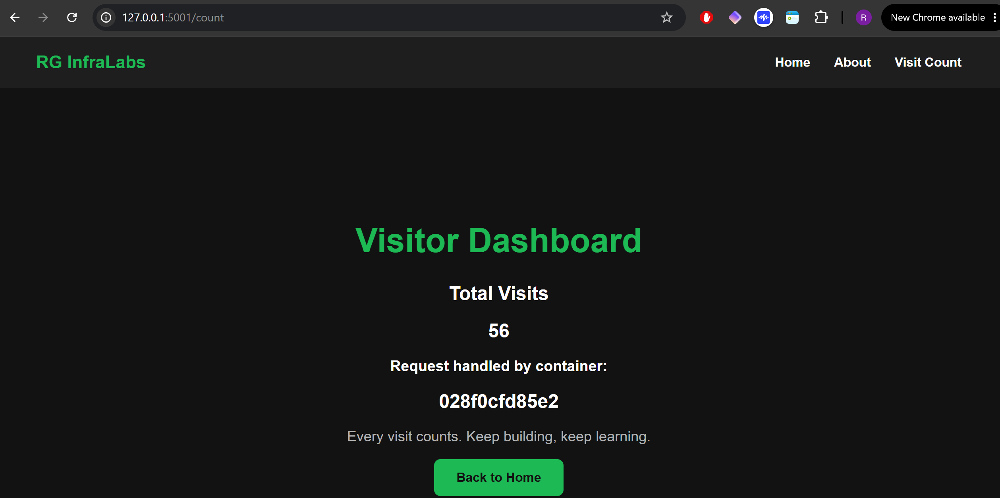
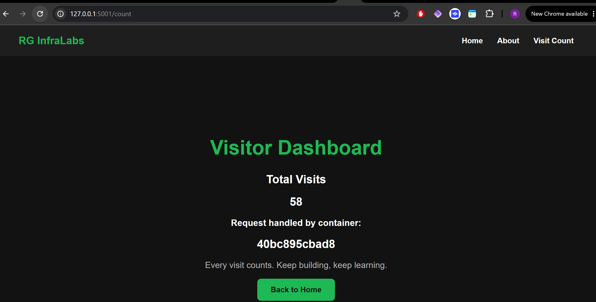

# CoderCo Containers Challenge

## Building a Multi-Container Application with Docker Compose, NGINX and Redis

### Overview

As part of the CoderCo Docker module, I built and expanded a multi-container web application using Python Flask, Redis, NGINX and Docker Compose.

The project started with a Flask application connected to a Redis database. I then introduced NGINX as a reverse proxy and load balancer, scaled the Flask application to three containers and implemented persistent storage for Redis.

The aim was to develop a practical understanding of containerisation, Docker networking, service scaling, load balancing and data persistence.

## Objectives

- Build and containerise a Python Flask web application.
- Use Redis to store and increment a visitor counter.
- Create separate Dockerfiles for Flask and Redis.
- Connect application services using Docker Compose.
- Configure NGINX as a reverse proxy and load balancer.
- Scale the Flask application to three containers.
- Implement persistent Redis storage using a Docker volume.
- Verify that requests are distributed across multiple Flask containers.

## Technologies Used

| Technology | Purpose |
|---|---|
| Python Flask | Web application and visitor dashboard |
| Redis | Stores the visitor counter |
| Docker | Containerises the application services |
| Docker Compose | Builds and manages the multi-container application |
| NGINX | Reverse proxy and load balancer |
| HTML/CSS | Frontend interface and styling |
| Ubuntu WSL2 | Development environment |

## Project Structure

```text
Challenge/
├── Flask/
│   ├── static/
│   │   ├── css/
│   │   │   └── style.css
│   │   └── images/
│   │       └── rg-logo.png
│   ├── templates/
│   │   ├── about.html
│   │   ├── base.html
│   │   ├── count.html
│   │   └── index.html
│   ├── .dockerignore
│   ├── app.py
│   └── Dockerfile
├── Redis/
│   └── Dockerfile
├── Screenshots/
│   ├── 1-docker-compose .png
│   ├── 2-localhost-count .png
│   ├── 3-localhost.png
│   ├── 4-nginx-compose.png
│   ├── 5-three-flask-containers.png
│   ├── 6-load-balancing-1.png
│   └── 7-load-balancing-2.png
├── docker-compose.yml
├── nginx.conf
└── README.md
```

## Application Architecture

```text
                 Browser
                    |
              HTTP Port 5001
                    |
                    v
             NGINX Container
          Reverse Proxy / LB
                    |
         +----------+----------+
         |          |          |
         v          v          v
      Flask 1    Flask 2    Flask 3
         |          |          |
         +----------+----------+
                    |
              Docker Network
                    |
                    v
              Redis Container
                    |
                    v
             Persistent Volume
                redis_data
```

NGINX receives incoming HTTP requests and forwards them to the Flask application containers.

Docker Compose provides a shared network that allows the Flask containers to communicate with Redis using its service name rather than a hardcoded IP address.

All three Flask containers use the same Redis database, maintaining a shared visitor counter.

## Implementation

### 1. Flask and Redis Containers

I initially created a Flask application with two endpoints:

- `/` — Displays the application welcome page.
- `/count` — Increments and displays the visitor count stored in Redis.

I created separate Dockerfiles for Flask and Redis, then used Docker Compose to build and connect the services.

The Flask application connects to Redis using the hostname `redis` and TCP port `6379`.

### 2. Building the Frontend

I expanded the Flask application with HTML templates and CSS styling.

The application now includes:

- Home page featuring the RG InfraLabs logo.
- About page explaining the project architecture.
- Visitor dashboard displaying the Redis counter.
- Navigation between the application pages.

Flask's Jinja2 templating system allows the application to render dynamic values, including the visitor count and the container handling the request.

### 3. Configuring NGINX

I introduced NGINX as a reverse proxy to provide a single entry point for the application.

The NGINX configuration is stored in `nginx.conf` and mounted into the NGINX container using Docker Compose.

NGINX listens on port `5001` and forwards requests to the Flask application service.

This separates external HTTP access from the individual Flask containers.

### 4. Scaling Flask Containers

I used Docker Compose to scale the Flask application to three containers:

```bash
sudo docker compose up -d --scale web=3
```

Docker Compose created three Flask replicas:

```text
challenge-web-1
challenge-web-2
challenge-web-3
```

Each replica runs the same Flask application and communicates with the shared Redis service.

### 5. Implementing Redis Persistence

I configured a named Docker volume to provide persistent storage for Redis:

```yaml
redis:
  build: ./Redis
  volumes:
    - redis_data:/data

volumes:
  redis_data:
```

This allows Redis data to be stored outside the container's writable layer.

The named volume remains available when the Redis container is removed or recreated, provided the volume itself is not deleted.

### 6. Verifying Load Balancing

To identify which Flask container handled each request, I updated the application to retrieve its container hostname using Python's `socket` module.

```python
container_id = socket.gethostname()
```

The Flask application passes this value to the visitor dashboard using `render_template()`.

By refreshing `/count`, I observed different container IDs while the visitor counter continued increasing.

This demonstrated that requests were reaching different Flask replicas through NGINX while sharing the same Redis database.

## Deployment

From the `Challenge` directory, build and start the application:

```bash
sudo docker compose up -d --build --scale web=3
```

Verify the running services:

```bash
sudo docker compose ps
```

The deployment consists of five containers:

- One NGINX container.
- Three Flask application containers.
- One Redis container.

Access the application through:

```text
http://localhost:5001
```

Visitor dashboard:

```text
http://localhost:5001/count
```

## Screenshots and Results

### 1. Initial Docker Compose Deployment

The initial deployment demonstrated communication between Flask and Redis using Docker Compose.


### 2. Redis Visitor Counter

The visitor count increased when the `/count` endpoint was accessed, confirming communication between Flask and Redis.


### 3. Flask Welcome Page

The original Flask application successfully served its welcome page.


### 4. Updated Docker Compose Configuration

I expanded the Compose configuration to include NGINX, Redis persistence and support for multiple Flask replicas.



### 5. Three Flask Containers Running

The `docker compose ps` output confirmed that all five containers were running successfully.



### 6. Load Balancing — First Container

The visitor dashboard displayed the ID of the Flask container handling the request.



### 7. Load Balancing — Different Container

After refreshing the page, a different Flask container ID appeared while the shared visitor counter continued increasing.



## What I Learnt

- How to build and manage a multi-container application using Docker Compose.
- How Docker service discovery allows containers to communicate using service names.
- How Flask communicates with Redis to maintain shared application state.
- How to configure NGINX as a reverse proxy and load balancer.
- How to scale an application horizontally using multiple Docker containers.
- How to use container hostnames to identify which replica handles a request.
- How Docker named volumes separate persistent data from container lifecycles.
- How to organise Flask applications using HTML templates and static assets.
- How to verify running services and troubleshoot deployments using Docker CLI commands.

## Conclusion

This challenge helped me move beyond running individual containers and understand how multiple services work together as an application stack.

Starting with Flask and Redis, I expanded the project by introducing NGINX, scaling the application to three Flask replicas and configuring persistent storage.

The project strengthened my understanding of Docker networking, service discovery, load balancing, horizontal scaling and data persistence.

It also provided practical experience with infrastructure concepts that are important in DevOps and cloud engineering.