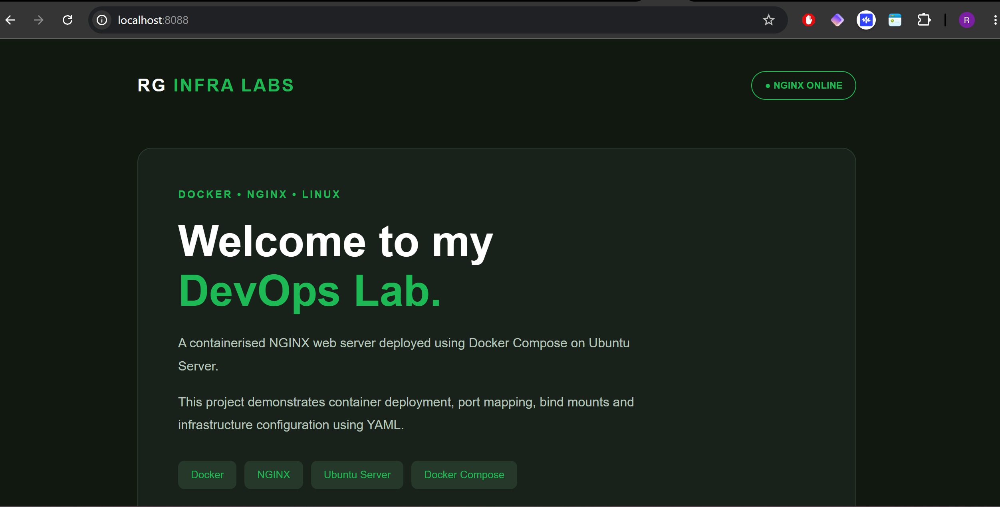
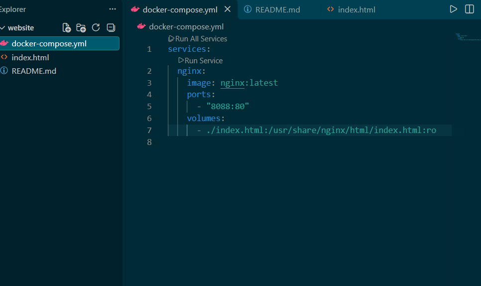
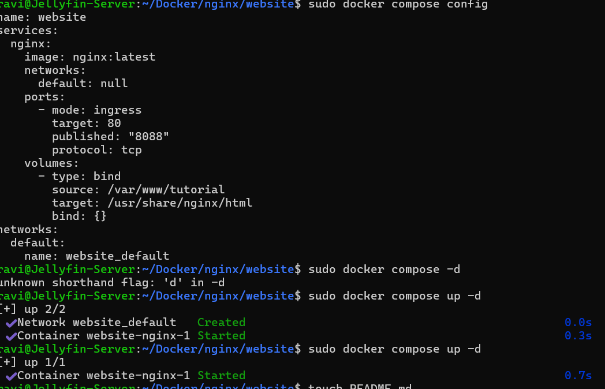

# NGINX Web Server Using Docker Compose

## Overview

As part of my CoderCo Docker learning, I deployed a custom NGINX web server using both Docker CLI commands and Docker Compose.

The objective was to understand container deployment, port mapping, bind mounts, YAML configuration and how Docker Compose simplifies container management.

## Lab Environment

- **Operating System:** Ubuntu Server
- **Container Platform:** Docker Engine
- **Web Server:** NGINX
- **Orchestration Tool:** Docker Compose
- **Editor:** Visual Studio Code
- **Host Port:** 8088
- **Container Port:** 80

## Project Structure

```text
nginx-compose-lab/
├── docker-compose.yml
├── index.html
└── README.md
```

## Part 1 — Deploying NGINX Using Docker CLI

I initially deployed the official NGINX image using the Docker CLI.

```bash
sudo docker run -d \
  -p 8088:80 \
  --name nginx-container-1 \
  -v /var/www/tutorial:/usr/share/nginx/html \
  nginx
```

This command:

- Runs NGINX in detached mode.
- Maps host port 8088 to container port 80.
- Assigns a name to the container.
- Uses a bind mount to serve HTML files from the Ubuntu host.

I verified the deployment by accessing `http://localhost:8088`.

## Part 2 — Deploying NGINX Using Docker Compose

I then created a `docker-compose.yml` file to manage the deployment declaratively.

```yaml
services:
  nginx:
    image: nginx:latest
    ports:
      - "8088:80"
    volumes:
      - ./index.html:/usr/share/nginx/html/index.html:ro
```

The configuration uses a relative bind mount, allowing the HTML file to be stored alongside the Compose file.

The `:ro` option makes the mounted file read-only inside the container.

### Validate the configuration

```bash
sudo docker compose config
```

### Start the service

```bash
sudo docker compose up -d
```

### Check running containers

```bash
sudo docker compose ps
```

### Stop and remove the Compose deployment

```bash
sudo docker compose down
```

## Troubleshooting

### Missing Docker image argument

During the initial deployment, I received an error because I forgot to specify the NGINX image at the end of the `docker run` command.

I corrected the command by adding `nginx`.

### Container name conflict

I encountered a conflict when attempting to reuse an existing container name.

I resolved this by assigning a different name to the new container.

### Incorrect Docker Compose command

I initially attempted to use `docker compose -d`, which returned an error.

I corrected the syntax to:

```bash
sudo docker compose up -d
```

## Screenshots

### 1. Custom NGINX Landing Page

The custom HTML/CSS landing page using RG Infra Labs branding, served by NGINX through Docker Compose on port 8088.



### 2. Docker Compose Configuration

The Docker Compose YAML configuration defining the NGINX service, port mapping and bind mount.



### 3. Docker Compose Deployment

Terminal output showing the configuration validation and successful deployment of the NGINX container.




## What I Learnt

- The difference between Docker images and containers.
- How Docker port mapping works.
- How bind mounts connect host files to containers.
- The difference between absolute and relative paths.
- How to create and validate Docker Compose YAML files.
- How Docker Compose manages services and creates networks.
- How configuration changes can trigger container recreation.
- Why changes to bind-mounted HTML files do not require rebuilding the image.

## Outcome

Successfully deployed a custom NGINX website using Docker Compose and verified that the website was accessible through `localhost:8088`.

The project can be redeployed on another Docker host without requiring the original `/var/www/tutorial` directory.