# Deploying WordPress on AWS Using Terraform

## Project Overview

This project is part of the CoderCo DevOps Bootcamp Terraform module.

The objective was to deploy a WordPress website on AWS using Terraform for infrastructure provisioning and a Bash script executed through EC2 user data for application configuration.

Rather than manually installing the application after provisioning the server, I wanted to automate the process so that a new EC2 instance could install Apache, MySQL, PHP and WordPress during its initial boot.

The project also provided an opportunity to practise Terraform fundamentals, AWS networking, Linux administration and troubleshooting.

## Architecture

The deployment consists of:

- **Terraform:** Provisions and manages AWS infrastructure
- **AWS EC2:** Hosts the WordPress application on Ubuntu Server
- **AWS Security Groups:** Control SSH, HTTP and outbound traffic
- **Apache:** Serves the WordPress website
- **PHP:** Runs the WordPress application
- **MySQL:** Stores WordPress application data locally on EC2
- **Bash and cloud-init:** Automate installation and configuration

**Traffic flow:**

```text
Internet
    |
    | HTTP (Port 80)
    v
AWS Security Group
    |
    v
EC2 Instance (Ubuntu)
    |
    +-- Apache Web Server
    |       |
    |       +-- PHP / WordPress
    |
    +-- MySQL Database (localhost)
```

This is a single-server lab deployment. The database and application run on the same EC2 instance to keep the architecture simple while learning Terraform.

## Prerequisites

- AWS account
- AWS CLI configured with appropriate permissions
- Terraform installed
- SSH key pair
- Linux terminal
- VS Code

## 1. Initialising the Terraform Project

I started by creating the Terraform configuration and AWS provider block in `main.tf`.

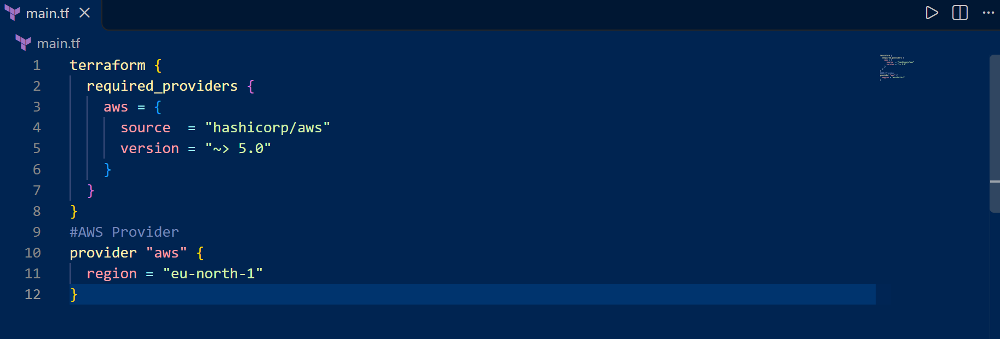

I formatted the HCL configuration:

```bash
terraform fmt
```

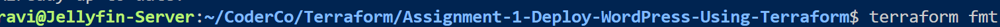

Next, I initialised the Terraform working directory:

```bash
terraform init
```

This downloads the required provider plugins and prepares the project.

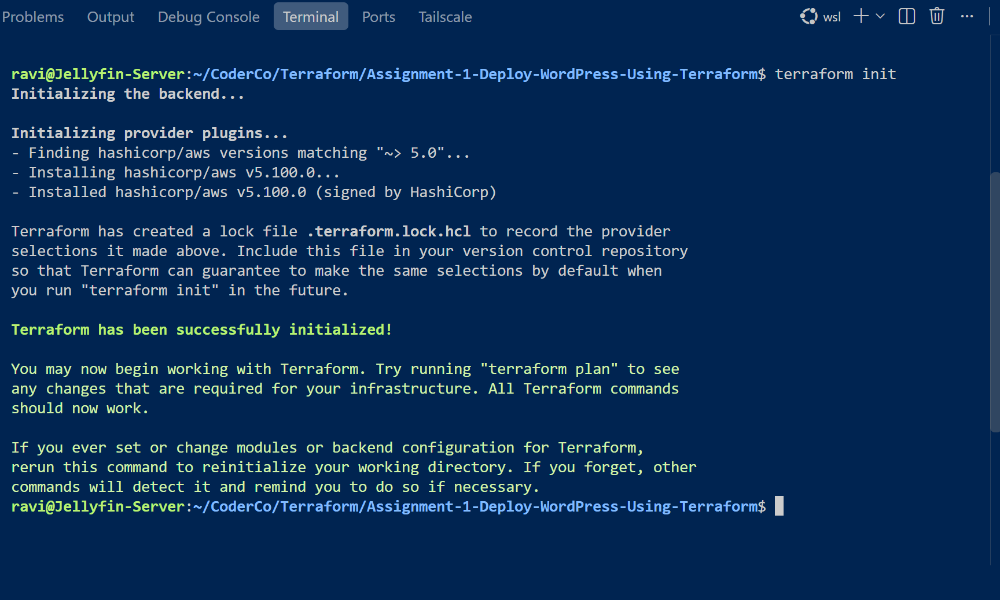

I then validated the configuration:

```bash
terraform validate
```

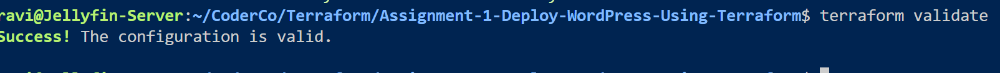

These commands became part of my regular workflow whenever I modified the infrastructure configuration.

## 2. Creating an AWS SSH Key Pair

The first AWS resource I configured was an EC2 key pair, allowing SSH authentication to the instance.

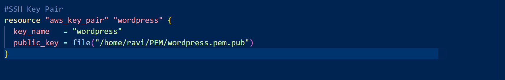

I ran `terraform fmt`, `terraform validate` and `terraform plan` to review the configuration before deployment.

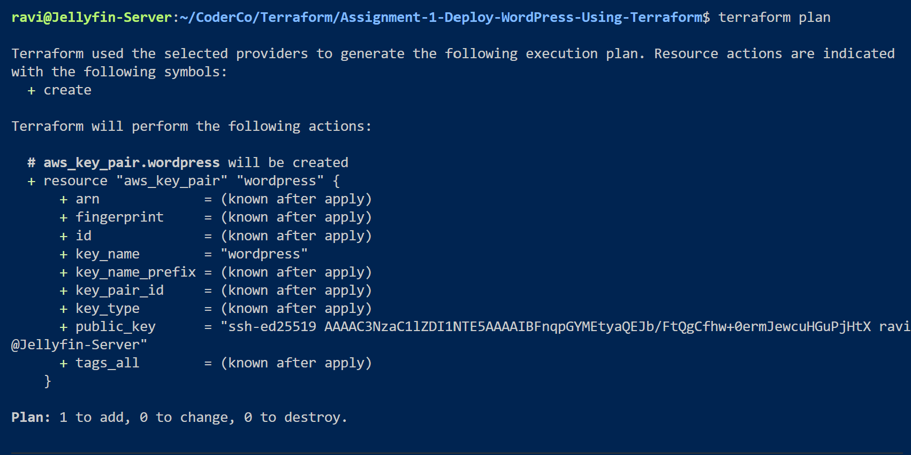

I also verified that the AWS CLI was configured to use the intended AWS account.

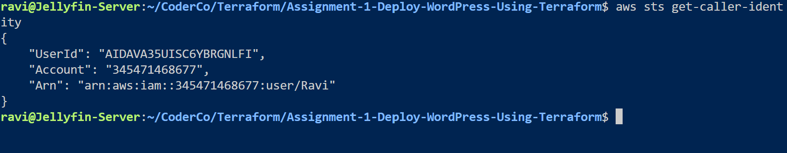

### Troubleshooting: Duplicate Key Pair

My first `terraform apply` failed with:

```text
Error: importing EC2 Key Pair (wordpress)

InvalidKeyPair.Duplicate:
The keypair already exists
```

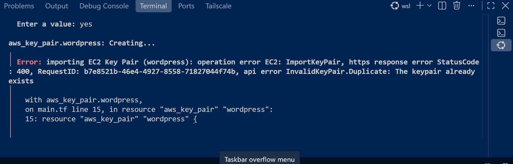

The error occurred because a key pair with the same name already existed in AWS, but Terraform was attempting to create a new one.

I investigated the existing key pair.

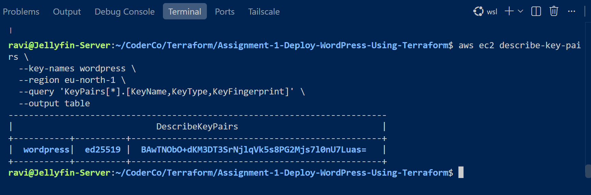

Because it was a disposable key pair created for this assignment, I deleted the existing AWS resource.

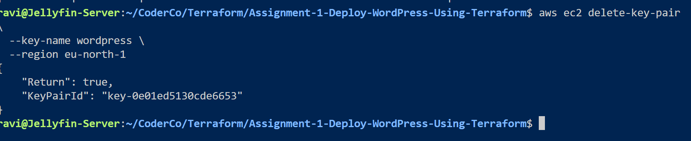

I verified that it had been removed.

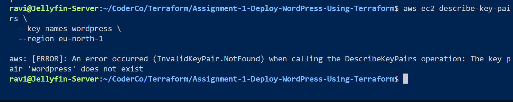

I then ran another Terraform plan to confirm the expected resource creation.

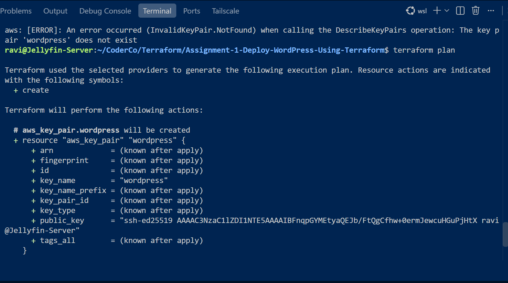

Finally, I ran:

```bash
terraform apply
```

The key pair was created successfully.

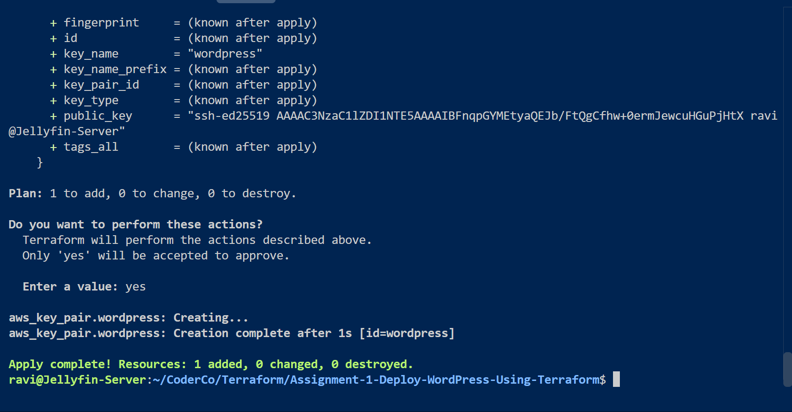

**Lesson learned:** Terraform state determines which resources Terraform manages. An existing AWS resource is not automatically recognised as part of the Terraform configuration. In other situations, importing the existing resource into Terraform state may be more appropriate than deleting it.

## 3. Configuring AWS Security Groups

Before deploying EC2, I checked my public IP address so I could restrict SSH access.

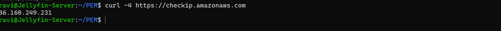

I created a security group allowing inbound SSH traffic on TCP port 22 from my public IP address only.

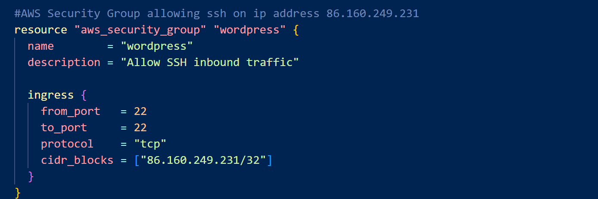

I then created another security group allowing inbound HTTP traffic on TCP port 80 and outbound traffic.

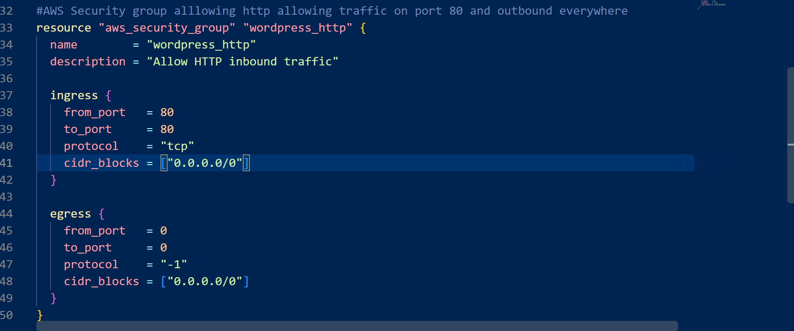

This configuration allows users to access the WordPress website while limiting administrative SSH access.

I validated the configuration.

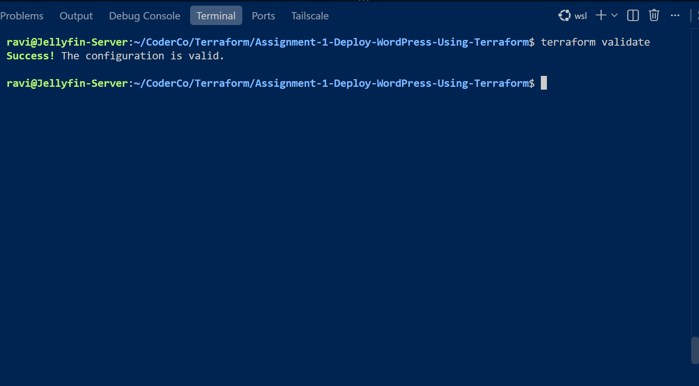

I reviewed the planned infrastructure changes.

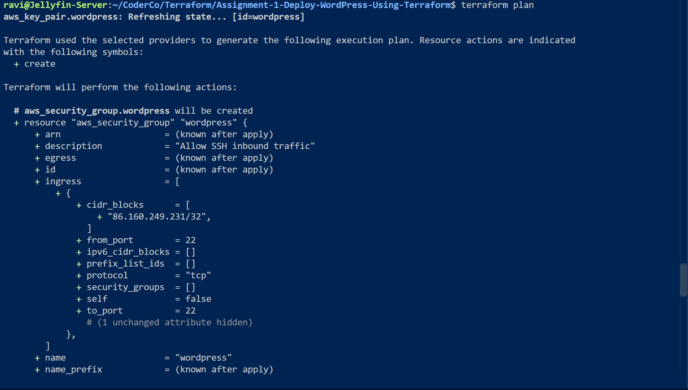

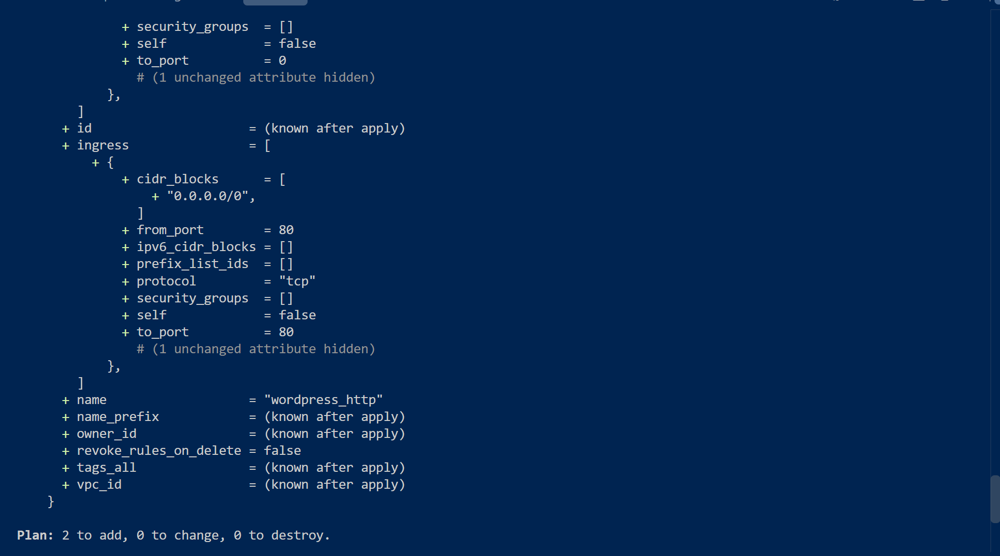

I then applied the changes.

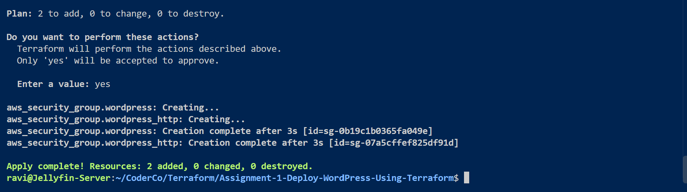

**Lesson learned:** Security groups operate as virtual firewalls for AWS resources. Only the required inbound ports should be exposed. MySQL remained accessible locally rather than being exposed publicly on port 3306.

## 4. Provisioning the EC2 Instance

Next, I created the Terraform configuration for the Ubuntu EC2 instance.

The configuration included:

- Ubuntu AMI
- `t3.micro` instance type
- SSH key pair
- SSH and HTTP security groups
- Public subnet
- Public IPv4 address assignment

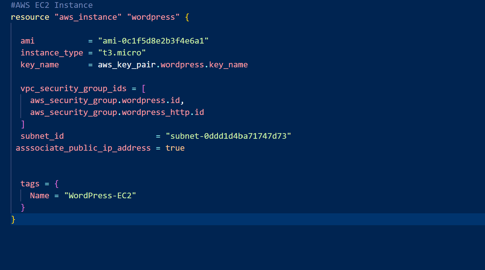

### Troubleshooting: Unsupported Argument

When I ran `terraform validate`, Terraform returned:

```text
Error: Unsupported argument

asssociate_public_ip_address = true

Did you mean "associate_public_ip_address"?
```

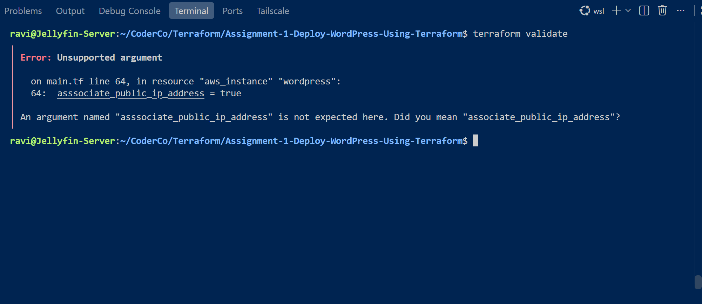

The problem was a spelling mistake in the argument name.

I corrected it to:

```hcl
associate_public_ip_address = true
```

After fixing the typo, validation passed.

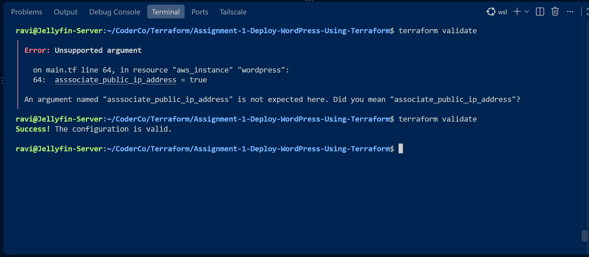

I reviewed the EC2 deployment plan.

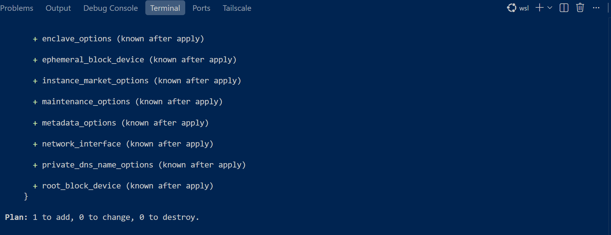

### Testing EC2 Connectivity

After provisioning the instance, I connected using SSH.

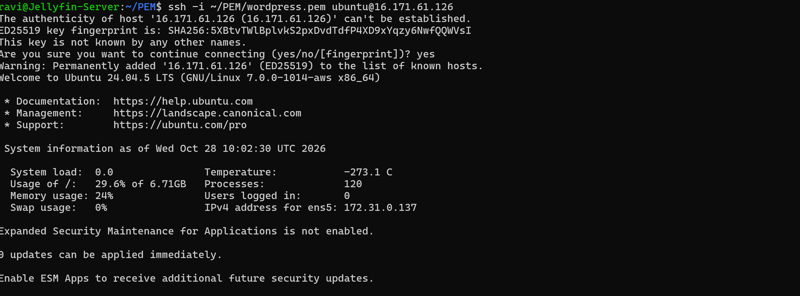

I verified internet connectivity by testing access to an external IP address.

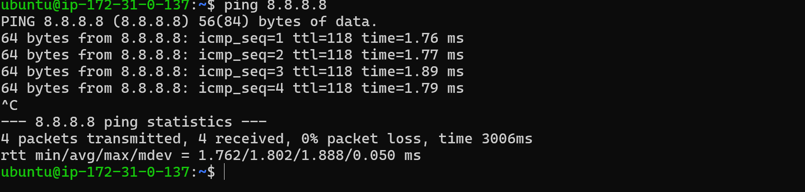

I also tested DNS resolution using `nslookup`.

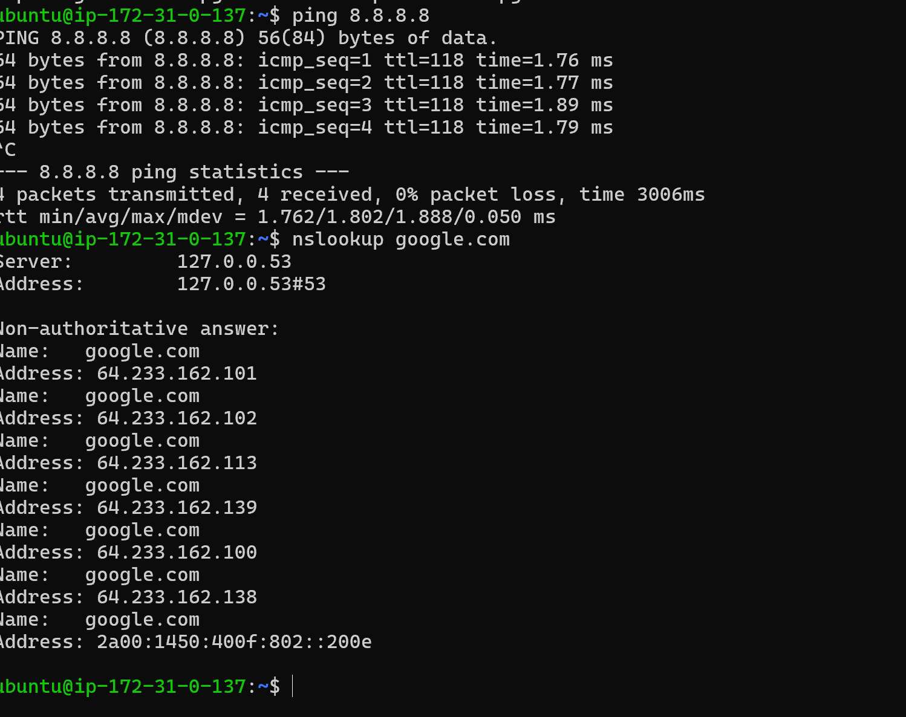

These tests helped confirm that the EC2 instance had working network connectivity before I moved on to application deployment.

## 5. Automating WordPress Installation with Bash

With the infrastructure working, I created an `install-wordpress.sh` script to configure the application automatically.

The script installs and configures a LAMP stack, creates a WordPress database, downloads WordPress and configures its connection to MySQL.

### Installation Script

```bash
#!/bin/bash
set -e

# 1. Update packages and install Apache, PHP and MySQL
export DEBIAN_FRONTEND=noninteractive

apt-get update -y

apt-get install -y \
  apache2 \
  mysql-server \
  php \
  libapache2-mod-php \
  php-mysql \
  php-curl \
  php-gd \
  php-mbstring \
  php-xml \
  php-zip \
  wget \
  tar

# 2. Start Apache and MySQL
systemctl enable --now apache2
systemctl enable --now mysql

# 3. Generate a password for the WordPress database
DB_PASSWORD=$(openssl rand -hex 16)

# 4. Create the WordPress database and user
mysql <<EOF
CREATE DATABASE wordpress_db;
CREATE USER 'wp_user'@'localhost' IDENTIFIED BY '${DB_PASSWORD}';
GRANT ALL PRIVILEGES ON wordpress_db.* TO 'wp_user'@'localhost';
EOF

# 5. Download and extract WordPress
cd /tmp

wget -q https://wordpress.org/latest.tar.gz
tar -xzf latest.tar.gz

# 6. Remove the default Apache homepage
rm -f /var/www/html/index.html

# 7. Copy WordPress into Apache's website directory
cp -r wordpress/. /var/www/html/

# 8. Configure WordPress database connection
cd /var/www/html

cp wp-config-sample.php wp-config.php

sed -i "s/database_name_here/wordpress_db/" wp-config.php
sed -i "s/username_here/wp_user/" wp-config.php
sed -i "s/password_here/${DB_PASSWORD}/" wp-config.php

# 9. Set file ownership and permissions
chown -R www-data:www-data /var/www/html
find /var/www/html -type d -exec chmod 755 {} \;
find /var/www/html -type f -exec chmod 644 {} \;

# 10. Restart Apache
systemctl restart apache2
```

### How the Script Works

| Section | Purpose |
|---|---|
| 1 | Updates package lists and installs Apache, MySQL, PHP and required extensions |
| 2 | Enables and starts Apache and MySQL |
| 3 | Generates a random database password |
| 4 | Creates a dedicated WordPress database and user |
| 5 | Downloads and extracts WordPress |
| 6 | Removes the default Apache homepage |
| 7 | Copies WordPress into the Apache document root |
| 8 | Configures the WordPress database connection |
| 9 | Sets ownership and filesystem permissions |
| 10 | Restarts Apache |

The `set -e` command instructs Bash to exit when a command fails, subject to Bash's normal exception rules.

The database password is generated during deployment rather than being stored directly in the script.

For this lab, MySQL runs on the same EC2 instance as WordPress, and the database user is granted permissions only on the WordPress database.

## 6. Connecting the Bash Script to Terraform

I connected the installation script to the EC2 resource using the `user_data` argument.

```hcl
user_data = file("${path.module}/install-wordpress.sh")

user_data_replace_on_change = true
```

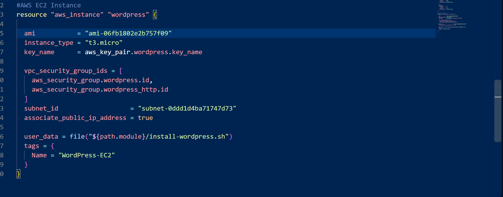

This allows AWS EC2 user data to pass the script to cloud-init, which executes it during the instance's initial boot.

The `user_data_replace_on_change` setting tells Terraform to replace the instance when the user-data configuration changes.

I validated the configuration and reviewed the Terraform plan.

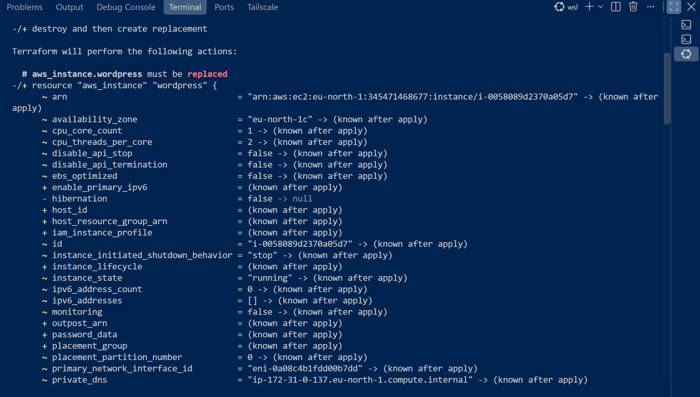

I then deployed the updated configuration.

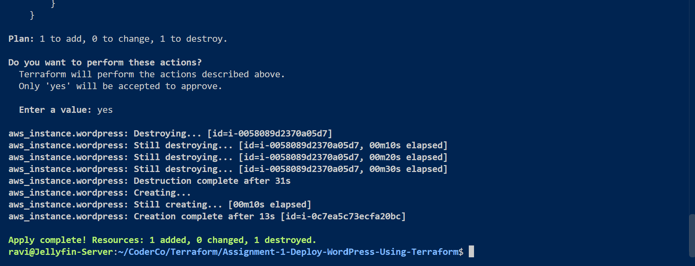

## 7. Troubleshooting the WordPress Deployment

Although Terraform successfully provisioned the EC2 instance, the WordPress website initially failed to load.

This demonstrated an important distinction: a successful Terraform apply does not necessarily mean that the application inside the EC2 instance has been configured successfully.

### Investigating Cloud-init

I connected to the instance and checked the cloud-init status:

```bash
sudo cloud-init status --long
```

The output showed:

```text
status: error

Failed to run module scripts_user
```

I also checked the Apache service:

```bash
sudo systemctl status apache2
```

Apache had not been installed successfully, indicating that the installation script had failed before reaching the application setup stage.

### Identifying the Cause

I inspected the user-data script stored on the EC2 instance:

```bash
sudo cat /var/lib/cloud/instance/scripts/part-001
```

I then examined the beginning of the file at byte level:

```bash
sudo head -c 40 /var/lib/cloud/instance/scripts/part-001 | od -An -tx1c
```

The output showed an unexpected newline character (`0a`) before the Bash shebang:

```text
0a 23 21 2f 62 69 6e 2f 62 61 73 68
```

This meant the file started with a blank line rather than:

```bash
#!/bin/bash
```

The shebang should be the first two bytes of an executable Bash script so the operating system can identify the correct interpreter.

### Resolving the Issue

I removed the leading blank line from `install-wordpress.sh` and verified that the file now began with the correct bytes.

I then ran Terraform again to replace the EC2 instance and execute the corrected script during initialisation.

The deployment completed successfully.

### Verifying Services

After connecting to the replacement EC2 instance, I checked Apache and MySQL:

```bash
sudo systemctl is-active apache2
sudo systemctl is-active mysql
```

Both returned:

```text
active
```

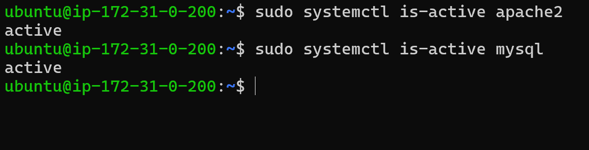

I also checked cloud-init:

```bash
sudo cloud-init status --long
```

The output showed:

```text
status: done
extended_status: done
errors: []
recoverable_errors: {}
```

This confirmed that cloud-init had completed without reporting errors.

Finally, I verified that the WordPress application files were present in Apache's document root.

```bash
ls -l /var/www/html/
```

The directory contained `index.php`, `wp-admin`, `wp-content`, `wp-includes` and `wp-config.php`.

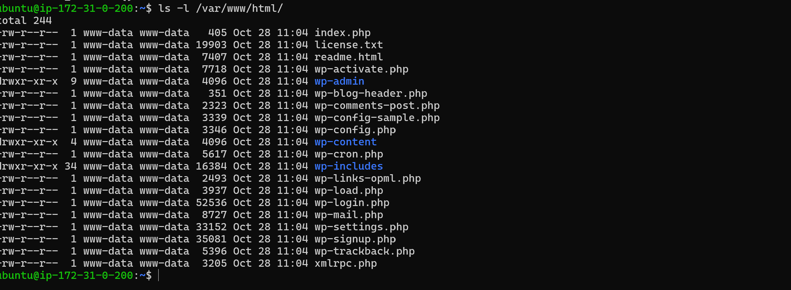

**Lesson learned:** When Terraform succeeds but the application fails, troubleshooting needs to continue inside the EC2 instance. Cloud-init logs, service status and file inspection are essential tools for identifying application provisioning failures.

## 8. Final Result

After resolving the script issue, I accessed the EC2 public IP address using HTTP.

The WordPress installation wizard loaded successfully.

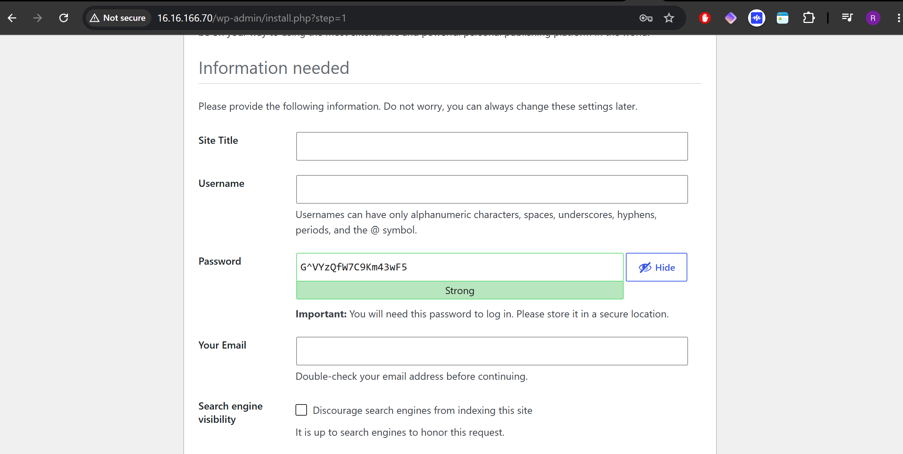

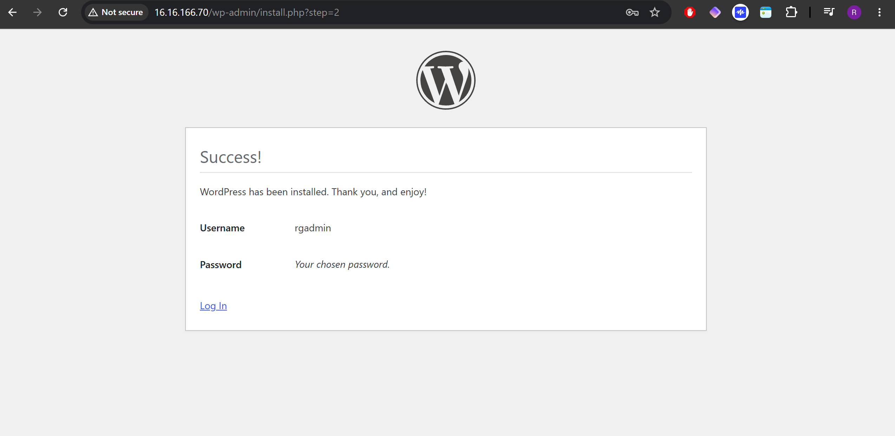

This verified that:

- Terraform had successfully provisioned the AWS infrastructure.
- The EC2 instance was publicly accessible on port 80.
- Apache and PHP were serving WordPress.
- MySQL was running locally.
- WordPress could progress to its installation setup page.
- Cloud-init had successfully executed the installation script.

## 9. Cleanup and Cost Management

Because this was a temporary learning environment, the infrastructure should be destroyed after testing and capturing evidence.

```bash
terraform destroy
```

After destruction, I should verify in AWS that the EC2 instance and other Terraform-managed resources have been removed.

Any separately created or retained resources, including Elastic IPs and EBS volumes, should also be checked to avoid unnecessary charges.

## 10. Key Learnings

This assignment strengthened my understanding of several important DevOps concepts.

**Infrastructure as Code:** I used Terraform to define and provision AWS resources rather than relying on manual console configuration.

**Terraform workflow:** I practised `terraform fmt`, `terraform init`, `terraform validate`, `terraform plan` and `terraform apply`.

**AWS networking:** I configured security groups, public IP addressing and network connectivity for an EC2 instance.

**Linux automation:** I used Bash to install and configure Apache, PHP, MySQL and WordPress.

**Cloud-init:** I learned how EC2 user data executes scripts during initialisation and how to investigate failures.

**Troubleshooting:** I resolved a duplicate AWS key pair, a Terraform argument typo and a Bash script formatting issue.

**Infrastructure versus application state:** Terraform can report a successful deployment even when the application installation fails, so both infrastructure and application validation are necessary.

## 11. Future Improvements

This deployment was intentionally kept simple for learning purposes.

Potential improvements include:

- Using HTTPS with a domain name and TLS certificate
- Moving MySQL to Amazon RDS
- Managing application secrets with AWS Secrets Manager or Systems Manager Parameter Store
- Tightening WordPress configuration file permissions
- Adding monitoring and automated backups
- Improving repeatability by pinning software versions and making the bootstrap script idempotent
- Using a load balancer and multiple instances for higher availability

## Conclusion

I successfully used Terraform to provision an AWS EC2 instance and automated the installation of WordPress using Bash and cloud-init.

The most valuable part of the assignment was troubleshooting the application deployment. Although Terraform completed successfully, WordPress initially failed because the user-data script did not execute correctly.

By investigating cloud-init status, checking system services and inspecting the script at byte level, I identified and corrected the issue.

The final deployment successfully loaded the WordPress installation wizard through the EC2 public IP address.

This project reinforced the importance of validating not only the infrastructure Terraform creates, but also the applications and services running on that infrastructure.
