# Assignment 2 — EC2 Deployment with Cloud-Init Using Terraform

## 1. Project Overview

In this assignment, I used Terraform to provision an AWS EC2 instance and Cloud-Init to automate the installation and configuration of an NGINX web server.

The objective was to deploy a Linux server that automatically installs NGINX, starts the service, and hosts a custom HTML webpage without requiring manual configuration after deployment.

I also created a custom webpage using my RG Infrastructure Labs green and black branding.

### Technologies Used

- **Terraform** — Infrastructure as Code (IaC)
- **AWS EC2** — Virtual machine hosting
- **AWS Security Groups** — Inbound and outbound network access
- **AWS Key Pairs** — SSH authentication
- **Ubuntu Linux** — EC2 operating system
- **Cloud-Init** — Automated instance configuration
- **NGINX** — Web server
- **HTML/CSS** — Custom webpage

## 2. Project Setup

I started by creating a new directory for Assignment 2 using the Linux terminal.

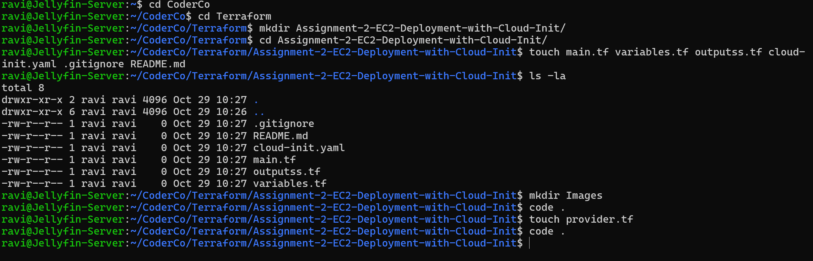

I then created a `provider.tf` file to configure the AWS provider.

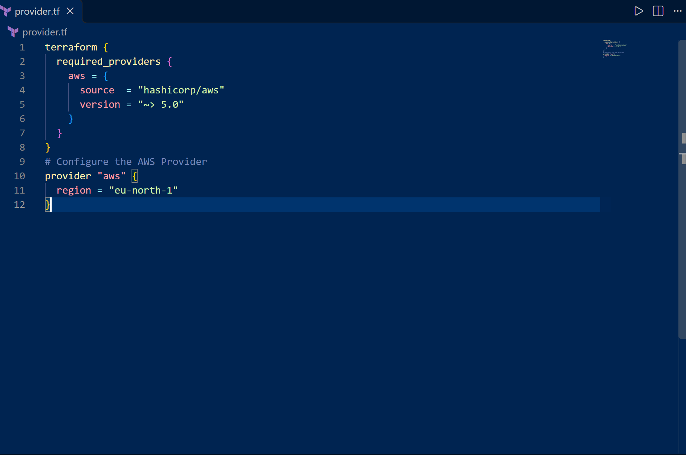

Rather than hardcoding the AWS region directly in the provider configuration, I created a variable in `variables.tf`.

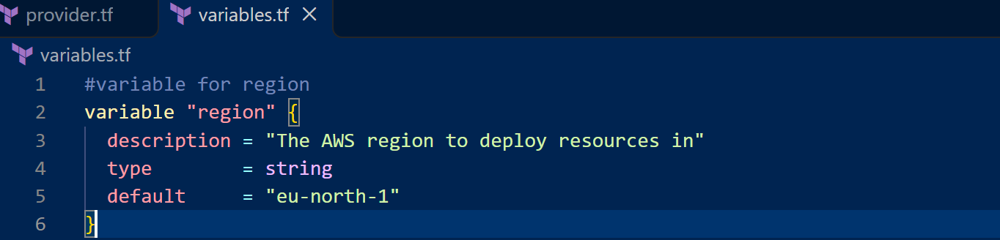

I then updated `provider.tf` to reference the variable using `var.region`.

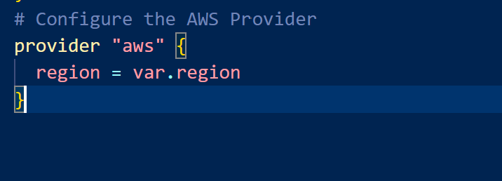

After configuring the provider, I ran:

```bash
terraform init
terraform validate
```

This initialized the Terraform working directory, installed the required provider plugins, and validated the configuration.

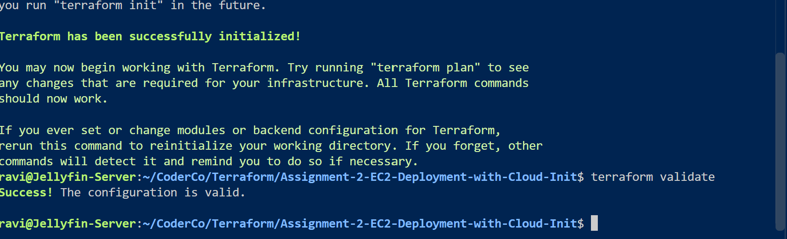

## 3. Configuring the Security Group

I reused the security group configuration from Assignment 1 and adapted it for the NGINX deployment.

The security group was configured with the following rules:

| Direction | Protocol | Port | Source/Destination |
|---|---|---|---|
| Inbound | TCP | 22 | My public IP address (`/32`) |
| Inbound | TCP | 80 | `0.0.0.0/0` |
| Outbound | All | All | `0.0.0.0/0` |

SSH access was restricted to my public IP address, while HTTP access was allowed from anywhere so the website could be accessed through a browser.

I created variables for the security group name, description, VPC ID, and resource tags.

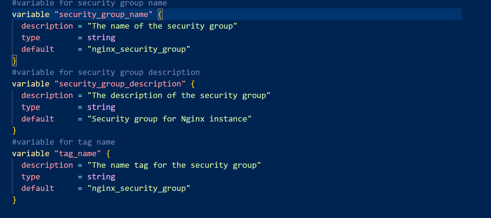

I then defined the security group resource in `main.tf`.

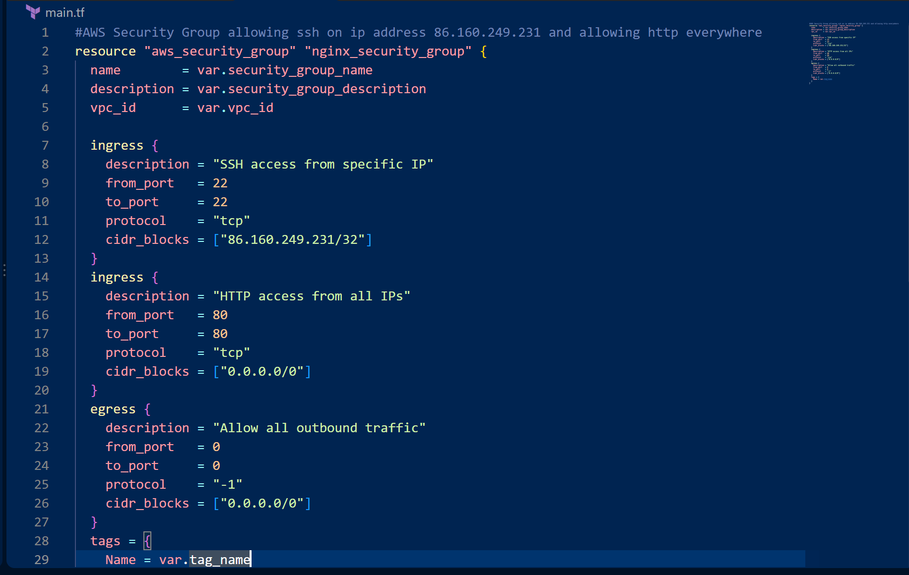

To check the configuration, I ran:

```bash
terraform fmt
terraform validate
terraform plan
```

`terraform fmt` formatted the configuration, `terraform validate` checked its validity, and `terraform plan` displayed the proposed infrastructure changes.

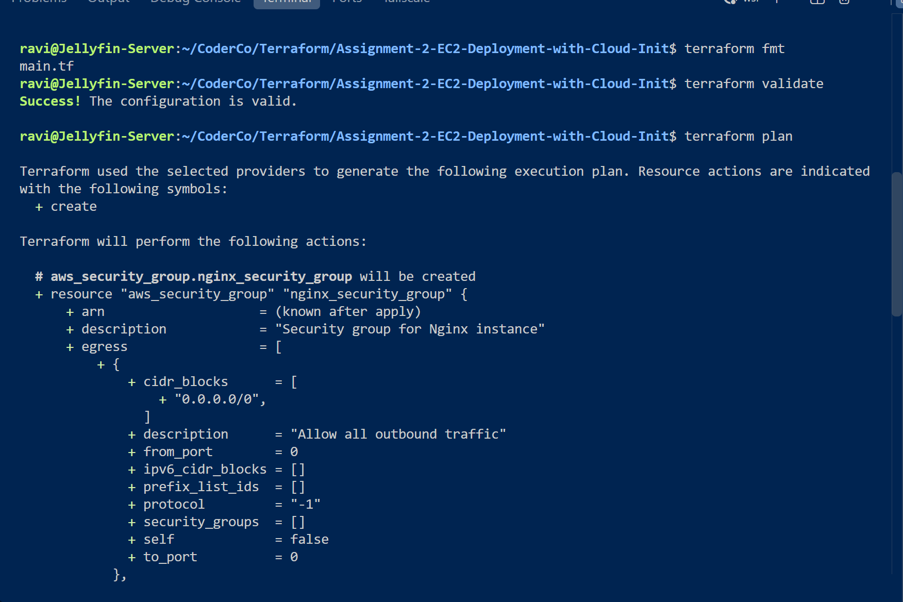

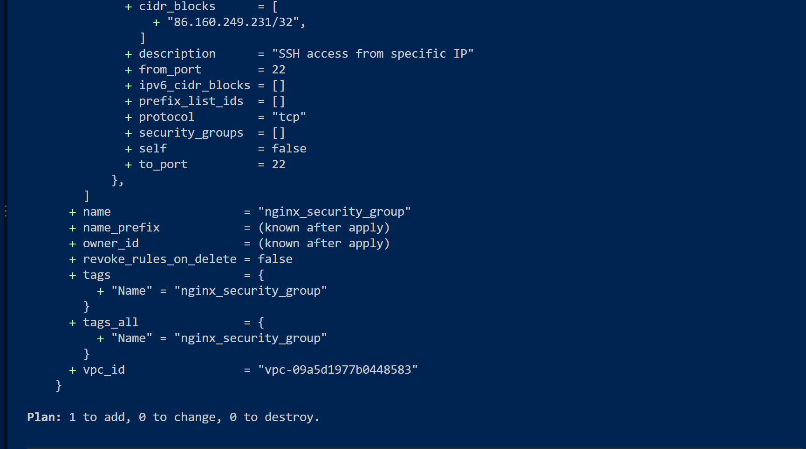

## 4. Creating the EC2 Instance

Next, I created the `aws_instance` resource to provision the Linux server.

The instance configuration included:

- An Ubuntu Linux AMI
- A `t3.micro` instance type
- An existing VPC and selected subnet
- The NGINX security group
- An SSH key pair
- A public IP address
- A resource name tag

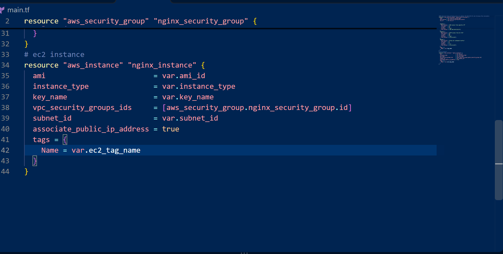

I also defined variables for the EC2 configuration so the values could be changed without modifying the resource block directly.

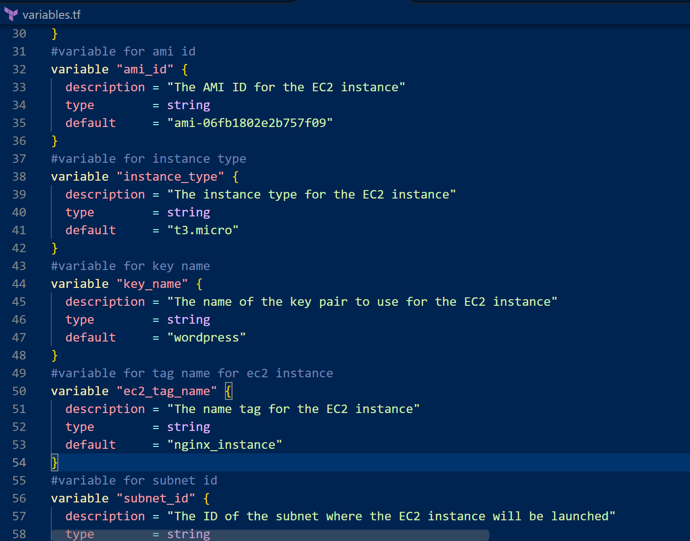

## 5. Configuring the SSH Key Pair

To enable SSH access, I created an AWS key pair resource using Terraform.

The configuration registered my existing SSH public key with AWS.

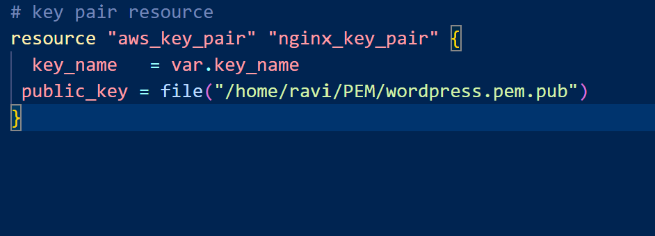

I also created a variable for the key pair name.

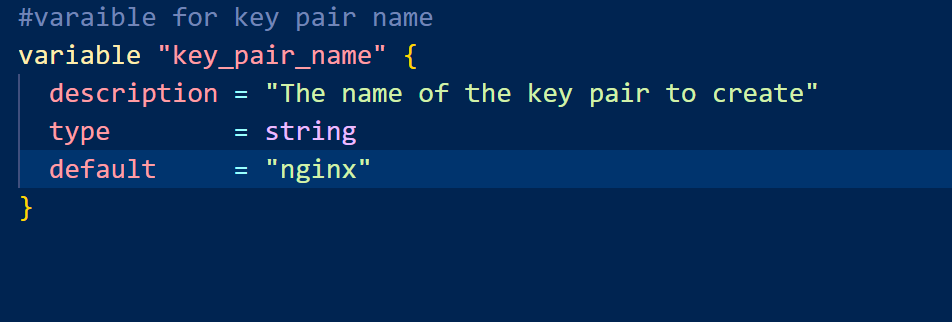

The EC2 resource referenced the Terraform-managed key pair, creating a dependency between the two resources.

This meant Terraform could register the key pair before launching the EC2 instance.

The corresponding private key remained on my local machine and was not included in the Terraform configuration or Git repository.

## 6. Automating NGINX Installation with Cloud-Init

The next stage was configuring the instance automatically during its initial boot.

I created a `cloud-init.yaml` file containing the configuration required to install and start NGINX and create a custom webpage.

The Cloud-Init configuration performed the following actions:

1. Updated the package metadata.
2. Installed the NGINX package.
3. Created `/var/www/html/index.html`.
4. Enabled NGINX to start automatically.
5. Started the NGINX service.

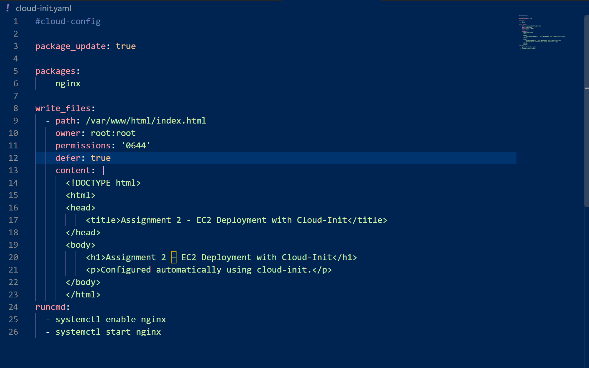

I then linked the YAML file to my EC2 resource using Terraform's `file()` function:

```hcl
user_data = file("${path.module}/cloud-init.yaml")

user_data_replace_on_change = true
```

The `file()` function loads the contents of the YAML file and passes them to the EC2 instance as user data.

The `user_data_replace_on_change` setting instructs Terraform to replace the EC2 instance when the user data changes.

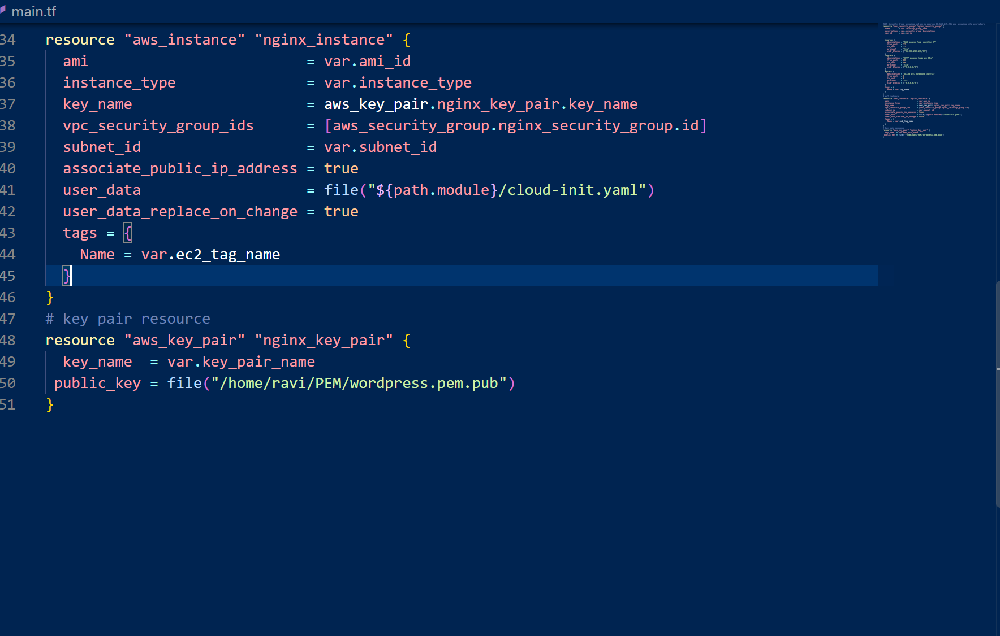

## 7. Deploying the Infrastructure

Once the Terraform and Cloud-Init configurations were complete, I ran:

```bash
terraform fmt
terraform validate
terraform plan
terraform apply
```

I reviewed the execution plan before applying the configuration.

Terraform successfully provisioned three AWS resources:

- EC2 instance
- Security group
- SSH key pair

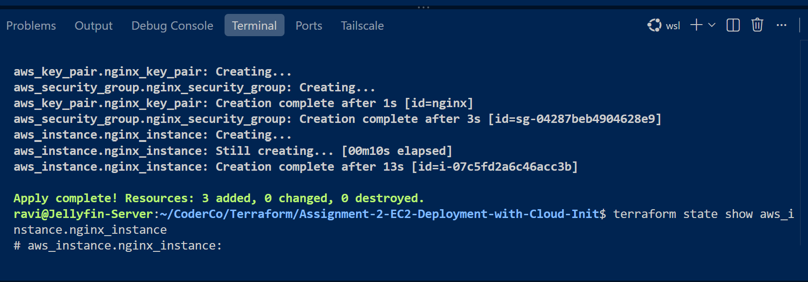

## 8. Verifying Cloud-Init and NGINX

After deployment, I connected to the EC2 instance using SSH to verify that the automated configuration had completed successfully.

### Checking Cloud-Init

I ran:

```bash
sudo cloud-init status --long
```

The output showed that Cloud-Init had completed without reported errors.

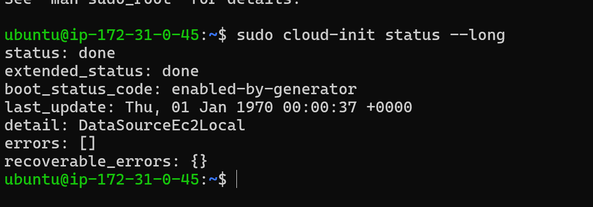

### Checking NGINX

I then checked the NGINX service:

```bash
sudo systemctl status nginx
```

The service reported `active (running)`, confirming that NGINX had started successfully.

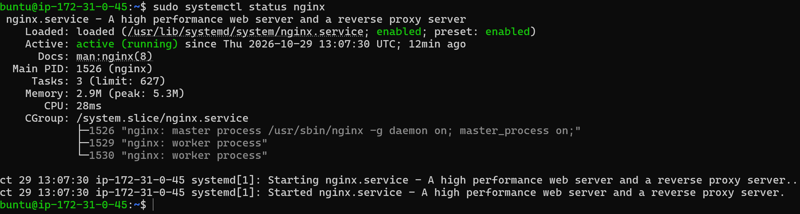

### Testing the Web Server Locally

I tested the web server from inside the EC2 instance:

```bash
curl -i http://localhost
```

The response returned:

```text
HTTP/1.1 200 OK
```

The response also contained my custom HTML webpage.

This confirmed that NGINX was serving the website locally.

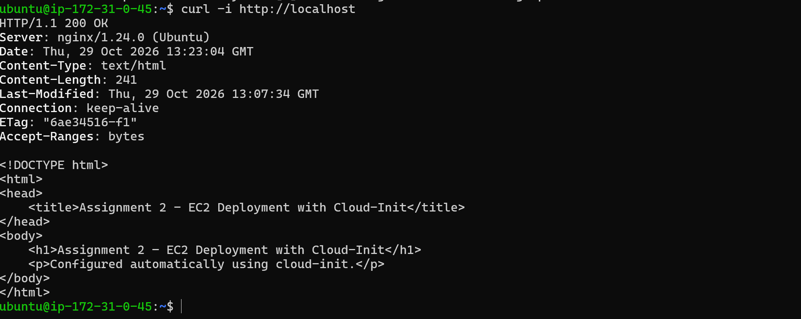

## 9. Customising the Website

After verifying the initial deployment, I updated the webpage with custom CSS using my RG Infrastructure Labs branding.

The design included:

- A black background
- Spotify-inspired green (`#1DB954`)
- A centred content container
- Custom headings and typography
- An NGINX deployment status badge

I also corrected a character encoding issue by adding a UTF-8 declaration to the HTML document.

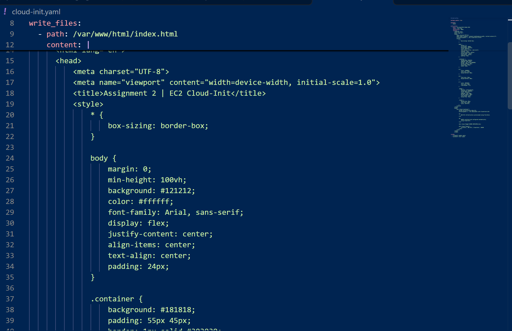

Because the Cloud-Init configuration had changed, Terraform could detect the updated user data and replace the EC2 instance to apply the new configuration during boot.

## 10. Creating Terraform Outputs

To make it easier to retrieve information about the deployed EC2 instance, I created an `outputs.tf` file.

The outputs included:

```hcl
output "instance_id" {
  description = "The ID of the EC2 instance"
  value       = aws_instance.nginx_instance.id
}

output "public_ip" {
  description = "The public IP address of the EC2 instance"
  value       = aws_instance.nginx_instance.public_ip
}

output "private_ip" {
  description = "The private IP address of the EC2 instance"
  value       = aws_instance.nginx_instance.private_ip
}
```

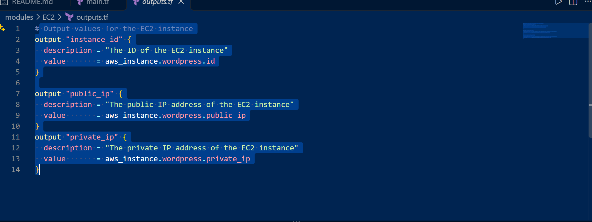

I then ran Terraform formatting, validation, planning, and apply commands to update the outputs.

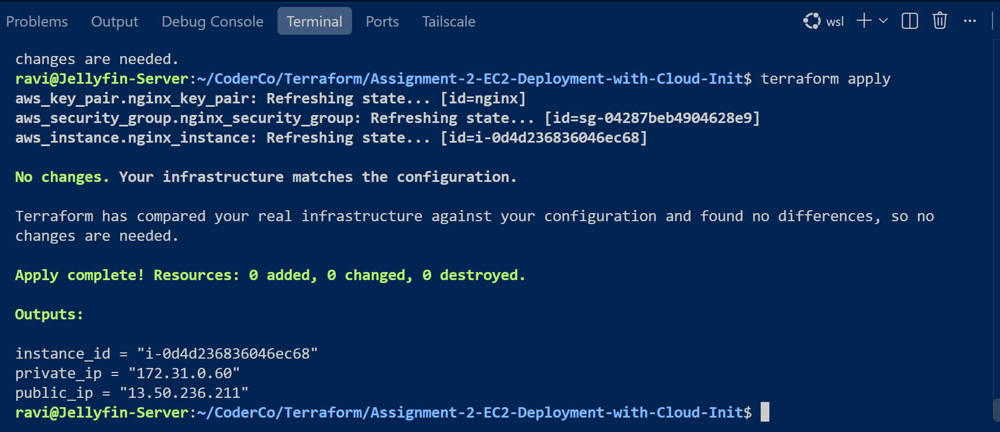

These outputs made it easier to identify the EC2 instance and retrieve its IP addresses without navigating through the AWS Management Console.

## 11. Final Verification

After updating the Cloud-Init configuration and redeploying the instance, I connected to the EC2 instance again.

I repeated the Cloud-Init, NGINX, and HTTP checks to confirm that the updated deployment was working.

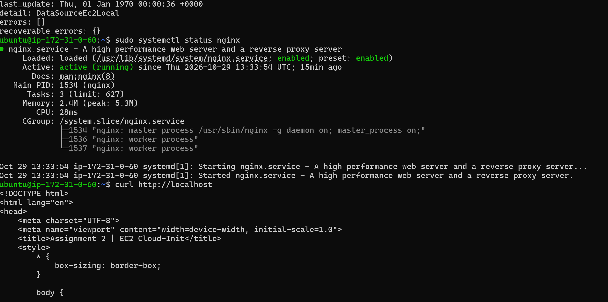

Finally, I opened the EC2 instance's public IP address in my browser.

The custom RG Infrastructure Labs webpage loaded successfully with the updated styling.

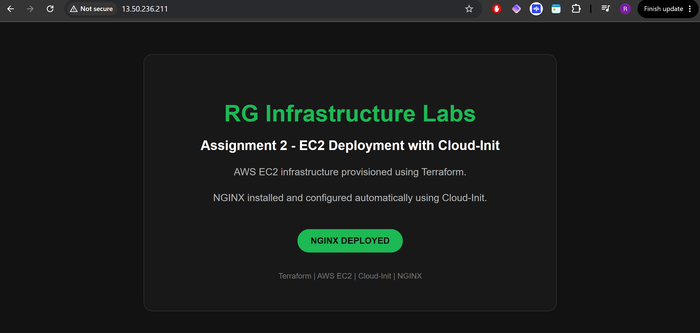

**Final result:** Terraform successfully provisioned the AWS infrastructure, Cloud-Init configured the Linux instance automatically, and NGINX served the custom webpage over HTTP.

## 12. Infrastructure Cleanup

After completing the assignment and capturing the required evidence, I destroyed the infrastructure using:

```bash
terraform destroy
```

This removed the Terraform-managed AWS resources and helped prevent unnecessary ongoing charges.

## 13. Key Takeaways

This assignment helped me develop my understanding of Infrastructure as Code and automated server configuration.

My main takeaways were:

- **Terraform and Cloud-Init perform different roles.** Terraform provisions the AWS infrastructure, while Cloud-Init configures the operating system and applications during boot.
- **Terraform resource references create dependencies.** By referencing the security group and key pair resources from the EC2 instance, Terraform determines the required creation order.
- **Validation is not the same as application verification.** A successful Terraform deployment does not automatically guarantee that the software inside the instance is working.
- **Testing each layer independently makes troubleshooting easier.** Checking Cloud-Init, NGINX, localhost connectivity, and browser access helps identify where a failure occurs.
- **Terraform outputs improve usability.** Outputs provide quick access to important infrastructure information.

## Conclusion

I successfully deployed an Ubuntu EC2 instance using Terraform and automated the installation and configuration of NGINX using Cloud-Init.

The project demonstrated how Infrastructure as Code and boot-time configuration can work together to create a repeatable server deployment.

The most valuable part of the assignment was verifying the deployment at multiple levels rather than assuming that a successful `terraform apply` meant the web server was fully operational.

The final webpage was accessible through the EC2 instance's public IP address, and the infrastructure was destroyed after testing to avoid unnecessary AWS charges.
